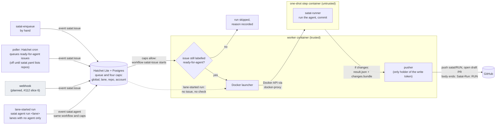

# Satat design: how it works today

This is the tour for someone new to the repo. It describes what runs on `main` now, the v0.2
Docker prototype (#112). Things that are planned but not built are in
[What is not built](#what-is-not-built), each with the ADR or issue that owns it. The flow also
shows its planned parts in place, marked as planned. For direction
see the [roadmap](roadmap/README.md); for the reasons behind a choice, the [ADRs](#adrs-and-research).

## What Satat is

Satat (सतत, "continuous") is a self-hosted system that takes a GitHub issue, has a coding agent
work on it in an isolated container, and opens a **draft** pull request for a human to review.
It never merges, and never force-pushes
([ADR 0022](adr/0022-v2-platform-requirement-decisions.md), `pusher/pusher.go`).

Today it runs on one laptop under Docker Compose
([ADR 0026](adr/0026-docker-first-runtime.md)). The agent is the unmodified Claude Code CLI on a
Claude subscription token. The prototype is pointed only at the owner's own repos.

## The flow, end to end

Every way in ends in one `satat:issue` event. From there the worker gates, queues, launches and
publishes the run. Solid boxes exist on `main` today. Dashed boxes are planned, with the issue
that owns them.



1. **Ways in.** Two exist. A person runs
   `go run ./cmd/satat-enqueue --repo owner/name --issue N`: it reads the issue with the `gh` CLI,
   looks up the lane's caps in `satat.yaml` (`workflows.MapIssue`) and pushes the Hatchet event
   `satat:issue`. The poller (`poller/`, #135) is a Hatchet cron workflow, `satat-poll`, in the
   worker. It runs only when `satat.yaml` has `poller.repos`, every `poller.cron` (default every
   five minutes). For each repo it lists the open issues labelled `ready-for-agent` and pushes the
   same event for each one that has no run and no open PR, oldest first. "Has a run" means any
   `satat-issue` run in the last 30 days, found by the repo and issue number in the run input,
   whatever its status: a failed run is not retried by the poll, so a person retries it with
   `satat-enqueue`. "Has an open PR" means an open PR whose body says `Resolves #N` (or another
   closing keyword), which is what Satat's own PRs say. The poller remembers what it pushed for 30
   minutes, because Hatchet creates the run from the event a moment later. It also refuses a partial view: more
   than 1000 ready issues or open PRs in one repo, hidden run payloads, or a `satat-issue` run
   whose input cannot be read each fail the poll rather than risk queuing an issue twice. If Hatchet's runs
   cannot be listed it queues nothing. It uses the read-only token, which needs Issues: read and
   Pull requests: read. **The poller has not been run against a live Hatchet**: the cron
   registration and the run listing are covered by unit tests only. A run older than 30 days (or
   than Hatchet's retention) is forgotten, so a still-labelled issue whose last run failed that long
   ago is queued again. The poller does not need the repo-readiness check (#175): the run gate
   above already handles readiness. The worker also re-reads the title and body (step 3), so listing a repo is not what keeps a forged delivery's text out.
   A webhook (#112 slice 6) is planned and will push the same event. Because
   they share the event, everything after this step is the same whichever way a run came in.
2. **Queue.** Hatchet Lite (with Postgres) holds the event. The workflow `satat-issue`
   (`workflows/issue.go`) starts on the worker only when all four
   [concurrency caps](#concurrency-caps) allow it. Over-cap work waits and is not dropped. The
   Hatchet run ID becomes the Satat run ID.
3. **Readiness check.** When the run starts, the worker re-reads the issue from the GitHub API
   with the read-only token (`SATAT_GITHUB_TOKEN`, which needs Issues: read as well as
   Contents: read). Unless the repo is still listed (`SATAT_INTAKE_REPOS` plus `poller.repos`;
   an empty list allows none) and the issue is open, not a pull request, and labelled
   `ready-for-agent`, nothing is launched and the run finishes with status `skipped` and a
   reason. A `satat-enqueue` run for an unlisted repo therefore shows as a skip in Hatchet. The
   check belongs in the worker, not in each way in, so that every way in is gated the same way
   and a label removed while the run waited behind a cap is honoured. Only a human moves an
   issue to `ready-for-agent` ([roadmap](roadmap/README.md#how-it-fits-together)). If the issue
   cannot be read (a fine-grained token without Issues: read gets a 404 on a private repo),
   nothing is launched and the run fails. The step is given the title and body from this read;
   the text in the event, whether from the poller, the webhook or a forged delivery, is ignored
   (#181). This stops a forged delivery from supplying text. It does not stop someone with
   write access editing the body, or an edit after labelling (#175): the step gets whatever the
   issue says at run start. Either way the task cancels any container an earlier attempt of the
   same run left running, which the reaper then removes.
4. **One step, one container.** Otherwise the task calls `pipeline.Run`, which launches one step
   named `claude` in the lane the event names (default `claude`) through the
   [launcher](#the-launcher). Before launching, the worker clones the repo and base branch (depth
   50) with the read token (`GitCloner`, `pipeline/clone.go`) and reads `.satat/commands.yaml`
   from the **base commit**: `version: 1`, with `commands.setup` and `commands.test` required and
   any other key a free-form hint. The step's input is `{repo, base, issue, commands}`, and the
   clone arrives in the step's input volume at `/etc/satat/repo`, owned by the step's user. The
   input holds no secrets. The agent's edits to the commands file cannot change what the harness
   passed, and a repo whose file is missing or invalid is not started (the full readiness check is
   #175).
5. **Runner.** Inside the container the entrypoint is `satat-runner` (`runner/runner.go`). It
   checks that no variable would route Claude Code off the subscription token
   (`ANTHROPIC_API_KEY` and others make it refuse to start), copies the worker's clone into
   `/workspace/repo`, creates branch `satat/<run>`, and runs `claude -p` headless on the issue
   with a fixed prompt that fences the issue text as untrusted data. Anything the agent left
   uncommitted is committed as `Satat`. Then it rehearses the push: `HEAD` goes to a throwaway
   local bare repo, so git runs the repo's own `pre-push` hook (pre-commit, husky, a plain
   script) with no credentials in its environment and git limited to local transports. Blocking
   other egress is the container's job ([ADR 0033](adr/0033-lane-toolchain-and-build-caches.md)),
   and the [managed settings](#guarding-the-repos-hooks) stop the agent setting `core.hooksPath` or
   passing `--no-verify` (#174). If the hook fails, its
   output goes back to the agent in a follow-up `claude -p`, at most 3 times (a stand-in for the
   retry cap of #19); a hook that never passes fails the run. The pusher runs no hooks. The runner writes `result.json` (status `changes`,
   `no_changes` or `failed`), `transcript.jsonl`, and, if there are commits, `changes.patch` for
   humans and `changes.bundle` for the pusher. It never pushes.
6. **Read back.** The launcher reads the files the step left in `$SATAT_OUTPUT` after it exits
   and removes the container and its input volume.
7. **Publish.** If the step exited 0 with status `changes`, the worker's [pusher](#why-the-write-token-lives-only-in-the-pusher)
   checks the bundle, pushes `satat/<run>` and opens a draft PR. The PR body links the issue
   (`Resolves #N`), quotes the agent's summary as untrusted text, and ends with a
   `Satat-Run: <run>` line, which is how a PR is traced back to its Hatchet run. This is a line
   in the PR body, not a git commit trailer. The workflow output reports the status, branch and
   PR URL in the Hatchet dashboard (`http://localhost:8888`).
8. **Failure is visible.** A failed step, a timeout, an out-of-memory kill or a refused push
   makes the Hatchet run fail. A step that changes nothing is a normal result with no PR.
   Hatchet retries are off (`WithRetries(0)`): a re-delivered task finds the earlier attempt's
   container instead (see the launcher).

A [lane-started run](#lane-started-runs) is the one exception to "every way in is an
issue". It is allowed only on lanes that run no agent, so agent work never skips the readiness
check.

There is also a hand path for developers that skips Hatchet: `go run ./cmd/satat-step --repo ...
--issue N [--push]` runs the same `pipeline.Run` directly and saves the output under
`docs/scratch/runs/<run>`. Both use the same code, so they behave the same. It is not a way in:
it bypasses the queue, the caps and the readiness check. Use it only on an issue
you would label `ready-for-agent` yourself.

### Pieces and where they live

| Piece | Path | Runs in |
|---|---|---|
| Hatchet workflow, caps, registration | `workflows/` | worker |
| Worker entrypoint | `cmd/satat-worker`, `images/worker/Dockerfile` | worker container |
| Issue to PR path (launch, then publish) | `pipeline/` | worker |
| Launcher interface | `launcher/` | worker |
| Docker launcher, hardening floor, reaper | `launcher/docker/` | worker |
| Launcher conformance suite | `launcher/conformance/` | tests |
| `satat.yaml` loader | `config/` | worker |
| Runner (clone, Claude, commit, bundle) | `runner/`, `cmd/satat-runner`, `images/claude/Dockerfile` | step container |
| Pusher (checks, push, draft PR) | `pusher/` | worker |
| Eval harness | `eval/`, `cmd/satat-eval` | your machine |
| Hand triggers | `cmd/satat-enqueue`, `cmd/satat-step` | your machine |
| Worker liveness and readiness (`/livez`, `/readyz`) | `health/` | worker |
| Deploy adapter (`satat deploy`) and on-demand agent runs (`satat agent`) | `deploy/`, `cmd/satat` | your machine |
| Platform | `compose.yaml`, generated from `deploy/compose/compose.yaml.tmpl` and `satat.yaml` | Docker |

The Compose project has four services: `postgres`, `hatchet-lite`, `docker-proxy` and `worker`.
Ports bind to `127.0.0.1`. All images are pinned by digest.

## Lane-started runs

Built in #129 as `satat agent run <lane> [--input] [--wait]`, with `ls` and `rm`
([ADR 0030](adr/0030-on-demand-agent-runs.md), proposed). This section says where they fit in
the flow above.

A lane-started run starts from a lane instead of an issue. The operator names a lane and passes
JSON, which the worker places at `/etc/satat/input.json`. It goes through the same workflow and
the same four caps as an issue run, so the two kinds queue behind each other. It launches one
step, keeps a small scrubbed result (exit status, the last 4 KiB of output, the output file
names) and never publishes. There is no issue, so there is no readiness check.

**Only on lanes that run no agent.** A lane-started run is for checking the platform and for
lanes that run a fixed command:

- `smoke` and `sleep`, for platform smoke tests. The pre-flight `doctor`
  (#133) could use a `smoke` run as its end-to-end check.
- `check-python` and other eval lanes, which run held-out tests over a set of files, could use
  them too. Today `satat-eval` calls the launcher directly instead.

Lanes that run an agent, such as `claude`, refuse lane-started runs, because agent work must
start from a triaged issue. On `claude`, a lane-started run would have the agent do real work
from input nobody triaged, spend the subscription, and then throw the work away, because nothing
publishes it. Issue runs are the mirror image: they only make sense on a lane that runs an agent.

**How a lane is marked.** A lane that runs no agent says `agent: false`; absent means the lane
runs an agent:

```yaml
lanes:
  claude:            # no `agent` key: runs an agent, so issue runs only
    ...
  smoke:
    agent: false     # runs no agent, so lane-started runs only
    ...
```

The key is one optional boolean on the lane (`config.NoAgent` holds the lanes that set it to
false). The worker refuses a lane-started run on a lane without `agent: false`: it launches
nothing and records the run as `refused`, with the reason, and `satat agent run --wait` prints
it and exits 1. The default is the safe side: a new lane that leaves the key out counts
as an agent lane, so the mistake shows up as a refused lane-started run, not as an agent working
from made-up input. The check runs in the worker at run start, like the readiness check, so
every event is gated whoever pushed it. The CLI checks as well, but only to fail early with a
clear message. Refusing an issue run on a lane with `agent: false` is an optional follow-up to
the readiness check.

The other ways of marking a lane that were considered are in
[lane-started runs](research/v2/lane-started-runs.md).

## The launcher

`launcher.Launcher` (`launcher/launcher.go`) is the seam between workflows and a runtime:

- `Launch(ctx, Step) (Result, error)` runs one step to completion and removes its workload on
  every exit path. A non-zero exit code, a timeout or an OOM kill is a `Result`, not an error.
- `Cancel(ctx, run, name)` stops a running step.

A `Step` carries the run, step name, lane and non-secret input (placed at
`/etc/satat/input.json`). A `Result` carries exit code, logs and the files from `$SATAT_OUTPUT`.
Workflows and the runner never see which backend is behind it. Docker is the default backend. A
Kubernetes backend (`launcher/kubernetes`) runs each step as a one-shot agent-sandbox
`SandboxClaim` on k3d and passes the same `launcher/conformance` suite
([ADR 0031](adr/0031-kubernetes-adapter-and-launcher.md)). The rest of this section describes
Docker.

**Lanes.** A lane is the fixed shape a step runs in: image, user, limits, network, timeout and
the names of the environment variables it may receive. Lanes come from `satat.yaml` only. Issue
text, workflow input and agent output cannot change one
([ADR 0027](adr/0027-docker-api-access.md)). `satat.yaml` has four lanes: `claude` (the real
one), `smoke` (a busybox placeholder), `sleep` (idles, to test cancelling a lane-started run) and
`check-python` (runs a command over a set of files with no network, used by the eval harness).
Only `claude` runs an agent; the other three say `agent: false`
([lane-started runs](#lane-started-runs)).

**Behaviour.**

- *Idempotent.* The container name derives from the run and step. A re-delivered step finds the
  container an earlier attempt started and adopts it (only if it carries Satat's labels).
  Concurrent calls for one step in one process share one execution.
- *Clean-up.* No auto-remove. The launcher removes the container and volume it created or
  adopted, and nothing else. The worker also runs a reaper every five minutes that removes
  labelled containers older than twice the longest lane timeout plus an hour.
- *Input.* A per-step volume at `/etc/satat` (a read-only root refuses a copy into it). No host
  bind mounts.
- *Secrets.* A lane's `pass_env` names variables copied from the worker's environment into the
  step. A name that is unset fails the launch. Values are never in `satat.yaml`.

**Hardening floor.** `ValidateRequest` (`launcher/docker/floor.go`) checks the finished create
request, not the lane that produced it, and returns every violation. The launcher refuses to
start any step, and `docker.New` refuses to start at all, if a request breaks it. The floor
requires:

- an image pinned by digest, and a numeric non-root `uid:gid`
- `cap-drop ALL`, `no-new-privileges`, no `privileged`, no added capabilities, devices, sysctls,
  or extra groups
- a read-only root filesystem, with only tmpfs at `/tmp` and `/workspace` (both `nosuid`,
  `nodev`, sized) and the launcher's own `satat-` volume
- no host bind mounts, no Docker socket, no published ports, no stdin or tty
- no host, shared or custom pid, ipc, uts, userns or cgroup namespaces
- a memory limit with swap equal to it, a CPU limit and a pids limit
- no auto-remove, no restart policy, and a `json-file` or `local` log driver
- exactly one network, a Satat lane network, with no DNS or extra-host overrides
- runtime `runsc` (gVisor) is allowed per lane where installed, and is not required

`/workspace` is memory-backed, so it counts against the lane's `memory`.

**Network.** Each lane gets its own Docker network. `internal: true` removes the route out. The
`claude` lane has `internal: false` because it must reach Anthropic and GitHub, so it has open
egress. That is acceptable only because the prototype serves the owner's own repos. An egress
proxy with a hostname allowlist is not built ([ADR 0026](adr/0026-docker-first-runtime.md)).

**Who may reach the Docker API.** Only the worker, and only through `docker-proxy`
(`DOCKER_HOST=tcp://docker-proxy:2375`, [ADR 0027](adr/0027-docker-api-access.md)). The proxy
narrows the endpoints (no exec start, build, swarm or secrets). It does not inspect request
bodies, so the real gate is that the worker builds every create request from lane config and
runs it through the floor. `scripts/check-compose-socket.sh` fails if any other Compose service
can reach the socket. The worker container is itself hardened: read-only root, all capabilities
dropped, `no-new-privileges`, 512 MiB.

## Why the write token lives only in the pusher

The step container runs an agent that follows text from an issue, which anyone may have written.
So the design keeps write access out of reach of the agent
([ADR 0025](adr/0025-github-token-broker.md)):

- The agent only commits locally. The runner writes a git bundle of those commits.
- The pusher (`pusher/`) runs in the worker, never in a step. `SATAT_PUSH_TOKEN` is set on the
  worker only. Lane `pass_env` does not list it, so no step receives it. It is handed to git
  through a credential helper that reads it from the environment, so it is not in argv, the
  remote URL or `.git/config`, and error text has it scrubbed.
- Before it pushes, the pusher checks, on exactly what would be pushed:
  - repo, base branch, run ID and commit SHAs are plain, well-formed values
  - the bundle applies to a fresh clone of the base and holds exactly one branch, ending at the
    reported head, which descends from the reported base
  - between 1 and 20 commits
  - the base is the commit the worker cloned (not the step's `result.json`) and is on the base
    branch. The net diff and every commit in the bundle touch no protected path: CI config, lint
    and format config, hook directories, `.gitmodules`, `.gitattributes`, CODEOWNERS and `.satat/`
    by default, plus whatever the repo adds under `protected:` in its `.satat/commands.yaml` on
    the base commit (see CONTRIBUTING.md). Renames, deletions, mode changes, submodules and
    symlinks into a protected path count, and matching ignores case and path tricks (`./`, `//`).
    The refusal names the paths. A malformed `protected:` section blocks every push until fixed
  - `gitleaks` finds no secret in the diff or commit messages. If gitleaks cannot run, nothing
    is published
- The only branch it creates is `satat/<run>`. It will not overwrite an existing remote branch
  at a different commit. If the branch and PR already exist (a re-delivered step), it reuses them.
- The PR is always a draft, with `maintainer_can_modify` off.

What the step does hold: the Claude subscription token (`CLAUDE_CODE_OAUTH_TOKEN`). It holds **no
GitHub credential**: the worker clones with the read token (`SATAT_GITHUB_TOKEN`, in the worker's
environment only and never in a lane's `pass_env`) before the container starts, git gets the
token through a credential helper in that one clone process, and the clone's remote is the plain
`https://github.com/<repo>.git`. `launcher/docker/exposure_test.go` starts a process in the step
and fails if a GitHub credential is visible by name, value or file. The Claude token is the one
known gap: the planned fix is an LLM gateway proxy that issues each step a short-lived key
([ADR 0025](adr/0025-github-token-broker.md), [ADR 0032](adr/0032-secret-store.md), #155). Until
OpenBao exists the worker reads `github-read-token` from its environment as
`SATAT_GITHUB_TOKEN`.

## Guarding the repo's hooks

The repo's own git hooks are the gate ([inner loop](roadmap/inner-loop.md)), so the agent must not
skip them. The lane image ships Claude Code **managed settings** (#174), the one settings level the
agent cannot override. Three files, all root-owned on the read-only root filesystem, while the agent
runs as uid 10001:

- `/etc/claude-code/managed-settings.json` (source: `images/claude/managed-settings.json`). It keeps
  the subscription-login rules of #102 and adds deny rules for `git commit --no-verify`,
  `git commit -n` and `git push --no-verify`, and for edits to `.claude/settings*.json`, the policy
  and the hook. A deny rule wins over any allow rule.
- A PreToolUse hook on `Bash`, `/usr/local/lib/satat/hooks/guard-git-hooks.js` (source:
  `images/claude/hooks/`). It reads the whole command and blocks what a deny pattern misses:
  `-c core.hooksPath=...`, `git config core.hooksPath`, `GIT_CONFIG_*` overrides, `HUSKY=0`,
  `SKIP=...`, `PRE_COMMIT_ALLOW_NO_CONFIG`, `LEFTHOOK`, `git commit-tree`, `git update-ref`,
  `git fast-import`, `-n` in combined short flags (`-anm`), writes to `.git/hooks` and
  `.git/config`, and shell writes to Claude settings or the policy files. It fails closed on input
  it cannot parse. `git push -n` is a dry run and passes.

Tests: `images/claude/image_test.go` (hook table: bypass forms and benign commands) and
`image_docker_test.go` (as the agent user in the lane image, every shell route to modify the policy
and hook fails; the hook command from the settings runs and blocks). The Docker tests use
`SATAT_CLAUDE_IMAGE` or `satat-claude:dev` and skip if it is absent.

### Limits of the hook guard

This guards against the agent skipping hooks by habit or after a prompt injection, in trusted repos.
It is not a boundary against a determined agent with a shell. CI on the draft PR and the push
rehearsal (#168) are the backstops.

- Deny patterns and the hook match the command **text**. The hook tokenizes it (so quoting tricks
  like `git commit "-n"` and long-option abbreviations like `--no-veri`, which git accepts, are
  caught) and looks inside `sh -c`, `bash -c` and `eval` strings, nested. It does not see a command
  assembled at run time (`g=git; $g commit ...`), `python -c` or `node -e` strings, `xargs` or
  `find -exec`, aliases (`git config alias.x`), base64, or a script the agent writes and then runs.
  Those pass. So do wrappers that take their own arguments (`sudo`, `nice`, `env -i`, `env -u X`),
  `bash -c $'...'` and `bash -c "$(...)"` (the string is not known until it runs), `git -ccore.hooksPath=x`
  (no space after `-c`), `core.hooks''Path` split by quotes (the raw `core.hooksPath` match sees the
  quotes), and `--git-dir x` or `GIT_DIR` pointing at another repository.
- The hook fails closed on bad input, and the settings set `onFailure: block` so a crash, a timeout
  or a missing script also blocks the call (otherwise only exit 2 does).
- A Python or Node script can write `.claude/settings.local.json` or any workspace file: the
  workspace is writable and the deny rules cover Claude's file tools and recognised shell commands,
  not a script. Only the root-owned files are immutable. Repo-level settings do not override
  managed ones, so a planted file cannot loosen the deny rules.
- Hooks can be skipped without any flag: `GIT_DIR` or `--git-dir` pointing at another repository,
  `git -c` forms the regex does not know, deleting the hook files in the repo's own hook directory
  (`.husky/`, `.pre-commit-config.yaml`) or committing a hook that does nothing. The push rehearsal
  runs whatever hooks the branch contains, so a weakened hook weakens the gate; review catches that.
- Trade-off: a false positive costs the agent one retry, a bypass costs the gate, so the hook
  leans to blocking. Words inside a quoted commit message are not matched (`-m "use SKIP=1"`,
  `git log --grep=update-ref` pass), but `core.hooksPath` and `.git/hooks` anywhere in the text are
  blocked, as is any `--no-ve...` option on a git command. The agent is told why and can reword.
- Verified by a human, not in CI: that `claude -p` in the lane refuses the commands end to end and
  that `claude doctor` lists the managed source. The tests cover the files, the hook and its wiring.

## Concurrency caps

`satat.yaml` sets the limits. Hatchet enforces them with four concurrency expressions on the
workflow (`workflows.Define`), each with the group-round-robin strategy
([ADR 0023](adr/0023-hatchet-queue-and-workflow-engine.md)):

| Cap | Key | Value now | Where it comes from |
|---|---|---|---|
| Whole platform | the constant `global` | 2 | `limits.global` |
| Each lane | `input.lane` | 1 for `claude` | the lane's `max_runs` (default 1) |
| Each repo | `input.repo` | 1 | `limits.per_repo` |
| Each credential account | `input.account` | 1 | `limits.per_account`; a lane's `account` names it (`claude` is `claude-subscription`; a lane without one is its own account) |

Over-cap work waits in the queue and is not dropped. Hatchet's default would cancel it after five
minutes, so `Spec.Validate` refuses to register a workflow with fewer than these four caps or a
schedule timeout under 24 hours (it sets 720 hours). A task's execution timeout is the longest
lane timeout plus 15 minutes, and the worker has as many slots as `limits.global`. The numbers
are sized for a laptop VM of about 5.8 GiB; see
[docker-prototype.md](research/v2/docker-prototype.md).

### One run per issue

A redelivered webhook, a label removed and re-added, or an intake retry must not start a second
`satat-issue` run (#182). Two layers, both fail closed:

- **Intake** lists the issues that have a run (the poller's `HatchetRuns`) and queues nothing for an
  issue that has one, whatever its status. A failed run is retried by a person with `satat-enqueue`,
  the same rule as the poller. If the runs cannot be listed, intake errors and Hatchet retries it.
- **The workflow** has a fifth concurrency expression, `input.repo + '#' + string(input.issue.number)`
  with `CANCEL_NEWEST` and a limit of 1 (`Spec.DedupeKey`). It closes the window the first layer
  cannot: two deliveries that both see no run before either run exists. The newest is cancelled and
  the run in flight is never touched. Hatchet chains the strategies, so the key is registered
  first: checked live, a duplicate queued behind a cap is then cancelled while it waits, whereas
  with the key last both duplicates ran in turn. It stops overlap only, not a re-run after the
  first run finished (intake's check covers that).
  `MapIssue` lower-cases the repo, so the key and the intake check agree on case.

Consequences: a run Hatchet cancelled as a duplicate, and any cancelled or failed run, counts as "has
a run", so the webhook will not re-run that issue for 30 days (`poller.RunHistory`); use
`satat-enqueue`. The skip shows as the reason on the intake result and in the worker log.

Verified live on Hatchet Lite v0.110.5: the expression compiles, `string()` of the number gives
`7`, two back-to-back runs for one issue leave one run and one cancelled, and a malformed
expression fails registration. The run listing needs `include_payloads=true` and its input comes
wrapped in an `input` envelope (`poller/hatchet.go` handles both).

Not verified live: how the dedupe key interacts with the back-off retries below. A retry stays
inside the same run; if Hatchet rechecks the concurrency slot on retry, a duplicate arriving in that
gap is the one cancelled, which fails safe.

## Claude rate-limit back-off

A step that dies on the subscription rate or usage limit is retried, not failed. The worker
(`workflows/ratelimit.go`) reads the runner's `result.json`: a `rate_limit_event` with status
`rejected` (which carries the reset time), a 429 in the error, or an error result that says the
usage limit was reached. It then closes the account's Hatchet rate limit (`account-<account>`, set
to 0) until the reset plus 30 seconds, and fails that attempt with a retryable error. The task
declares one unit of that rate limit, so the retry waits in the queue while the lane is closed,
and an in-process timer reopens the lane at the reset. When the stream gives no reset time the wait
starts at five minutes and doubles to an hour. Any other failure is non-retryable, as before.
Each attempt is visible in Hatchet (its error and log line), and the run's output carries
`backoffs`. A run is backed off up to 20 times. The schedule timeout is already 720 hours (see
above). Lanes are opened at worker start, so a restart cannot leave one closed.

## The eval harness

`cmd/satat-eval` runs one issue through the same pipeline and grades the result with checks a
machine can run (`eval/`). It is a quick harness for the prototype, not a benchmark: one case
(`eval/cases/sandbox-greet`, issue 1 of `javatarz/satat-sandbox`), deterministic checks, no model
judging.

```sh
go run ./cmd/satat-eval --case eval/cases/sandbox-greet [--push]   # run, then grade
go run ./cmd/satat-eval --case eval/cases/sandbox-greet --grade docs/scratch/runs/<run>   # grade a saved run
```

A case (`case.yaml`) names the repo, base and issue, and any of these checks:

- **run**: the step exited 0 with status `changes`. If not, the rest are skipped.
- **scope**: changed files are within `allowed_paths` and at most `max_files`.
- **commits**: at most `max` commits, each subject at most 50 characters, capitalised, with no
  trailing period.
- **tests**: the change plus **held-out test files** the agent never saw run in the `check-python`
  lane, which has no network. `require_output` strings must appear, so a runner that silently
  skips the hidden tests cannot pass.
- **pr** (with `--push`): the PR is a draft, not merged, from `satat/<run>` onto the base, and
  its body has the `Satat-Run: <run>` line.

Results print and are saved to `docs/scratch/evals/<run>.json` (gitignored). The exit status is
0 on pass, 1 on a failed check and 2 on an error. Evals need real tokens for a fresh run; `--grade`
needs none for the run itself. Where evals are going is in the [evals theme](roadmap/evals.md).

## Run it locally

**Tests.** Go tests that start containers share one Docker daemon and reap by label, so packages
must not run in parallel:

```sh
go test -p 1 ./...          # needs Docker
go test -short -p 1 ./...   # skips the tests that start containers
```

**The platform.** `satat deploy up` brings it up on Compose
([ADR 0028](adr/0028-infrastructure-adapter-compose-first.md)). It needs Docker with the `compose`
plugin (colima and Docker Desktop are what the docs cover) and one source for the secrets: the
1Password CLI `op`, signed in, for the `op://` references in `satat.yaml`'s `deploy.secrets`, or
`env` references that read the variable from your shell. The [prototype notes](research/v2/docker-prototype.md)
record runs of it.

1. Build the Claude lane image and push it with `SATAT_REGISTRY=<registry> scripts/build-claude-image.sh`.
   It prints a reference pinned by manifest digest; put it in the `claude` lane's `image` in
   `satat.yaml`.
2. Run `go run ./cmd/satat deploy up`. It creates `POSTGRES_PASSWORD` and the Hatchet token in
   `.env` if they're absent, resolves the other secrets into the child process only, starts the
   stack and waits until the worker reports ready. Running it again changes nothing that is already
   healthy. `satat deploy status` shows each service and the worker's readiness; `satat deploy down`
   stops it and removes any agent containers left behind. `deploy down --volumes` also deletes
   the platform's data and the Hatchet token in `.env`, which is dead without that data.

   `deploy up` always runs the worker's `compose up`, so a changed worker is recreated, and agents
   running at that moment are orphaned. An edited `satat.yaml` counts as a change: `deploy up`
   passes its sha256 to the worker as `SATAT_CONFIG_SHA256`, so compose recreates the worker and
   remounts the file (a running worker does not see an edit until then). Orphaned agents: `agent rm` then reports them cancelled while their
   containers keep running, with their tokens, until they exit, the reaper removes them or
   `deploy down`. `deploy up` warns when agents are running; run it when none are.
3. Check it with `go run ./cmd/satat agent run smoke --wait`. It starts a one-shot agent on the
   `smoke` lane through Hatchet and prints the result ([ADR 0030](adr/0030-on-demand-agent-runs.md)).
   `agent ls` lists queued and running runs, and `agent rm <run>` cancels one. The agent commands
   use the Hatchet SDK's `HATCHET_CLIENT_*` variables and fill in any that are unset: the token
   from the `.env` beside `--config`, and for `deploy.target: compose` or `kubernetes` the ports the
   stack publishes on this machine (`localhost:7077`, TLS `none`, `http://localhost:8888`). A variable
   you set wins. The token is never printed.
4. Label the issue `ready-for-agent` (the worker skips it otherwise), queue it with
   `go run ./cmd/satat-enqueue --repo owner/name --issue N` and watch the run at
   `http://localhost:8888`.

`scripts/hatchet-token.sh` and `scripts/compose-up.sh` still work but duplicate `deploy up`.
`just setup` (writes `.env` with a random `POSTGRES_PASSWORD`) and `just run` (the two scripts,
after `just doctor` has checked the prerequisites) still drive that older path.

### Run it on k3d

The same platform runs on a local k3d cluster, with every agent as a one-shot `SandboxClaim`
([ADR 0031](adr/0031-kubernetes-adapter-and-launcher.md)). It needs Docker, `kubectl` and `helm`.

1. Run `scripts/k3d-up.sh`. It downloads a pinned k3d into `docs/scratch/bin`, creates the cluster
   `satat` (kube context `k3d-satat`) with a registry on `localhost:5111` and agent-sandbox, and
   prints `SATAT_REGISTRY=localhost:5111`. Running it again changes nothing.
2. Set `deploy.target: kubernetes` in a copy of `satat.yaml` inside the repo (under `docs/scratch/`,
   say: `deploy up` builds the platform image from the repo above it). Every lane needs a `command`.
3. Run `go run ./cmd/satat deploy render --config <copy>`. It writes `satat.k8s/values.yaml` and
   `satat.k8s/lanes.yaml` next to the copy.
4. Run `SATAT_REGISTRY=localhost:5111 go run ./cmd/satat deploy up --config <copy>`. It builds and
   pushes the platform image, applies the lane objects and Secrets, installs the chart in
   `deploy/helm/satat/` and waits for the worker. It acts on the context `k3d-satat` unless
   `--context` or `SATAT_KUBE_CONTEXT` names another, never on the shell's current one.
5. Check it with `go run ./cmd/satat agent run smoke --wait --config <copy>`.

`deploy status` and `deploy down [--volumes]` work as on Compose.

Never put token values in the repo ([AGENTS.md](../AGENTS.md#secrets)).

## What is not built

Do not read these as features. They are decided or planned, not present:

| Not built | Where it is tracked |
|---|---|
| Webhook intake that starts a run when an issue is labelled. | #112 slice 6, [docker-prototype.md](research/v2/docker-prototype.md), [signal-driven intake](roadmap/signal-driven-intake.md) |
| Language toolchain in the lane image. The Claude image has no `python` or other toolchain, so the agent cannot run the repo's tests. Decided: a lean image, mise installs the repo's toolchains at step start into a persistent per-repo cache volume. | #120, [ADR 0033](adr/0033-lane-toolchain-and-build-caches.md) |
| Kubernetes beyond k3d: real k3s on a VM, a managed cluster, gVisor and per-cloud provisioning | [ADR 0024](adr/0024-kubernetes-agent-sandbox-runtime.md), [ADR 0031](adr/0031-kubernetes-adapter-and-launcher.md), [AGENTS.md](../AGENTS.md) |
| Egress proxy with a hostname allowlist and no secrets, and a worker-side clone, so a step holds no GitHub token | [ADR 0025](adr/0025-github-token-broker.md), [ADR 0026](adr/0026-docker-first-runtime.md) |
| GitHub App identity, per-push tokens and signed commits (later; v0.2 uses a machine-user token and no broker). Today the pusher uses a token from `SATAT_PUSH_TOKEN` and the PR carries `Satat-Run` in its body, not as a commit trailer. | [ADR 0025](adr/0025-github-token-broker.md) |
| LiteLLM in the stack. The Claude lane talks to Anthropic directly; the `gateway/` directory is a config template carried from v0.1. | [ADR 0026](adr/0026-docker-first-runtime.md), [ADR 0002](adr/0002-litellm-model-routing.md) |
| The full `satat.yaml` spec. Only `limits`, `cache_reaper`, `poller`, `lanes` and `deploy` exist. | #108 |
| Publishing the Claude lane image to GHCR. The build script pushes to the registry you name; the `satat.yaml` pin has not been moved to one yet. | [ADR 0026](adr/0026-docker-first-runtime.md) |
| Back-off on Claude rate limits is built, but untested against a live Hatchet; a restart test of adoption on the real stack | [docker-prototype.md](research/v2/docker-prototype.md) |
| Reading `.satat/commands.yaml`. The file exists in this repo (format in [CONTRIBUTING.md](../CONTRIBUTING.md#satatcommandsyaml)) but nothing parses it yet. | #167, #175 |
| Inner loops (lint, judge, reviewer) before the draft PR | [inner loop](roadmap/inner-loop.md) |
| Trusting agent PRs without human approval | #124, [CONTRIBUTING.md](../CONTRIBUTING.md) |

The v0.1 stack (OpenHands Canvas on EC2) lives on the
[`v0.1` branch](https://github.com/javatarz/satat/tree/v0.1) and is not described here.

## ADRs and research

| ADR | Decides |
|---|---|
| [0022](adr/0022-v2-platform-requirement-decisions.md) | v0.2 requirements, including draft PRs only |
| [0023](adr/0023-hatchet-queue-and-workflow-engine.md) | Hatchet as queue and workflow engine, and the four caps |
| [0024](adr/0024-kubernetes-agent-sandbox-runtime.md) | Kubernetes with agent-sandbox as the target runtime (deferred by 0026) |
| [0025](adr/0025-github-token-broker.md) | GitHub credentials: machine-user token in the store, worker-side clone, pusher; no broker in v0.2, App later |
| [0026](adr/0026-docker-first-runtime.md) | Docker first behind the launcher interface; the hardening floor; lanes |
| [0027](adr/0027-docker-api-access.md) | Only the worker reaches the Docker API, built from lane config |
| [0028](adr/0028-infrastructure-adapter-compose-first.md) | Infrastructure adapter, Compose first: `satat deploy up/down/status`, generated `compose.yaml`, `deploy.secrets` (proposed) |
| [0029](adr/0029-worker-health.md) | Worker liveness and readiness include Hatchet; agents have no health endpoint (proposed) |
| [0030](adr/0030-on-demand-agent-runs.md) | On-demand one-shot agent runs through Hatchet: `satat agent run/ls/rm` (proposed) |
| [0032](adr/0032-secret-store.md) | Secrets live in OpenBao, read per component identity |
| [0033](adr/0033-lane-toolchain-and-build-caches.md) | Lean lane image; mise installs toolchains at step start; persistent per-repo cache volumes; toolchain and registry egress |

Research behind them is in [docs/research/v2/](research/v2/), in particular
[docker-prototype.md](research/v2/docker-prototype.md) (measurements and findings per slice),
[why-hatchet.md](research/v2/why-hatchet.md), [hatchet-caps-spike.md](research/v2/hatchet-caps-spike.md)
and [claude-lane-spike.md](research/v2/claude-lane-spike.md). Vocabulary is in
[CONTEXT.md](../CONTEXT.md).
