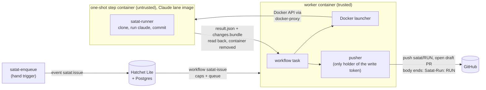

# Satat design: how it works today

This is the tour for someone new to the repo. It describes what runs on `main` now, the v0.2
Docker prototype (#112). Things that are planned but not built are in
[What is not built](#what-is-not-built), each with the ADR or issue that owns it. For direction
see the [roadmap](roadmap/README.md); for the reasons behind a choice, the [ADRs](#adrs-and-research).

## What Satat is

Satat (सतत, "continuous") is a self-hosted system that takes a GitHub issue, has a coding agent
work on it in an isolated container, and opens a **draft** pull request for a human to review.
It never merges, and never force-pushes
([ADR 0022](adr/0022-v2-platform-requirement-decisions.md), `pusher/pusher.go`).

Today it runs on one laptop under Docker Compose
([ADR 0026](adr/0026-docker-first-runtime.md)). The agent is the unmodified Claude Code CLI on a
Claude subscription token. The prototype is pointed only at the owner's own repos.

## The flow, end to end



1. **Intake.** Today a person runs `go run ./cmd/satat-enqueue --repo owner/name --issue N`. It
   reads the issue with the `gh` CLI, looks up the lane's caps in `satat.yaml`
   (`workflows.MapIssue`) and pushes the Hatchet event `satat:issue`. The workflow does not
   check labels: the `ready-for-agent` convention in [CONTRIBUTING.md](../CONTRIBUTING.md) is
   enforced by whoever runs the command. Webhook intake is not built.
2. **Queue.** Hatchet Lite (with Postgres) holds the event and starts the workflow
   `satat-issue` (`workflows/issue.go`) on the worker when the caps allow
   ([concurrency caps](#concurrency-caps)). The Hatchet run ID becomes the Satat run ID.
3. **One step, one container.** The workflow task calls `pipeline.Run`, which launches one step
   named `claude` in the lane the event names (default `claude`) through the
   [launcher](#the-launcher). Input is `{repo, base, issue}`. It holds no secrets.
4. **Runner.** Inside the container the entrypoint is `satat-runner` (`runner/runner.go`). It
   checks that no variable would route Claude Code off the subscription token
   (`ANTHROPIC_API_KEY` and others make it refuse to start), clones the repo with the read
   token (depth 50), creates branch `satat/<run>`, and runs `claude -p` headless on the issue
   with a fixed prompt that fences the issue text as untrusted data. Anything the agent left
   uncommitted is committed as `Satat`. The runner writes `result.json` (status `changes`,
   `no_changes` or `failed`), `transcript.jsonl`, and, if there are commits, `changes.patch` for
   humans and `changes.bundle` for the pusher. It never pushes.
5. **Read back.** The launcher reads the files the step left in `$SATAT_OUTPUT` after it exits
   and removes the container and its input volume.
6. **Publish.** If the step exited 0 with status `changes`, the worker's [pusher](#why-the-write-token-lives-only-in-the-pusher)
   checks the bundle, pushes `satat/<run>` and opens a draft PR. The PR body links the issue
   (`Resolves #N`), quotes the agent's summary as untrusted text, and ends with a
   `Satat-Run: <run>` line, which is how a PR is traced back to its Hatchet run. This is a line
   in the PR body, not a git commit trailer. The workflow output reports the status, branch and
   PR URL in the Hatchet dashboard (`http://localhost:8888`).
7. **Failure is visible.** A failed step, a timeout, an out-of-memory kill or a refused push
   makes the Hatchet run fail. A step that changes nothing is a normal result with no PR.
   Hatchet retries are off (`WithRetries(0)`): a re-delivered task finds the earlier attempt's
   container instead (see the launcher).

There is also a hand path that skips Hatchet: `go run ./cmd/satat-step --repo ... --issue N
[--push]` runs the same `pipeline.Run` directly and saves the output under
`docs/scratch/runs/<run>`. Both use the same code, so they behave the same.

### Pieces and where they live

| Piece | Path | Runs in |
|---|---|---|
| Hatchet workflow, caps, registration | `workflows/` | worker |
| Worker entrypoint | `cmd/satat-worker`, `images/worker/Dockerfile` | worker container |
| Issue to PR path (launch, then publish) | `pipeline/` | worker |
| Launcher interface | `launcher/` | worker |
| Docker launcher, hardening floor, reaper | `launcher/docker/` | worker |
| Launcher conformance suite | `launcher/conformance/` | tests |
| `satat.yaml` loader | `config/` | worker |
| Runner (clone, Claude, commit, bundle) | `runner/`, `cmd/satat-runner`, `images/claude/Dockerfile` | step container |
| Pusher (checks, push, draft PR) | `pusher/` | worker |
| Eval harness | `eval/`, `cmd/satat-eval` | your machine |
| Hand triggers | `cmd/satat-enqueue`, `cmd/satat-step` | your machine |
| Platform | `compose.yaml` | Docker |

The Compose project has four services: `postgres`, `hatchet-lite`, `docker-proxy` and `worker`.
Ports bind to `127.0.0.1`. All images are pinned by digest.

## The launcher

`launcher.Launcher` (`launcher/launcher.go`) is the seam between workflows and a runtime:

- `Launch(ctx, Step) (Result, error)` runs one step to completion and removes its workload on
  every exit path. A non-zero exit code, a timeout or an OOM kill is a `Result`, not an error.
- `Cancel(ctx, run, name)` stops a running step.

A `Step` carries the run, step name, lane and non-secret input (placed at
`/etc/satat/input.json`). A `Result` carries exit code, logs and the files from `$SATAT_OUTPUT`.
Workflows and the runner never see which backend is behind it. Docker is the only backend. A
Kubernetes backend is planned and must pass `launcher/conformance`
([ADR 0024](adr/0024-kubernetes-agent-sandbox-runtime.md), [ADR 0026](adr/0026-docker-first-runtime.md)).

**Lanes.** A lane is the fixed shape a step runs in: image, user, limits, network, timeout and
the names of the environment variables it may receive. Lanes come from `satat.yaml` only. Issue
text, workflow input and agent output cannot change one
([ADR 0027](adr/0027-docker-api-access.md)). `satat.yaml` has three lanes: `claude` (the real
one), `smoke` (a busybox placeholder) and `check-python` (runs a command over a set of files
with no network, used by the eval harness).

**Behaviour.**

- *Idempotent.* The container name derives from the run and step. A re-delivered step finds the
  container an earlier attempt started and adopts it (only if it carries Satat's labels).
  Concurrent calls for one step in one process share one execution.
- *Clean-up.* No auto-remove. The launcher removes the container and volume it created or
  adopted, and nothing else. The worker also runs a reaper every five minutes that removes
  labelled containers older than twice the longest lane timeout plus an hour.
- *Input.* A per-step volume at `/etc/satat` (a read-only root refuses a copy into it). No host
  bind mounts.
- *Secrets.* A lane's `pass_env` names variables copied from the worker's environment into the
  step. A name that is unset fails the launch. Values are never in `satat.yaml`.

**Hardening floor.** `ValidateRequest` (`launcher/docker/floor.go`) checks the finished create
request, not the lane that produced it, and returns every violation. The launcher refuses to
start any step, and `docker.New` refuses to start at all, if a request breaks it. The floor
requires:

- an image pinned by digest, and a numeric non-root `uid:gid`
- `cap-drop ALL`, `no-new-privileges`, no `privileged`, no added capabilities, devices, sysctls,
  or extra groups
- a read-only root filesystem, with only tmpfs at `/tmp` and `/workspace` (both `nosuid`,
  `nodev`, sized) and the launcher's own `satat-` volume
- no host bind mounts, no Docker socket, no published ports, no stdin or tty
- no host, shared or custom pid, ipc, uts, userns or cgroup namespaces
- a memory limit with swap equal to it, a CPU limit and a pids limit
- no auto-remove, no restart policy, and a `json-file` or `local` log driver
- exactly one network, a Satat lane network, with no DNS or extra-host overrides
- runtime `runsc` (gVisor) is allowed per lane where installed, and is not required

`/workspace` is memory-backed, so it counts against the lane's `memory`.

**Network.** Each lane gets its own Docker network. `internal: true` removes the route out. The
`claude` lane has `internal: false` because it must reach Anthropic and GitHub, so it has open
egress. That is acceptable only because the prototype serves the owner's own repos. An egress
proxy with a hostname allowlist is not built ([ADR 0026](adr/0026-docker-first-runtime.md)).

**Who may reach the Docker API.** Only the worker, and only through `docker-proxy`
(`DOCKER_HOST=tcp://docker-proxy:2375`, [ADR 0027](adr/0027-docker-api-access.md)). The proxy
narrows the endpoints (no exec start, build, swarm or secrets). It does not inspect request
bodies, so the real gate is that the worker builds every create request from lane config and
runs it through the floor. `scripts/check-compose-socket.sh` fails if any other Compose service
can reach the socket. The worker container is itself hardened: read-only root, all capabilities
dropped, `no-new-privileges`, 512 MiB.

## Why the write token lives only in the pusher

The step container runs an agent that follows text from an issue, which anyone may have written.
So the design keeps write access out of reach of the agent
([ADR 0025](adr/0025-github-token-broker.md)):

- The agent only commits locally. The runner writes a git bundle of those commits.
- The pusher (`pusher/`) runs in the worker, never in a step. `SATAT_PUSH_TOKEN` is set on the
  worker only. Lane `pass_env` does not list it, so no step receives it. It is handed to git
  through a credential helper that reads it from the environment, so it is not in argv, the
  remote URL or `.git/config`, and error text has it scrubbed.
- Before it pushes, the pusher checks, on exactly what would be pushed:
  - repo, base branch, run ID and commit SHAs are plain, well-formed values
  - the bundle applies to a fresh clone of the base and holds exactly one branch, ending at the
    reported head, which descends from the reported base
  - between 1 and 20 commits
  - the diff touches nothing under `.github/workflows`
  - `gitleaks` finds no secret in the diff or commit messages. If gitleaks cannot run, nothing
    is published
- The only branch it creates is `satat/<run>`. It will not overwrite an existing remote branch
  at a different commit. If the branch and PR already exist (a re-delivered step), it reuses them.
- The PR is always a draft, with `maintainer_can_modify` off.

What the step does hold: the Claude subscription token (`CLAUDE_CODE_OAUTH_TOKEN`) and a
**read-only** clone token (`SATAT_GITHUB_TOKEN`). The runner keeps the clone token out of
Claude's environment and uses it only for `git clone`, but both are in the runner's process
environment, so a determined agent could read them. `satat.yaml` calls this a prototype
shortcut. The planned fix is a proxy that injects credentials so the step holds none
([ADR 0025](adr/0025-github-token-broker.md), [ADR 0026](adr/0026-docker-first-runtime.md)).

## Concurrency caps

`satat.yaml` sets the limits. Hatchet enforces them with four concurrency expressions on the
workflow (`workflows.Define`), each with the group-round-robin strategy
([ADR 0023](adr/0023-hatchet-queue-and-workflow-engine.md)):

| Cap | Key | Value now | Where it comes from |
|---|---|---|---|
| Whole platform | the constant `global` | 2 | `limits.global` |
| Each lane | `input.lane` | 1 for `claude` | the lane's `max_runs` (default 1) |
| Each repo | `input.repo` | 1 | `limits.per_repo` |
| Each credential account | `input.account` | 1 | `limits.per_account`; a lane's `account` names it (`claude` is `claude-subscription`; a lane without one is its own account) |

Over-cap work waits in the queue and is not dropped. Hatchet's default would cancel it after five
minutes, so `Spec.Validate` refuses to register a workflow with fewer than these four caps or a
schedule timeout under 24 hours (it sets 720 hours). A task's execution timeout is the longest
lane timeout plus 15 minutes, and the worker has as many slots as `limits.global`. The numbers
are sized for a laptop VM of about 5.8 GiB; see
[docker-prototype.md](research/v2/docker-prototype.md).

## The eval harness

`cmd/satat-eval` runs one issue through the same pipeline and grades the result with checks a
machine can run (`eval/`). It is a quick harness for the prototype, not a benchmark: one case
(`eval/cases/sandbox-greet`, issue 1 of `javatarz/satat-sandbox`), deterministic checks, no model
judging.

```sh
go run ./cmd/satat-eval --case eval/cases/sandbox-greet [--push]   # run, then grade
go run ./cmd/satat-eval --case eval/cases/sandbox-greet --grade docs/scratch/runs/<run>   # grade a saved run
```

A case (`case.yaml`) names the repo, base and issue, and any of these checks:

- **run**: the step exited 0 with status `changes`. If not, the rest are skipped.
- **scope**: changed files are within `allowed_paths` and at most `max_files`.
- **commits**: at most `max` commits, each subject at most 50 characters, capitalised, with no
  trailing period.
- **tests**: the change plus **held-out test files** the agent never saw run in the `check-python`
  lane, which has no network. `require_output` strings must appear, so a runner that silently
  skips the hidden tests cannot pass.
- **pr** (with `--push`): the PR is a draft, not merged, from `satat/<run>` onto the base, and
  its body has the `Satat-Run: <run>` line.

Results print and are saved to `docs/scratch/evals/<run>.json` (gitignored). The exit status is
0 on pass, 1 on a failed check and 2 on an error. Evals need real tokens for a fresh run; `--grade`
needs none for the run itself. Where evals are going is in the [evals theme](roadmap/evals.md).

## Run it locally

**Tests.** Go tests that start containers share one Docker daemon and reap by label, so packages
must not run in parallel:

```sh
go test -p 1 ./...          # needs Docker
go test -short -p 1 ./...   # skips the tests that start containers
```

**The platform.** `satat deploy up` brings it up on Compose
([ADR 0028](adr/0028-infrastructure-adapter-compose-first.md)). It needs Docker with the `compose`
plugin (colima and Docker Desktop are what the docs cover) and one source for the secrets: the
1Password CLI `op`, signed in, for the `op://` references in `satat.yaml`'s `deploy.secrets`, or
`env` references that read the variable from your shell. The [prototype notes](research/v2/docker-prototype.md)
record runs of it.

1. Build the Claude lane image and push it with `SATAT_REGISTRY=<registry> scripts/build-claude-image.sh`.
   It prints a reference pinned by manifest digest; put it in the `claude` lane's `image` in
   `satat.yaml`.
2. Run `go run ./cmd/satat deploy up`. It creates `POSTGRES_PASSWORD` and the Hatchet token in
   `.env` if they're absent, resolves the other secrets into the child process only, starts the
   stack and waits until the worker reports ready. Running it again changes nothing that is already
   healthy. `satat deploy status` shows each service and the worker's readiness; `satat deploy down`
   stops it and removes any agent containers left behind. `deploy down --volumes` also deletes
   the platform's data and the Hatchet token in `.env`, which is dead without that data.

   `deploy up` always runs the worker's `compose up`, so a changed worker is recreated, and agents
   running at that moment are orphaned: `agent rm` then reports them cancelled while their
   containers keep running, with their tokens, until they exit, the reaper removes them or
   `deploy down`. `deploy up` warns when agents are running; run it when none are.
3. Check it with `go run ./cmd/satat agent run smoke --wait`. It starts a one-shot agent on the
   `smoke` lane through Hatchet and prints the result ([ADR 0030](adr/0030-on-demand-agent-runs.md)).
   `agent ls` lists queued and running runs, and `agent rm <run>` cancels one. The agent commands
   use the Hatchet SDK's `HATCHET_CLIENT_*` variables and fill in any that are unset: the token
   from the `.env` beside `--config`, and for `deploy.target: compose` the ports the stack
   publishes on this machine (`localhost:7077`, TLS `none`, `http://localhost:8888`). A variable
   you set wins. The token is never printed.
4. Queue an issue with `go run ./cmd/satat-enqueue --repo owner/name --issue N` and watch the run at
   `http://localhost:8888`.

`scripts/hatchet-token.sh` and `scripts/compose-up.sh` still work but duplicate `deploy up`.

Never put token values in the repo ([AGENTS.md](../AGENTS.md#secrets)).

## What is not built

Do not read these as features. They are decided or planned, not present:

| Not built | Where it is tracked |
|---|---|
| Webhook intake that starts a run when an issue is labelled (slice 6). Today a human runs `satat-enqueue`. | [docker-prototype.md](research/v2/docker-prototype.md), [signal-driven intake](roadmap/signal-driven-intake.md) |
| Language toolchain in the lane image. The Claude image has no `python` or other toolchain, so the agent cannot run the repo's tests. | #120 |
| k3d adapter and Kubernetes launcher: a second `deploy.Target` with Helm, and a launcher that runs agents as pods | [deploy-targets.md](research/v2/deploy-targets.md), [ADR 0028](adr/0028-infrastructure-adapter-compose-first.md) |
| Kubernetes backend, agent-sandbox, per-cloud provisioning and a Helm chart | [ADR 0024](adr/0024-kubernetes-agent-sandbox-runtime.md), [ADR 0026](adr/0026-docker-first-runtime.md), [AGENTS.md](../AGENTS.md) |
| Egress proxy with a hostname allowlist and credential injection, so a step holds no token | [ADR 0025](adr/0025-github-token-broker.md), [ADR 0026](adr/0026-docker-first-runtime.md) |
| GitHub App identity, token broker and signed commits. Today the pusher uses a token from `SATAT_PUSH_TOKEN` and the PR carries `Satat-Run` in its body, not as a commit trailer. | [ADR 0025](adr/0025-github-token-broker.md) |
| LiteLLM in the stack. The Claude lane talks to Anthropic directly; the `gateway/` directory is a config template carried from v0.1. | [ADR 0026](adr/0026-docker-first-runtime.md), [ADR 0002](adr/0002-litellm-model-routing.md) |
| The full `satat.yaml` spec. Only `limits`, `lanes` and `deploy` exist. | #108 |
| Publishing the Claude lane image to GHCR. The build script pushes to the registry you name; the `satat.yaml` pin has not been moved to one yet. | [ADR 0026](adr/0026-docker-first-runtime.md) |
| Back-off on Claude rate limits, and a restart test of adoption on the real stack | [docker-prototype.md](research/v2/docker-prototype.md) |
| Inner loops (lint, judge, reviewer) before the draft PR | [inner loop](roadmap/inner-loop.md) |
| Trusting agent PRs without human approval | #124, [CONTRIBUTING.md](../CONTRIBUTING.md) |

The v0.1 stack (OpenHands Canvas on EC2) lives on the
[`v0.1` branch](https://github.com/javatarz/satat/tree/v0.1) and is not described here.

## ADRs and research

| ADR | Decides |
|---|---|
| [0022](adr/0022-v2-platform-requirement-decisions.md) | v0.2 requirements, including draft PRs only |
| [0023](adr/0023-hatchet-queue-and-workflow-engine.md) | Hatchet as queue and workflow engine, and the four caps |
| [0024](adr/0024-kubernetes-agent-sandbox-runtime.md) | Kubernetes with agent-sandbox as the target runtime (deferred by 0026) |
| [0025](adr/0025-github-token-broker.md) | GitHub credentials: broker, proxy, pusher; the agent never holds a write token |
| [0026](adr/0026-docker-first-runtime.md) | Docker first behind the launcher interface; the hardening floor; lanes |
| [0027](adr/0027-docker-api-access.md) | Only the worker reaches the Docker API, built from lane config |

Research behind them is in [docs/research/v2/](research/v2/), in particular
[docker-prototype.md](research/v2/docker-prototype.md) (measurements and findings per slice),
[why-hatchet.md](research/v2/why-hatchet.md), [hatchet-caps-spike.md](research/v2/hatchet-caps-spike.md)
and [claude-lane-spike.md](research/v2/claude-lane-spike.md). Vocabulary is in
[CONTEXT.md](../CONTEXT.md).
