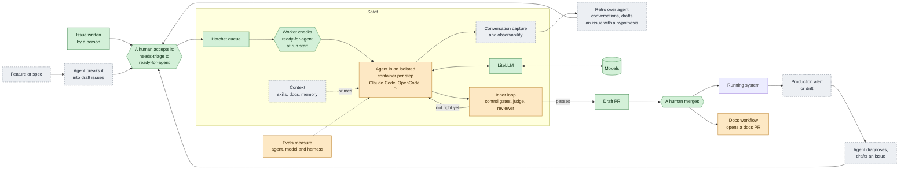

# Design roadmap

Where Satat is heading over the next six months or so: direction that isn't settled enough for
an [ADR](../adr/) and isn't cut into [issues](https://github.com/javatarz/satat/issues) yet.

- **ADRs** record decisions. **Issues** hold work. **This roadmap** holds the direction in between.
- When a theme turns into an issue or an ADR, link it from the theme and trim what it now covers.
- When grooming or designing, check the relevant theme. If a change goes against it, say so.

Status: **Idea** (talked about) · **Shaping** (someone is exploring) · **Backlog** (has an issue) ·
**Decided** (has an ADR)

## Terms

"Harness" gets used for several things. In this roadmap it means one thing:

| Term | Means | In Satat |
|---|---|---|
| **Agent** | The coding agent program that does the work. Its built-in tools (shell, file edits) come with it; the skills and tools Satat gives it are part of the harness. Off the shelf today. | Claude Code, OpenCode, Pi |
| **Model** | The LLM the agent calls. Chosen separately from the agent. | Any provider through LiteLLM |
| **Harness** | Everything around the agent that makes it likely to succeed. It has two halves: context and loops. | Satat builds and runs it |
| **Context** | Intent made durable, versioned and visible, so it primes the agent. Advisory: the agent can read it and still ignore it. | Skills, docs, memory |
| **Loop** | A check wired so that failing it goes back to the agent. Enforcing. | Control gates, the judge, the reviewer, retros |
| **Inner loop** | Answers while the agent can still fix the work. | Lint, tests, review before the draft PR |
| **Outer loop** | Answers after the work has shipped, so it can only change the next piece of work. | Conversation retros that raise tickets |

Once there are enough loops to need routing between them, the harness becomes a system with an
owner. That system is Satat.

## Why Satat exists

We use Dan Shapiro's
[five levels of AI-assisted coding](https://www.danshapiro.com/blog/2026/01/the-five-levels-from-spicy-autocomplete-to-the-software-factory/),
modelled on the levels of driving automation. The kitchen column carries the same idea for
readers who don't write code:

| Level | As a developer | In a kitchen |
|---|---|---|
| 0 | **Coder.** Autocomplete, AI as a search engine. Every line is yours. | You cook alone. |
| 1 | **Coder with an intern.** Discrete tasks ("write a test for this"), every line reviewed. | A kitchen porter does the chopping. You check it and do the cooking. |
| 2 | **Pair programmer.** In flow with an AI-native tool, still reading all the code. | You cook alongside a junior cook, watching every pan. |
| 3 | **Manager.** Agents write most of the code across several sessions. Your day is reviewing diffs. | Sous chef at the pass: the cooks cook, you check every plate. |
| 4 | **PM.** You write and argue the spec, craft skills, leave for hours, and check whether the tests pass. | Head chef: you write the menu and recipes, set up the stations, and step out during service. |
| 5 | **Builds the harness.** Agents do all the coding. You shape the skills, tools and checks, sample the output, and own what ships. | Head chef of a Michelin kitchen: you build the kitchen, taste samples, and answer for every dish. |

Most engineers using coding agents today are somewhere in level 3. Some reach level 4 on a
good day. Each level is a range, not a point. The team behind Satat does level 4 work well
today, and **Satat's goal is level 5**.

The foundation is **level 4 as a system** rather than one person's skill. A well-defined task,
broken down with human help if needed, is carried by agents up to a review point: a draft PR
that a human merges ([ADR 0022](../adr/0022-v2-platform-requirement-decisions.md)). The task
can also come from a signal: monitoring spots an alert or drift, an agent diagnoses and
classifies it, the diagnosis becomes a ticket, and an agent raises the PR.

Shapiro calls level 5 a dark factory: no human writes or reviews code. We use Lauren Tan's
[Michelin kitchen](https://georgediab.com/posts/2026/the-dark-factory-is-the-point) framing
instead, because a factory suggests mass production and software still needs
[craft and judgment](https://karun.me/blog/2025/11/06/intelligent-engineering-building-skills-and-shaping-principles/#fast-doesnt-mean-good). The agents are the cooks. The kitchen is the harness: skills, tools, code structure,
verification and lint rules. The head chef can't taste every dish, so they
sample. When the same mistake keeps coming out, they change the kitchen, not the plate.

That is Satat's level 5. Humans still
[own what ships](https://karun.me/blog/2025/11/06/intelligent-engineering-building-skills-and-shaping-principles/#ai-augments-humans-stay-accountable). What goes autonomous is the outer loop
that improves the kitchen: on a schedule, Satat reviews its own conversations, runs a retro, and raises tickets
with a hypothesis ("these conversations would have gone better if..."). A human picks which
ones to work on, and Satat builds them. The human role becomes deciding where the harness
goes: principles, not line-level feedback.

Satat is an opinionated, reusable template for level 5: a level 4 system that keeps improving
its own kitchen. It must scale from a two-person team to a large engineering org, and every part
(runtime, workflow, gates, security, monitoring, model routing) must be
[swappable](https://karun.me/blog/2025/11/06/intelligent-engineering-building-skills-and-shaping-principles/#shape-ai-deliberately).

Satat is **not a product**. It is a working reference and a body of tested opinions that the
team can take into engagements, and the source for blogs and talks.

## How it fits together

Every workflow that starts somewhere other than a person's issue ends in a draft issue. Only a
human moves an issue from `needs-triage` to `ready-for-agent`, and only `ready-for-agent`
issues reach the agent.

Every way in produces the same issue event: `satat-enqueue` by hand today, a poller (#135) and
later a webhook. The worker checks `ready-for-agent` when the run starts (#134), so every
way in is gated, whoever pushed the event.
The direction for the one exception is [lane-started runs](../design.md#lane-started-runs),
only on lanes that run no agent: platform smoke tests, and perhaps eval lanes. Nothing in
config marks those lanes yet (#129).

Green is decided, amber is being shaped, and grey dashed is an idea.

| Workflow | Starts with | Ends with | Status | Themes |
|---|---|---|---|---|
| Issue to draft PR | A human labels an issue `ready-for-agent` | A draft PR that a human merges | Shaping (#112, #135) | [Inner loop](inner-loop.md), [interchangeable agents](interchangeable-agents.md) |
| Feature breakdown | A feature or spec | Draft issues waiting for a human to accept them | Idea | [Per-codebase workflows](per-codebase-workflows.md) |
| Production signal to issue | An alert or drift in the running system | A diagnosis as a draft issue | Idea | [Signal-driven intake](signal-driven-intake.md), [observability](observability.md) |
| Harness self-improvement | A schedule | An issue with a hypothesis about the harness | Idea | [Observability](observability.md), [memory](memory.md) |
| Docs sync | A merged PR (weekly for now) | A docs PR | Shaping | [Self-documenting repos](self-documenting-repos.md) |
| Eval run | A change to the agent, model or harness | Scores to compare against the last run | Shaping | [Evals](evals.md) |

## Sequencing: why this order

1. **Thin slice end to end** (v0.2): issue to draft PR on Docker, horizontally scalable.
2. **Evals**: a code-based benchmark, so any change can be
   [measured](https://karun.me/blog/2025/11/06/intelligent-engineering-building-skills-and-shaping-principles/#learn-fast-adapt-continuously).
3. **Observability**: traces, cost per turn, conversation capture.
4. **Ratchet behaviour**: skills, verification, hooks, security. Tighten one problem at a time.
5. **Maybe replace the off-the-shelf agent**: only once evals are strong and reviews feel optional.

You can't tune behaviour without the data to see where it fails: install monitoring before
doing performance fixes. Behavioural work done first is no different from what a single
developer already does with Claude Code today.

## Themes

| Theme | Status | Related |
|---|---|---|
| [Inner loop as a state machine](inner-loop.md) | Shaping | #112 |
| [Interchangeable agents](interchangeable-agents.md) | Idea | ADR 0022 |
| [Model and provider neutrality](provider-neutrality.md) | Idea | ADR 0016, ADR 0022, #94 |
| [Model routing](model-routing.md) | Shaping | ADR 0016 |
| [Runtime scaling tiers](runtime-scaling.md) | Decided (near term) | ADR 0024, ADR 0026, #130 |
| [Per-codebase workflows](per-codebase-workflows.md) | Idea | |
| [Skill distribution](skill-distribution.md) | Idea | |
| [Observability and conversation capture](observability.md) | Idea | #82, ADR 0022 |
| [Memory](memory.md) | Idea | |
| [Evals](evals.md) | Shaping | |
| [Self-documenting repos](self-documenting-repos.md) | Shaping | |
| [Security](security.md) | Decided (secret store), Backlog (parts) | ADR 0025, ADR 0032, #97, #143, #153 |
| [Signal-driven intake](signal-driven-intake.md) | Idea | ADR 0023 |

Sources are the team calls on 2026-10-16 and 2026-10-21.
