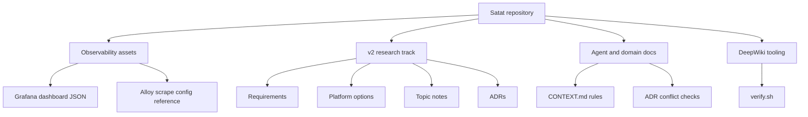
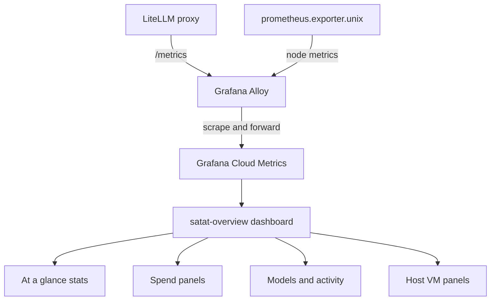
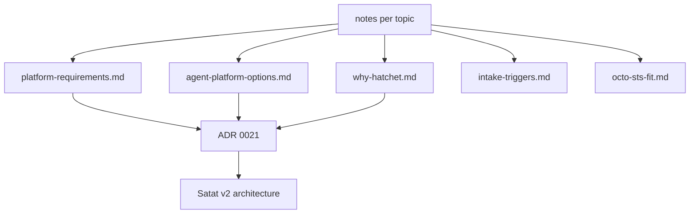
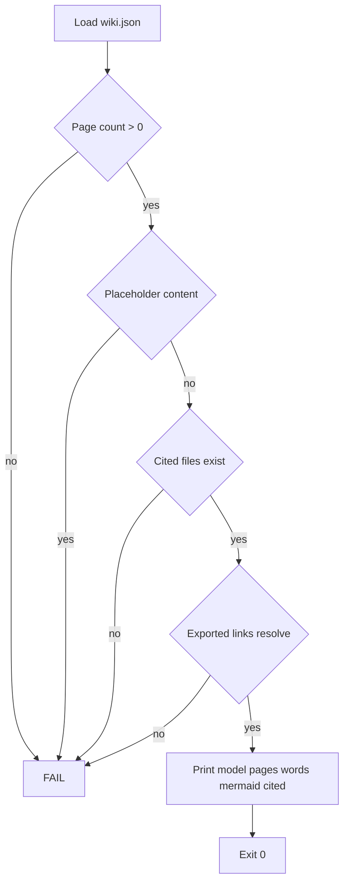
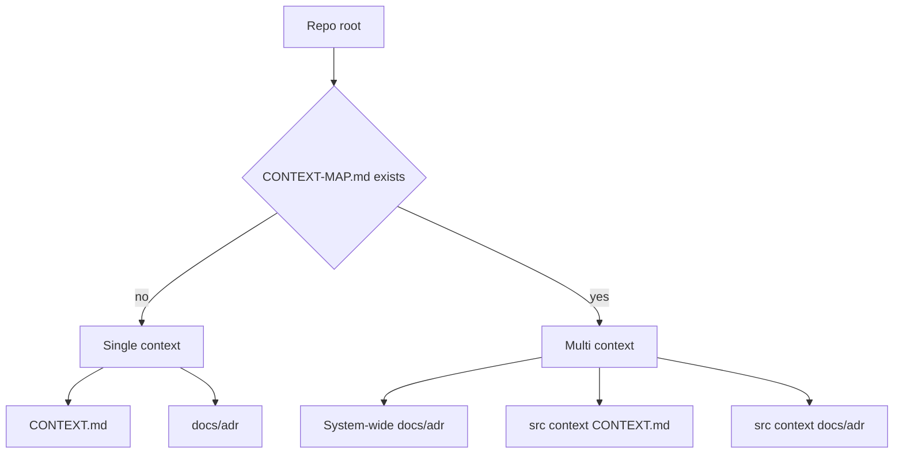

<!-- Generated by DeepWiki-Open d92819a with deepseek-v4.1-flash-1017 on 2026-10-19. Do not edit by hand; regenerate with `just wiki`. -->

[← Wiki index](index.md)

# Project Overview and Versions

<details>
<summary>Relevant source files</summary>

The following files were used as context for generating this wiki page:

- [README.md](README.md)
- [CONTEXT.md](CONTEXT.md)
</details>

# Project Overview and Versions

Satat is a system built around an LLM proxy layer (LiteLLM), an observability stack delivered through Grafana Cloud, and an active research track for a v2 platform that adds multiple harnesses, horizontal scale, and a backlog control plane. The repository combines operational assets (dashboards, metrics configuration references), research notes with pinned component versions, and process tooling for documentation and agent-ready work. This page maps those areas and records the version information that the repository actually carries, rather than assuming a single global version manifest. See [Observability and Dashboard Versioning](#observability-and-dashboard-versioning) and [v2 Platform Research and Version Matrix](#v2-platform-research-and-version-matrix) for the two main version-bearing areas. Sources: [docs/research/v2/README.md:1-19](), [observability/grafana/README.md:1-49]()

## Repository Areas at a Glance

| Area | Purpose | Key artifacts |
|---|---|---|
| `observability/grafana/` | Dashboards tracked as code, imported manually into Grafana Cloud | `satat-overview.json`, `README.md` |
| `docs/research/v2/` | Research for the next version: requirements, options, Hatchet rationale, RAM spike, intake, token brokering | `README.md`, `platform-requirements.md`, `agent-platform-options.md`, `why-hatchet.md`, `notes/` |
| `docs/agents/` | Rules for how engineering skills consume domain documentation | `domain.md` |
| `docs/research/` | Process research, including agent-ready issue quality | `agent-ready-issues.md` |
| `scripts/deepwiki/` | Verification of generated wiki output before it is read or committed | `verify.sh` |

Sources: [observability/grafana/README.md:1-8](), [docs/research/v2/README.md:5-14](), [docs/agents/domain.md:1-10](), [scripts/deepwiki/verify.sh:1-16]()

The v2 research index explicitly states its scope: several harnesses, horizontal scale, and a backlog control plane, with decisions recorded as ADRs starting at ADR 0021. Sources: [docs/research/v2/README.md:1-6]()



Sources: [observability/grafana/README.md:3-6](), [docs/research/v2/README.md:5-14](), [docs/agents/domain.md:1-52](), [scripts/deepwiki/verify.sh:1-9]()

## Observability and Dashboard Versioning

The Grafana dashboard definitions are tracked as code but are not provisioned automatically. They are imported manually into Grafana Cloud using the `grafanacloud-prom` / Grafana Cloud Metrics datasource, and there is no provisioning pipeline for them yet. Sources: [observability/grafana/README.md:3-6]()

The dashboard is identified by `uid` `satat-overview`, so re-importing the same file updates the existing dashboard rather than creating a duplicate. The editing workflow is: edit in the Grafana UI, copy the JSON model from Dashboard settings, paste it back into `satat-overview.json`, and commit while keeping the `uid` and `title` unchanged. Sources: [observability/grafana/README.md:20-28]()

### Dashboard Data Flow



The README states that no extra agent is needed because everything comes from the Grafana Alloy container already running on the VM, configured in `gateway/alloy-config.alloy`. Sources: [observability/grafana/README.md:31-38]()

### Panel-to-Metric Mapping

| Dashboard area | Panels | Metrics | Origin |
|---|---|---|---|
| Spend, requests, tokens, latency, failures | Spend stat, requests stat, tokens stat, error rate, spend rate by model, top models table, requests by model, p95 latency, tokens by model, failures by model | `litellm_*` | LiteLLM `/metrics`, scraped by Alloy |
| Host | CPU %, memory %, disk-used % per mount | `node_*` | `prometheus.exporter.unix`, scraped by Alloy |

Sources: [observability/grafana/README.md:39-46]()

The "At a glance" row contains spend, requests, tokens, error rate, VM CPU, and VM memory panels. Sources: [observability/grafana/README.md:10-13](), [observability/grafana/satat-overview.json:24-57]()

### Concrete PromQL Expressions

The dashboard JSON contains the exact queries used by the panels:

```json
"expr": "sum(increase(litellm_spend_metric[$__range]))"
```

```json
"expr": "sum(increase(litellm_proxy_total_requests_metric[$__range]))"
```

```json
"expr": "sum(increase(litellm_total_tokens_metric[$__range]))"
```

Sources: [observability/grafana/satat-overview.json:30-53]()

Spend rate and top-models panels:

```json
"expr": "sum by (model) (rate(litellm_spend_metric{model=~\"$model\"}[$__rate_interval])) * 3600"
```

```json
"expr": "topk(10, sum by (model) (increase(litellm_spend_metric{model=~\"$model\"}[$__range])))"
```

Sources: [observability/grafana/satat-overview.json:85-96]()

Latency and request panels:

```json
"expr": "histogram_quantile(0.95, sum by (le, model_group) (rate(litellm_request_total_latency_metric_bucket[$__rate_interval])))"
```

```json
"expr": "sum by (requested_model) (rate(litellm_proxy_total_requests_metric[$__rate_interval]))"
```

```json
"expr": "sum by (requested_model) (rate(litellm_proxy_failed_requests_metric[$__rate_interval]))"
```

Sources: [observability/grafana/satat-overview.json:101-125](), [observability/grafana/satat-overview.json:120-134]()

Host panels:

```json
"expr": "100 * (1 - avg(rate(node_cpu_seconds_total{mode=\"idle\"}[5m])))"
```

```json
"expr": "100 * (1 - sum(node_memory_MemAvailable_bytes) / sum(node_memory_MemTotal_bytes))"
```

Sources: [observability/grafana/satat-overview.json:67-79]()

### Dashboard Links and Metadata

The dashboard JSON includes external links to the Satat Canvas at `https://satat.karun.me/canvas/` and to ntfy at `https://notify.satat.karun.me/`, with `editable` set to true and `graphTooltip` set to 1. Sources: [observability/grafana/satat-overview.json:17-23]()

### Known Gap

Issue/PR-level attribution ("currently working issue #42") is not available yet; the activity panels reflect LLM traffic. T8 is planned to tag requests with issue metadata via LiteLLM `custom_prometheus_metadata_labels`, after which a "current issues" panel can be added. Sources: [observability/grafana/README.md:46-49]()

### Related Dashboards

The LiteLLM-maintained dashboards (v2 / all-metrics) can be imported alongside `satat-overview.json` from the LiteLLM cookbook repository, and Grafana.com dashboard 1860 ("Node Exporter Full") is suggested for a host deep-dive. Sources: [observability/grafana/README.md:44-46]()

## v2 Platform Research and Version Matrix

The v2 research directory contains confirmed requirements, a comparison of agent platform options by layer, the case for Hatchet, a measured RAM/CPU spike, intake research, and token-broker research. The index warns that `notes/` contains raw per-topic research with full citations and may describe options that were later rejected. Sources: [docs/research/v2/README.md:1-19]()

### Research-to-Decision Flow



The README states that decisions coming out of the research are recorded as ADRs in `docs/adr`, starting with ADR 0021. Sources: [docs/research/v2/README.md:1-6]()

### Workflow Engine Versions

| Engine | Version (date) | License | Runtime isolation |
|---|---|---|---|
| Kestra | v2.0.6 (2026-10-13); 2.0.0 on 2026-09-07 | Apache-2.0, Enterprise Edition proprietary | Docker runner in OSS; Kubernetes, AWS Batch, Cloud Run, Azure Batch runners are Enterprise |
| Prefect 3 | 3.8.8 (2026-10-06) | Apache-2.0 | Docker, Kubernetes, ECS (EC2 and Fargate), Cloud Run v2, Azure Container Instances |
| Restate | v1.8.0 (2026-10-14) | BUSL-1.1; Apache-2.0 after four years | No; handler calls runtime API |
| Inngest | v1.46.0 (2026-10-06) | SSPL-1.0 with Apache-2.0 after three years | No; step calls runtime API |
| Windmill | v1.835.0 (2026-10-14) | AGPLv3 + Apache-2.0 + proprietary; CE binary proprietary-licensed | `# sandbox <image>` under nsjail on the worker; no native K8s/ECS job launch |
| Trigger.dev | v4.7.4 (2026-10-14) | Apache-2.0 | Docker and Kubernetes via supervisor; no ECS/Cloud Run/ACA |
| Conductor OSS | v3.32.5 (2026-09-25) | Apache-2.0 | No; worker calls runtime API |

Sources: [docs/research/v2/notes/platforms-engines.md:18-25](), [docs/research/v2/agent-platform-options.md:89-96]()

### Intake and Gateway Versions

| Component | Version (date) | License | Role |
|---|---|---|---|
| Convoy | v26.9.1 (2026-10-15) | `LicenseRef-Elastic-2.0` (ELv2) | Webhook gateway with HMAC/basic/API key verification, retries, replay |
| Svix OSS server | v2.8.0 (2026-10-08) | MIT (OSS); Ingest is managed | Outbound sender only; not an intake solution when self-hosted |
| Hookdeck Outpost | v1.6.0 (2026-10-02) | Apache-2.0 | Outbound only; not intake |
| n8n | n8n@2.43.6 (2026-10-15) | Sustainable Use License (+ `.ee.` files) | Trigger nodes with GitHub/GitLab/Schedule/Webhook; full automation platform |
| Activepieces | 0.92.3 (2026-10-12) | MIT outside `packages/ee` | Many pieces with polling or instant triggers |
| Hookdeck Event Gateway | n/a | Proprietary SaaS | Managed event gateway with source auth presets and replay |

Sources: [docs/research/v2/notes/intake-platforms.md:48-54]()

### Webhook and Event Library Versions

| Library/spec | Version (date) | License | Use |
|---|---|---|---|
| go-github | v92.0.0 (2026-09-14) | BSD-3-Clause | `ValidatePayload` + `ParseWebHook` |
| client-go | v3.23.0 (2026-10-14) | Apache-2.0 | GitLab `HookEventType` + `ParseWebhook` |
| githubkit | v0.16.1 (2026-08-14) | MIT | `webhooks.verify/parse` |
| CloudEvents spec | Spec v1.0.2 (2022); CNCF graduated 2024-01-25 | Apache-2.0 | Envelope format |
| CloudEvents SDKs | sdk-go v2.16.2, sdk-python 2.2.0 (2026-06-11), sdk-javascript v10.0.0 | Apache-2.0 | Language bindings |
| CDEvents spec | v0.5.1 (2026-04-15) | Apache-2.0 | Event vocabulary on CloudEvents |
| Alertmanager webhook | v0.34.1 (2026-09-17) | Apache-2.0 | De facto alert payload |

Sources: [docs/research/v2/notes/intake-abstractions.md:20-26]()

### Version-Related Architectural Constraints

Kestra requires a JVM, at least 4 GiB RAM and 2 vCPU, and Postgres; its concurrency limits exist at flow, namespace, and tenant levels, with `QUEUE` as the default behaviour. Paused approval-waiting executions hold their slot. Sources: [docs/research/v2/notes/platforms-engines.md:127-147]()

Restate is licensed under BUSL-1.1 with a change to Apache-2.0 four years after release; self-hosting for your own workflows is permitted, but a public "deploy your own" recipe is not OSI-approved. Sources: [docs/research/v2/notes/platforms-engines.md:150-157]()

## Credential and Token Lifetimes

The secrets taxonomy records the expected lifetime of each credential class, which is the closest thing in the provided files to a versioning policy for runtime secrets.

| Credential | Mechanism | Lifetime | Scope |
|---|---|---|---|
| OpenAI API | Workload identity federation token exchange | At most 1 hour; never outlives the subject token; no refresh | Mapped project service account, narrowed by `permissions` |
| Other LLM providers | Varies; OpenRouter and Mistral assumed static | Cloud WIF typically 1 hour | Cloud IAM or project-wide static keys |
| LiteLLM virtual key | `POST /key/generate` with master key, or JWT-to-key mapping | `duration` such as `"30min"`; `upperbound_key_generate_params.duration` caps it | `models`, `max_budget`, `budget_duration`, `rpm`/`tpm`, per-model budgets, `team_id` |
| Postgres / DB creds | OpenBao or Vault database engine | Minutes to hours; lease revoke drops the role | SQL grants in `creation_statements`; per-role |
| Cloud (AWS, GCP, Azure) | OIDC federation / WIF | AWS and GCP: 1 hour typical | Cloud IAM roles |

Sources: [docs/research/v2/notes/secrets-taxonomy.md:47-52]()

Suggested rotation cadence for static credentials is: root keys yearly or on suspicion; vendor API keys and PATs every 90 days; Hatchet and ntfy tokens every 90 days minted by the deploy pipeline; webhook secrets yearly with overlap. Sources: [docs/research/v2/notes/secrets-taxonomy.md:102-104]()

## DeepWiki Verification Tooling

`scripts/deepwiki/verify.sh` checks a generated wiki before anyone reads or commits it. It fails when the wiki has no pages, when a page contains DeepWiki's placeholder text (`Error generating content: ...`), when a page cites a source file that does not exist in the repository, or when an exported page links to a wiki page that was not written. It also prints a summary containing the model, page count, size, Mermaid diagram count, and cited-file count. Sources: [scripts/deepwiki/verify.sh:1-9]()

### Verification Flow



Sources: [scripts/deepwiki/verify.sh:18-49]()

The script sources `scripts/deepwiki/lib.sh`, requires `$DEEPWIKI_DATA_DIR/wiki.json` and `$WIKI_OUT/index.md`, and accumulates failures in a `fail` variable rather than exiting on the first problem. Sources: [scripts/deepwiki/verify.sh:10-16]()

Key implementation details:

```bash
pages=$(jq '.generated_pages | length' "$wiki_json")
[ "$pages" -gt 0 ] || { echo "FAIL: wiki has no pages" >&2; fail=1; }
```

```bash
errored=$(jq -r '.generated_pages[] | select((.content // "") | test("^\\s*Error generating content:")) | .id' "$wiki_json")
```

Sources: [scripts/deepwiki/verify.sh:18-24]()

Cited-file validation strips `./` and the repository root prefix before checking existence, and broken-link detection uses `grep -oh '](\([a-z0-9-]*\.md\))'` over `$WIKI_OUT/*.md`. Sources: [scripts/deepwiki/verify.sh:26-39]()

The summary line is:

```bash
echo "==> model=$(jq -r '.model // "?"' "$wiki_json") pages=$pages words=$words mermaid=$mermaid cited-files=$cited"
```

Sources: [scripts/deepwiki/verify.sh:41-47]()

## Documentation and Work Intake Conventions

Domain documentation is consumed before code exploration: engineering skills read `CONTEXT.md` at the repository root, or `CONTEXT-MAP.md` if it exists and points at one `CONTEXT.md` per context, plus ADRs in `docs/adr/` (and `src/<context>/docs/adr/` in multi-context repositories). If these files do not exist, the guidance is to proceed silently rather than flagging their absence. Sources: [docs/agents/domain.md:1-10]()

The repository distinguishes single-context and multi-context layouts:



Sources: [docs/agents/domain.md:12-32]()

When naming a domain concept, outputs must use the glossary's vocabulary from `CONTEXT.md` and avoid synonyms the glossary explicitly avoids. If a concept is missing from the glossary, that is treated as a signal that either the language is invented or a real gap exists for `/domain-modeling`. If an output contradicts an existing ADR, the conflict must be surfaced explicitly rather than silently overridden. Sources: [docs/agents/domain.md:34-52]()

For agent-ready issues, the research recommends fields covering outcome, acceptance criteria with check paths, an oracle command, non-goals and paths not to touch, blast radius and reversibility, stop conditions, budget, evidence the PR must carry, and a named human owner. Routing is by blast radius and reversibility: auth, money, schema changes, and data migrations go to a human lane. Sources: [docs/research/agent-ready-issues.md:24-90]()

The recommended template is:

```markdown
## User-visible change
One concrete sentence.

## Scope
- Entry point:
- User role:
- Files or components likely involved:

## Oracle
- Command that fails now, passes when done:

## Acceptance criteria
- Behavior: (what the user sees/can do)
- Regression boundary: (what must not change)
- Verification: (test / lint / build / screenshot / manual path)

## Non-goals
- Do not:
- Paths not to touch:

## Review notes
- Risk: / Suggested reviewer:
```

Sources: [docs/research/agent-ready-issues.md:70-90]()

## Version Tracking Summary

The repository does not contain a single central version manifest in the provided files. Versions are instead distributed across three places:

| Version domain | Where it lives | Example |
|---|---|---|
| Dashboard identity | Grafana JSON `uid` and `title` | `satat-overview` |
| Candidate platform components | Research comparison tables | Kestra v2.0.6, Prefect 3.8.8, Restate v1.8.0 |
| Intake components and libraries | Research notes with dates and licenses | Convoy v26.9.1, go-github v92.0.0, CloudEvents spec v1.0.2 |

Sources: [observability/grafana/README.md:20-28](), [docs/research/v2/notes/platforms-engines.md:18-25](), [docs/research/v2/notes/intake-platforms.md:48-54](), [docs/research/v2/notes/intake-abstractions.md:20-26]()

This distribution is intentional for the research phase: the v2 index describes the notes as raw per-topic research with full citations and warns that they may describe options later rejected, while decisions are promoted into ADRs. Sources: [docs/research/v2/README.md:13-14]()

Satat's operational identity is captured by the dashboard links to Canvas and ntfy, and by the metrics pipeline from LiteLLM and the Unix exporter through Alloy into Grafana Cloud. The v2 research adds a versioned candidate set for workflow engines, intake gateways, and webhook libraries, with licensing and runtime constraints recorded alongside each version. Together these provide the project overview and the version baseline needed before adopting any v2 component. Sources: [observability/grafana/satat-overview.json:17-23](), [observability/grafana/README.md:31-46](), [docs/research/v2/README.md:1-19]()

## Related pages

- [Repository Layout, Docs, and Two-Repo Split](page-2.md)
- [Domain Glossary and Vocabulary](page-3.md)
- [System Architecture Overview](page-4.md)
