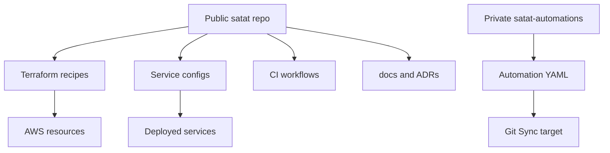
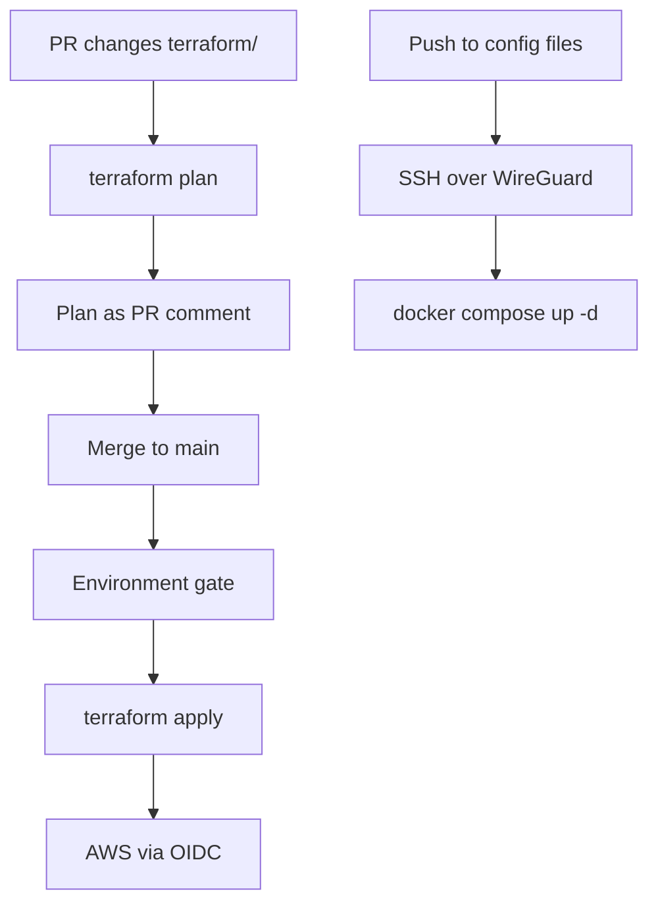
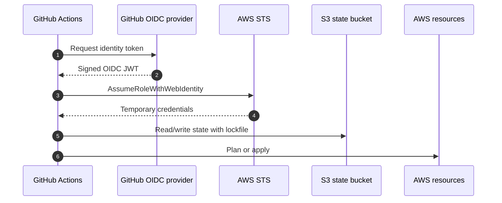
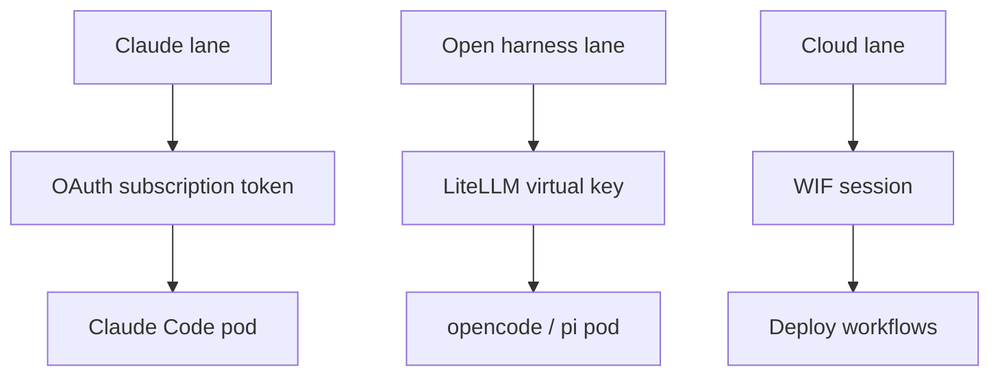
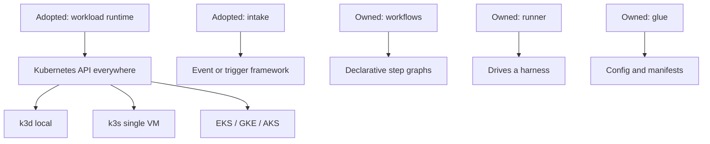

<!-- Generated by DeepWiki-Open d92819a with deepseek-v4.1-flash-1017 on 2026-10-19. Do not edit by hand; regenerate with `just wiki`. -->

[← Wiki index](index.md)

# Deployment and Infrastructure

<details>
<summary>Relevant source files</summary>

The following files were used as context for generating this wiki page:

- [README.md](README.md)
- [AGENTS.md](AGENTS.md)
- [docs/adr/0021-adopt-platform-plumbing.md](docs/adr/0021-adopt-platform-plumbing.md)
- [docs/research/v2/platform-ram-spike.md](docs/research/v2/platform-ram-spike.md)
- [ntfy/](ntfy/)
</details>

# Deployment and Infrastructure

Satat's deployment story is deliberately split into two independent concerns that share one CI system: **provisioning** (creating the machine and network resources) and **deploying** (pushing service configuration onto that machine). Provisioning is Terraform applied through GitHub Actions; deploy is SSH over WireGuard followed by `docker compose up -d`. Both authenticate to AWS with GitHub OIDC, so no long-lived cloud credentials exist in the repository, in Terraform state, or in cloud-init. This EC2 + Docker Compose pipeline is the v0.1 shape and lives on the `v0.1` branch; the v0.2 direction replaces the single VM with a conformant Kubernetes cluster, provisioned by per-cloud Terraform recipes and deployed via a Helm chart, neither of which exists yet.

The infrastructure recipe is public while the automation configuration is private, a split recorded in ADR 0007. Observability is bolted onto the same VM through a Grafana Alloy container that scrapes LiteLLM and node metrics into Grafana Cloud. Secrets handling is the most heavily researched part of the infrastructure: the v2 research notes classify every credential by whether it can be short-lived and federated, and which lane (Claude subscription, LLM gateway, cloud, registry) it belongs to.

Sources: [AGENTS.md:31-40](), [docs/adr/0013-provision-deploy-pipeline-split.md:1-54](), [docs/adr/0007-two-repo-split.md:1-4]()

## Repository Topology and the Two-Repo Split

Satat is split across two repositories with different visibility, and the split is an architectural decision rather than an accident of history:

| Repository | Visibility | Contents |
|---|---|---|
| `javatarz/satat` | Public | Terraform, cloud-init, service configs (`gateway/`, `ntfy/`, `automations/`), CI, documentation |
| `javatarz/satat-automations` | Private | Git Sync target for automation YAML files: which repos are watched, under which labels, with which prompts |

The public repo contains "the infrastructure recipe" so anyone can see and reproduce the setup, while repo-specific configuration (owner names, label choices, prompt templates) stays out of the public showcase. The rejected alternatives were a single private repo (hides the recipe from the community) and a single public repo (exposes automation details).

Sources: [docs/adr/0007-two-repo-split.md:1-4](), [AGENTS.md:41-45]()



The public repo is the single source of truth for both infrastructure and configuration: GitHub Actions reads both from the same commit, which removes any cross-repository ordering problem during a provision-then-deploy run.

Sources: [docs/adr/0013-provision-deploy-pipeline-split.md:47-54]()

## Provisioning with Terraform

All infrastructure — the EC2 VM, the security group, the Elastic IP, and supporting resources — is defined as Terraform resources in this repo. Terraform is **never** applied from a local machine except for the one-time bootstrap: `plan` runs on pull requests (posted as a PR comment) and `apply` runs on merge to `main`, gated by a GitHub Environment with required reviewers.

Sources: [docs/adr/0004-terraform-iac.md:1-4](), [docs/adr/0013-provision-deploy-pipeline-split.md:23-33]()

### State and locking

State lives in S3 with Terraform's native lockfile (`use_lockfile`, Terraform ≥ 1.10) — there is no DynamoDB lock table. This removes a dependency while retaining locking, and keeps the whole recipe reproducible from the repo alone.

Sources: [docs/adr/0004-terraform-iac.md:1-4](), [docs/adr/0013-provision-deploy-pipeline-split.md:33-36]()

### The bootstrap chicken-and-egg

Terraform cannot create the credentials it needs to run. A one-time local bootstrap in `bootstrap/`, executed with admin credentials, creates three things:

1. the S3 state bucket,
2. the GitHub OIDC identity provider,
3. the Terraform IAM role that workflows assume.

This is the only sanctioned local apply; everything afterwards flows through CI.

Sources: [docs/adr/0013-provision-deploy-pipeline-split.md:33-36](), [docs/adr/0013-provision-deploy-pipeline-split.md:48-50]()

### Rejected alternatives

Ansible was rejected as mutation-oriented rather than declarative (harder to reason about drift); manual provisioning was rejected as unreviewable and unreproducible. Terraform Cloud was rejected later: it required an API token and a workflow that polled TFC run status before deploying, and it was replaced by GitHub Actions in the 2026-10-05 revision of ADR 0013.

Sources: [docs/adr/0004-terraform-iac.md:1-4](), [docs/adr/0013-provision-deploy-pipeline-split.md:5-20]()

## Provision-Deploy Pipeline

The pipeline distinguishes two classes of change with very different frequencies:

| Concern | Trigger | Mechanism |
|---|---|---|
| Provision | Push to files under `terraform/` | `terraform plan` on PR (posted as a PR comment); `apply` on merge to `main`, gated by a GitHub Environment |
| Deploy | Push to config files (`gateway/`, `ntfy/`, …) | SSH over WireGuard + `docker compose up -d` |

Sources: [docs/adr/0013-provision-deploy-pipeline-split.md:23-29]()



### Ordering

Because provisioning and deploy now live in one system, ordering is expressed as a plain `needs:` between jobs rather than an external run-status poller. This is the main structural simplification that came out of abandoning Terraform Cloud.

Sources: [docs/adr/0013-provision-deploy-pipeline-split.md:38-40]()

### Authentication sequence



Workflow runs assume a scoped IAM role via `sts:AssumeRoleWithWebIdentity`; no long-lived AWS keys are stored anywhere in the pipeline.

Sources: [docs/adr/0013-provision-deploy-pipeline-split.md:30-32](), [docs/adr/0004-terraform-iac.md:1-4]()

### Consequences of the single-CI design

The accepted trade-offs are explicit in the ADR: one CI system, one auth mechanism, and one place to reason about provision-then-deploy ordering. In exchange, Satat forgoes Terraform Cloud's plan UI, cost estimation, and Sentinel/OPA policy — plans are PR comments and applies are gated by a GitHub Environment.

Sources: [docs/adr/0013-provision-deploy-pipeline-split.md:42-54]()

## Secrets and Credential Lanes

The secrets posture carries over from ADR 0011 into the v2 non-negotiables: secrets never appear in git-tracked files, Terraform state, or instance metadata, and each task receives least-privilege, short-lived credentials where the provider supports them. Until a dedicated secret-store ADR lands, secrets live in GitHub repository secrets and cloud OIDC. Note that where secrets live *on Kubernetes* is still undecided and marked as a planned ADR.

Sources: [AGENTS.md:37-40](), [docs/research/v2/platform-requirements.md:65-72]()

### Credential lanes as an infrastructure property

Lane enforcement is not prompt-based. It is enforced by **which secrets each workload receives**:

- Claude Code uses only the Claude subscription (OAuth token) and is never given an API key it could fall back to.
- Open harnesses use only the LLM Gateway through LiteLLM.
- The subscription token never reaches a non-Claude-Code harness (Anthropic consumer terms).

Sources: [docs/research/v2/platform-requirements.md:34-42]()



### Federation support by credential type

The research notes classify each credential by whether it can be federated and how long it lives. Condensed from the taxonomy table:

| # | Credential | Federated / short-lived | Mechanism | Lifetime |
|---|---|---|---|---|
| 3b | OpenAI API | Yes (WIF, token exchange) | k8s JWT, SPIFFE JWT-SVID or X.509 to `auth.openai.com` | ≤ 1 hour, never outlives subject token |
| 3c | Other LLM providers | Varies | Google/AWS/Azure via cloud WIF; OpenRouter/Mistral assumed static | Cloud 1 h typical |
| 4 | LiteLLM virtual key | Yes | `POST /key/generate` with master key, or JWT-to-key mapping | `duration`, capped by `upperbound_key_generate_params.duration` |
| 5 | Postgres / DB creds | Yes, with extra component | OpenBao or Vault database engine, unique user per request | Minutes to hours; lease revoke drops the role |
| 6 | Cloud (AWS/GCP/Azure) | Yes | `AssumeRoleWithWebIdentity`, GCP WIF, Azure federated identity credential | AWS/GCP 1 h default, up to 12 h; Azure Entra token 24 h |
| 7 | Container registry (GHCR) | No outside Actions | Only classic PAT or Actions `GITHUB_TOKEN` | `GITHUB_TOKEN` per job |
| 8 | Hatchet API token | Partly | Token API `expiresIn`, no federation; mint per deploy from admin CLI | Any chosen duration, tenant-scoped |

Sources: [docs/research/v2/notes/secrets-taxonomy.md:47-52](), [docs/research/v2/notes/secrets-taxonomy.md:51-55]()

Two operational notes from that table are especially relevant to deployment: LiteLLM virtual keys should be **deleted at step end** as well as relying on expiry, and GHCR is the awkward case — app installation tokens do not authenticate to GHCR even though `packages` appears as a permission. The suggested resolutions are making Satat's images public (no pull secret at all), a classic PAT with only `read:packages` on a 90-day rotation owned by a bot account, or mirroring into a cloud registry reached by WIF.

Sources: [docs/research/v2/notes/secrets-taxonomy.md:49-55]()

### Static secrets and rotation

What stays static is rotated on a defined cadence rather than left indefinitely:

| Secret class | Suggested rotation |
|---|---|
| Root keys | Yearly or on suspicion |
| Vendor API keys and PATs | 90 days |
| Hatchet and ntfy tokens | 90 days, minted by the deploy pipeline |
| Webhook secrets | Yearly with overlap |

The rotator is the deploy pipeline where the vendor has an API (Hatchet, ntfy, LiteLLM, GitHub App keys) and a calendar-driven human task where it does not (Slack reinstall, GHCR PAT, subscription token). SaaS keys, DB credentials and cloud credentials stay with the launcher/broker/CI; deploy and publish run in GitHub Actions with OIDC.

Sources: [docs/research/v2/notes/secrets-taxonomy.md:102-108]()

### Known unverified areas

The notes are explicit about what was not verified, and these gaps bear directly on infrastructure decisions: exact maximum TTLs for AWS/GCP sessions and AWS role-chaining limits, whether LiteLLM can authenticate upstream with WIF-minted tokens instead of static keys, whether the Claude Code CLI accepts a federated Anthropic token, whether Anthropic's terms allow the subscription token for unattended automation, Hatchet token scoping finer than tenant, SSH CA tooling details, ECR/GAR kubelet credential-provider fit on k3s, and whether `SandboxTemplate` passes a projected `serviceAccountToken` volume.

Sources: [docs/research/v2/notes/secrets-taxonomy.md:110-121]()

## Observability on the VM

Grafana dashboard definitions are tracked as code in `observability/grafana/`, but there is **no provisioning pipeline** — they are imported manually into Grafana Cloud, against the `grafanacloud-prom` (Grafana Cloud Metrics) datasource. The `uid` is `satat-overview`, so re-importing the same file updates the existing dashboard instead of creating a duplicate.

Sources: [observability/grafana/README.md:1-30]()

No extra agent is required on the host: everything comes from the Grafana Alloy container already running on the VM (`gateway/alloy-config.alloy`).

| Panels | Metrics | Origin |
|---|---|---|
| Spend, requests, tokens, latency, failures | `litellm_*` | LiteLLM `/metrics`, scraped by Alloy |
| CPU, memory, disk | `node_*` | `prometheus.exporter.unix`, scraped by Alloy |

Sources: [observability/grafana/README.md:32-42]()

The dashboard itself is organised into rows — *At a glance*, *Spend*, *Models & activity*, and *Host (VM)*. Representative PromQL from the JSON:

```json
"expr": "sum by (model) (rate(litellm_spend_metric{model=~\"$model\"}[$__rate_interval])) * 3600"
```

```json
"expr": "100 * (1 - sum(node_memory_MemAvailable_bytes) / sum(node_memory_MemTotal_bytes))"
```

```json
"expr": "sum by (requested_model) (rate(litellm_proxy_failed_requests_metric[$__rate_interval]))"
```

Sources: [observability/grafana/satat-overview.json:67-92](), [observability/grafana/satat-overview.json:120-144]()

The documented gap is issue/PR-level attribution ("currently working issue #42"): the activity panels reflect LLM traffic only, and issue metadata tagging via LiteLLM `custom_prometheus_metadata_labels` is deferred to a later task (T8).

Sources: [observability/grafana/README.md:44-49]()

## The v0.2 Direction: Kubernetes as the Single Runtime

ADR 0021 changes what Satat builds. The platform redesign originally had Satat writing its own workload drivers for Docker, Kubernetes, ECS, Cloud Run and Azure Container Apps jobs, plus its own intake service. That code is plumbing; the value is in the workflows (issue to PR, review feedback to updated PR, production alert to issue or PR). Satat therefore **adopts** infrastructure plumbing and **owns** only workflow definitions, the in-workload runner, and integration glue.

Sources: [docs/adr/0021-adopt-platform-plumbing.md:1-40]()



The runtime candidate under evaluation is Kubernetes as the single runtime API everywhere — k3d locally, k3s on a single VM, EKS/GKE/AKS in the clouds — with [agent-sandbox](https://github.com/kubernetes-sigs/agent-sandbox) providing per-step sandboxes. Adopting it is a separate ADR, written once verification is done; intake likewise moves to an adopted event or trigger framework decided separately.

Sources: [docs/adr/0021-adopt-platform-plumbing.md:36-48]()

### What this means for provisioning and deploy

The provision-deploy split survives the transition but changes shape. Satat v0.2 assumes a conformant Kubernetes cluster is available; provisioning (a cluster) becomes Terraform recipes per cloud provider, and deploying Satat onto it becomes a separate step (a Helm chart). **Neither exists yet**, and the EC2 + Docker Compose pipeline remains on the `v0.1` branch.

Sources: [AGENTS.md:31-35]()

The relevant non-negotiable is workload isolation: every task runs in its own isolated workload (a pod), with no shared process or filesystem between tasks, and capacity grows by adding nodes. Each infrastructure dependency — workload runtime, queue/state store, secret store, ingress and auth, notifications, observability backend, model router, issue tracker — sits behind an interface with at least a local implementation and one cloud or Kubernetes implementation, and a local single-node install must work with Docker plus the k3d CLI.

Sources: [docs/research/v2/platform-requirements.md:29-34](), [docs/research/v2/platform-requirements.md:56-64]()

### Research inputs behind the runtime choice

The runtime/queue decision is backed by a comparison of engines and platforms. Notable infrastructure-relevant constraints found in that research: Kestra's Kubernetes, AWS Batch, Cloud Run and Azure Batch runners are Enterprise-only and it needs ≥ 4 GiB RAM and 2 vCPU; Windmill's concurrency limits are Enterprise-only and its Community Edition image may not be modified or wrapped; Trigger.dev needs roughly ten services; Restate and Inngest fail the OSI license bar. These constraints are what pushed the design toward Kubernetes as the universal runtime API rather than a per-backend driver.

Sources: [docs/research/v2/agent-platform-options.md:89-96](), [docs/research/v2/notes/platforms-engines.md:127-157]()

Multica illustrates the "no runtime driver" failure mode the design avoids: its daemon runs on a machine, gives no filesystem-sandbox guarantee, runs Claude Code with `--permission-mode bypassPermissions`, and child processes inherit `MULTICA_TOKEN`. Its recommended boundary is a dedicated user, container or VM *for the daemon*, not per run.

Sources: [docs/research/v2/notes/platforms-full.md:245-274]()

### Research index

The v2 research corpus is indexed in `docs/research/v2/README.md`, and decisions that come out of it are recorded as ADRs starting with ADR 0021. Infrastructure-relevant entries include `platform-requirements.md` (non-negotiables, layer model, scoring rubric, open questions), `platform-ram-spike.md` (measured RAM and CPU of k3s, Hatchet, Postgres and LiteLLM across three VM sizes), `intake-triggers.md`, and `octo-sts-fit.md` (whether octo-sts can mint per-step GitHub tokens on k3s, recommending a Satat token broker).

Sources: [docs/research/v2/README.md:1-19]()

## Supporting Automation Scripts

Repo automation follows an environment-driven, fail-fast pattern that CI can run unchanged. `scripts/deepwiki/lib.sh` centralises every setting as an environment variable with defaults applied only when unset (`LLM_GATEWAY_BASE_URL`, `DEEPWIKI_REPO_URL`, `DEEPWIKI_REF`, `DEEPWIKI_PORT`, `WIKI_MODEL`, `WIKI_OUT`, `WIKI_TIMEOUT_SECONDS`, and others), resolves repo-relative paths to absolute ones because the spawned API runs with its own working directory, and pins both the llama.cpp build and the GGUF embedding model by SHA-256.

Sources: [scripts/deepwiki/lib.sh:1-75]()

`scripts/deepwiki/pipeline.sh` is the orchestration entry point (`just wiki`, and CI can run the same): it runs setup, starts the API in the background, waits for `/health` with a 60-second bounded loop, generates, validates that **every** chunk was embedded and that no page was generated without RAG context, then exports and verifies. The trap on `EXIT` kills the background API. This is the same "fail loudly instead of publishing a partial artifact" posture that the Terraform and deploy pipelines apply to infrastructure.

Sources: [scripts/deepwiki/pipeline.sh:1-58]()

## Summary

Satat's infrastructure is a small, fully declarative surface: Terraform for the VM, security group and Elastic IP; S3 with a native lockfile for state; GitHub Actions for both provisioning and deploy; GitHub OIDC for AWS authentication; and a one-time local bootstrap for the credentials Terraform cannot create for itself. The public/private two-repo split keeps the recipe reproducible while withholding automation specifics, and the provision-deploy split keeps ordering explicit through `needs:` rather than an external poller. Secrets are treated as a taxonomy rather than a single problem — federate where the provider supports it (cloud, OpenAI, LiteLLM, databases via OpenBao), rotate what cannot be federated (GHCR PATs, Hatchet tokens, vendor keys), and enforce credential lanes by which secrets a workload receives. Observability rides on the same VM via Grafana Alloy into Grafana Cloud, with dashboards tracked as code but imported manually. The v0.2 direction collapses the runtime to Kubernetes everywhere, with per-cloud Terraform recipes and a Helm chart still to be written.

Sources: [docs/adr/0004-terraform-iac.md:1-4](), [docs/adr/0013-provision-deploy-pipeline-split.md:1-54](), [docs/adr/0007-two-repo-split.md:1-4](), [docs/research/v2/notes/secrets-taxonomy.md:102-121](), [observability/grafana/README.md:1-49](), [AGENTS.md:31-40]()

## Related pages

- [System Architecture Overview](page-4.md)
- [Agent Execution and Sandbox Runtime](page-5.md)
- [Observability and Cost Tracking](page-11.md)
