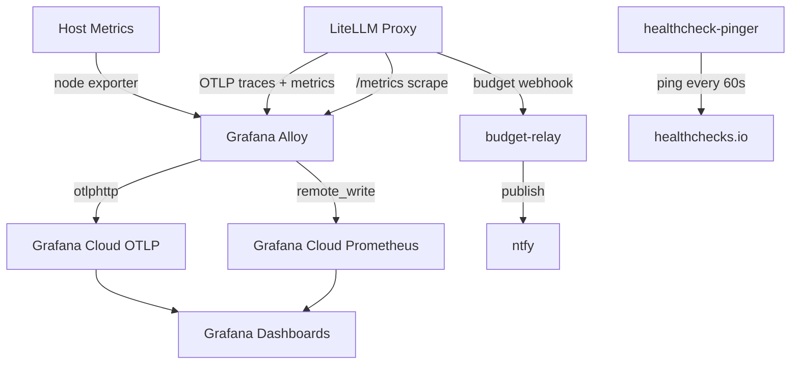
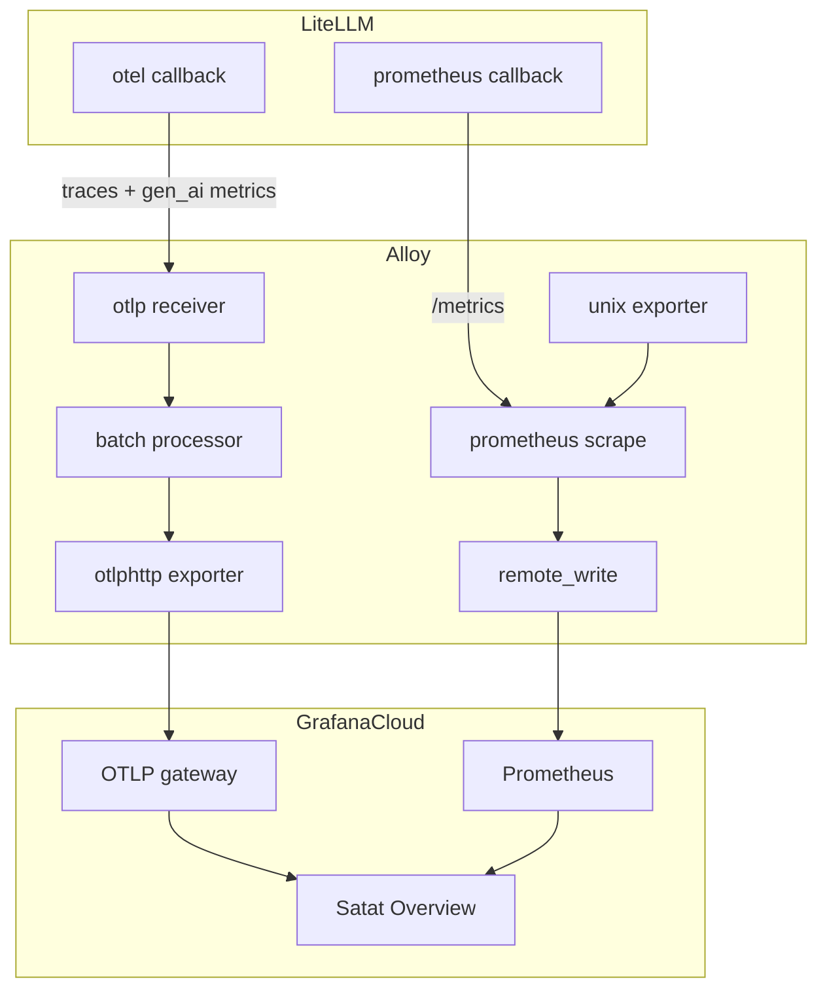
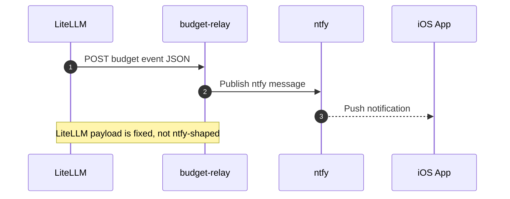

<!-- Generated by DeepWiki-Open d92819a with deepseek-v4.1-flash-1017 on 2026-10-19. Do not edit by hand; regenerate with `just wiki`. -->

[← Wiki index](index.md)

# Observability and Cost Tracking

<details>
<summary>Relevant source files</summary>

The following files were used as context for generating this wiki page:

- [observability/grafana/README.md](observability/grafana/README.md)
- [observability/grafana/satat-overview.json](observability/grafana/satat-overview.json)
- [gateway/alloy-config.alloy](gateway/alloy-config.alloy)
</details>

# Observability and Cost Tracking

Satat runs on a single AWS EC2 instance (`t4g.large`, 2 vCPU / 8 GB). Because running Prometheus and Grafana locally would consume RAM/CPU needed for the agent sandbox, observability is delegated to external services using a three-layer approach: **Grafana Cloud** for LLM metrics and VM health, **healthchecks.io** as a VM liveness dead-man switch, and **LiteLLM built-in alerting routed to ntfy** for budget/performance events. Observability is **outbound-only** — the VM pushes to Grafana Cloud and nothing scrapes inbound. Sources: [docs/adr/0015-monitoring.md:1-31](), [docs/adr/0019-ntfy-hosting-and-observability.md:1-53]()

Cost tracking is handled inside LiteLLM itself: a global `$SATAT_DAILY_BUDGET` (`max_budget` / `budget_duration: 1d`) caps daily spend, budget thresholds fire webhook alerts, and spend/token/request metrics are exported to Grafana Cloud for dashboards. Sources: [gateway/litellm-config.yaml.tmpl:1-36](), [docs/research/litellm-otlp-budget.md:1-59]()

## Architecture Overview

The telemetry pipeline has two independent ingest paths into a single Grafana Alloy container, plus two sidecar-based alerting paths.



The Alloy container receives **OTLP** (gRPC `4317` / HTTP `4318`) from LiteLLM for traces and GenAI metrics, and separately **scrapes** host metrics (`prometheus.exporter.unix`) and LiteLLM's Prometheus `/metrics` endpoint, remote-writing both to Grafana Cloud. Sources: [gateway/alloy-config.alloy:1-77](), [docs/adr/0019-ntfy-hosting-and-observability.md:39-67]()

## Component Breakdown

### Grafana Alloy

Alloy is configured by a static `gateway/alloy-config.alloy` that reads endpoints and credentials from the container environment via `sys.env`, so no templating is required. Sources: [docs/adr/0019-ntfy-hosting-and-observability.md:39-67]()

```alloy
otelcol.receiver.otlp "litellm" {
  grpc {
    endpoint = "0.0.0.0:4317"
  }
  http {
    endpoint = "0.0.0.0:4318"
  }

  output {
    metrics = [otelcol.processor.batch.default.input]
    traces  = [otelcol.processor.batch.default.input]
    logs    = [otelcol.processor.batch.default.input]
  }
}
```

Sources: [gateway/alloy-config.alloy:4-21]()

The pipeline components and their roles:

| Component | Purpose | Key Configuration |
|---|---|---|
| `otelcol.receiver.otlp "litellm"` | Receives OTLP gRPC/HTTP from LiteLLM | Binds `0.0.0.0:4317` and `0.0.0.0:4318` |
| `otelcol.processor.batch "default"` | Batches all signals before export | `timeout = "5s"`, `send_batch_size = 1000`, `send_batch_max_size = 2000` |
| `otelcol.exporter.otlphttp "grafana_cloud"` | Exports to Grafana Cloud OTLP gateway | `endpoint = sys.env("GRAFANA_CLOUD_OTLP_ENDPOINT")`, `compression = "gzip"` |
| `otelcol.auth.basic "grafana_cloud"` | Basic auth for OTLP gateway | `username` = instance ID, `password` = API key |
| `prometheus.exporter.unix "host"` | Embeds upstream `node_exporter` | `procfs_path = "/host/proc"`, `sysfs_path = "/host/sys"`, `rootfs_path = "/host/root"` |
| `prometheus.scrape "host"` | Scrapes host exporter | `targets = prometheus.exporter.unix.host.targets` |
| `prometheus.scrape "litellm"` | Scrapes LiteLLM `/metrics` | `targets = [{ __address__ = "litellm:4000" }]`, `bearer_token = sys.env("LITELLM_MASTER_KEY")` |
| `prometheus.remote_write "grafana_cloud"` | Remote-writes metrics to Grafana Cloud Prometheus | `url = sys.env("GRAFANA_CLOUD_PROM_URL")`, basic auth |

Sources: [gateway/alloy-config.alloy:23-77]()

A notable implementation detail: the pinned Alloy version (v1.20.1) only supports the deprecated top-level `username`/`password` form in `otelcol.auth.basic`; using `client_auth` causes the component to fail with `"no credential source provided"`. Sources: [gateway/alloy-config.alloy:36-42]()

### LiteLLM Instrumentation

LiteLLM enables both callbacks in `litellm_settings`:

```yaml
litellm_settings:
  # otel -> OTLP traces + GenAI metrics to Alloy; prometheus -> /metrics for Alloy to scrape.
  callbacks: ["otel", "prometheus"]
  # $10/day cap: budget alerts fire on the way to it (threshold_crossed at 85%/95%).
  max_budget: ${SATAT_DAILY_BUDGET}
  budget_duration: 1d
```

Sources: [gateway/litellm-config.yaml.tmpl:28-36]()

OTLP metrics are **off by default** and must be explicitly enabled with `LITELLM_OTEL_INTEGRATION_ENABLE_METRICS=true`. LiteLLM's operational metrics (spend, budgets, rate limits, deployment health) are **not** OTLP — they live on the proxy `/metrics` endpoint and arrive via `prometheus.scrape`. Sources: [docs/research/litellm-otlp-budget.md:1-59](), [docs/research/grafana-alloy-otlp.md:1-75]()

| Signal | Default | How to Enable |
|---|---|---|
| Traces (spans) | On when OTEL callback configured | `callbacks: ["otel"]` (v1) or `LITELLM_OTEL_V2=true` |
| Metrics (GenAI histograms) | Off | `LITELLM_OTEL_INTEGRATION_ENABLE_METRICS=true` |
| Logs/events (`gen_ai.content.*`) | Off | `LITELLM_OTEL_INTEGRATION_ENABLE_EVENTS=true` |
| Prometheus `/metrics` | Off | `callbacks: ["prometheus"]` (separate subsystem) |

Sources: [docs/research/litellm-otlp-budget.md:1-59]()

### Sidecars

Two sidecars support the observability story:

| Sidecar | Function | Configuration |
|---|---|---|
| `budget-relay` | Translates LiteLLM's fixed JSON budget-alert schema into ntfy notifications | `WEBHOOK_URL` points at `budget-relay:8080`; relay re-publishes to the ntfy topic |
| `healthcheck-pinger` | Curls the healthchecks.io `HEALTHCHECK_PING_URL` every 60s as a dead-man switch | `HEALTHCHECK_PING_URL` env var |

Sources: [docs/adr/0019-ntfy-hosting-and-observability.md:39-67](), [docs/adr/0015-monitoring.md:20-31]()

LiteLLM's `general_settings.alerting: ["webhook"]` sends budget events to `WEBHOOK_URL`, which is the relay rather than ntfy directly because the payload is not ntfy-shaped. Sources: [gateway/litellm-config.yaml.tmpl:18-26](), [docs/adr/0019-ntfy-hosting-and-observability.md:39-67]()

## Data Flow and Signals

The following diagram shows how each signal type traverses the stack.



Signal characteristics:

| Signal | Producer | Transport | Destination |
|---|---|---|---|
| GenAI traces | LiteLLM `otel` callback | OTLP gRPC/HTTP to Alloy | Grafana Cloud OTLP |
| GenAI metrics (`gen_ai.*`) | LiteLLM `otel` callback (metrics enabled) | OTLP to Alloy | Grafana Cloud OTLP |
| Operational metrics (`litellm_*`) | LiteLLM `prometheus` callback | `/metrics` scrape by Alloy | Grafana Cloud Prometheus |
| Host metrics (`node_*`) | `prometheus.exporter.unix` | Internal scrape | Grafana Cloud Prometheus |

Sources: [docs/research/grafana-alloy-otlp.md:1-75](), [gateway/alloy-config.alloy:44-77](), [observability/grafana/README.md:30-45]()

## Metrics Reference

### LiteLLM Metrics Used by Dashboards

| Metric | Used For |
|---|---|
| `litellm_spend_metric` | Spend range, spend rate by model, top models by spend |
| `litellm_proxy_total_requests_metric` | Requests (range), error-rate denominator |
| `litellm_total_tokens_metric` | Tokens (range), tokens by model |
| `litellm_proxy_failed_requests_metric` | Error rate (5m), failures by model |

Sources: [observability/grafana/satat-overview.json:24-74](), [observability/grafana/satat-overview.json:85-144]()

### Host Metrics

| Metric | Used For |
|---|---|
| `node_cpu_seconds_total{mode="idle"}` | VM CPU % |
| `node_memory_MemAvailable_bytes` / `node_memory_MemTotal_bytes` | VM memory % |
| `node_filesystem_avail_bytes` / `node_filesystem_size_bytes` | Disk-used % per mount |

Sources: [observability/grafana/satat-overview.json:66-92](), [observability/grafana/satat-overview.json:158-163]()

### OTLP GenAI Metrics

When OTLP metrics are enabled, LiteLLM emits GenAI semconv histograms: `gen_ai.client.operation.duration`, `gen_ai.client.token.usage`, `gen_ai.usage.cost`, `gen_ai.server.time_to_first_token`, `gen_ai.server.time_per_output_token`, and `gen_ai.client.response.duration`. Sources: [docs/research/litellm-otlp-budget.md:1-59]()

## Grafana Dashboard

`observability/grafana/satat-overview.json` defines a single dashboard, `uid: satat-overview`, titled **Satat Overview**. Dashboards are imported manually into Grafana Cloud (datasource `grafanacloud-prom`); there is no provisioning pipeline yet. Re-importing the same file updates the existing dashboard because the `uid` is stable. Sources: [observability/grafana/README.md:1-49](), [observability/grafana/satat-overview.json:1-39]()

### Panel Layout

| Section | Panels |
|---|---|
| At a glance | Spend (range), Requests (range), Tokens (range), Error rate (5m), VM CPU, VM Memory |
| Spend | Spend rate by model ($/hour), Top models by spend (range) table |
| Models & activity | Requests by model, p95 latency, Tokens by model, Failures by model |
| Host (VM) | CPU %, Memory %, Disk-used % per mount |

Sources: [observability/grafana/README.md:8-14](), [observability/grafana/satat-overview.json:24-92](), [observability/grafana/satat-overview.json:120-163]()

### Templating and Time Range

The dashboard defines a multi-select `model` template variable sourced from `label_values(litellm_spend_metric, model)`, with `includeAll: true` and `allValue: ".*"`. The default time range is `now-24h` to `now`, refreshed every `30s`. Sources: [observability/grafana/satat-overview.json:158-192]()

```json
{
  "name": "model",
  "label": "Model",
  "type": "query",
  "datasource": { "type": "prometheus", "uid": "grafanacloud-prom" },
  "definition": "label_values(litellm_spend_metric, model)",
  "includeAll": true,
  "allValue": ".*",
  "multi": true,
  "refresh": 2,
  "sort": 1
}
```

Sources: [observability/grafana/satat-overview.json:166-185]()

### Import and Re-export Workflow

1. Grafana → **Dashboards → New → Import**.
2. Upload `satat-overview.json`.
3. Select datasource **`grafanacloud-prom`**.
4. **Import** — the `uid` ensures updates rather than duplicates.

To re-export: edit in the Grafana UI, then **Dashboard settings → JSON model → copy**, paste into `satat-overview.json`, and commit while keeping `uid` and `title` unchanged. Sources: [observability/grafana/README.md:18-31]()

## Cost Tracking and Budgets

Cost control is implemented in LiteLLM configuration rather than in a separate billing system. The global daily cap is set with `max_budget` and `budget_duration`:

```yaml
litellm_settings:
  max_budget: ${SATAT_DAILY_BUDGET}
  budget_duration: 1d
```

Sources: [gateway/litellm-config.yaml.tmpl:28-36]()

A `1d` budget duration is valid and resets at midnight in the configured timezone (default UTC). Budget events fire thresholds (`threshold_crossed` at 85%/95%) on the way to the cap, in addition to `soft_budget_crossed` and `budget_crossed`. Sources: [docs/research/litellm-otlp-budget.md:93-172](), [docs/adr/0015-monitoring.md:20-31]()

Budget gauges are available on the Prometheus `/metrics` endpoint, including `litellm_team_max_budget_metric`, `litellm_remaining_team_budget_metric`, `litellm_api_key_max_budget_metric`, and `litellm_remaining_api_key_budget_metric`. `prometheus_initialize_budget_metrics: true` emits them without traffic. Sources: [docs/research/litellm-otlp-budget.md:93-123]()

Spend visualization relies on `litellm_spend_metric`:

```promql
# Spend (range)
sum(increase(litellm_spend_metric[$__range]))

# Spend rate by model ($/hour)
sum by (model) (rate(litellm_spend_metric{model=~"$model"}[$__rate_interval])) * 3600
```

Sources: [observability/grafana/satat-overview.json:24-33](), [observability/grafana/satat-overview.json:78-86]()

## Alerting

Alerting is split across three destinations, each covering a different failure mode.

| Layer | Mechanism | Trigger | Destination |
|---|---|---|---|
| Budget/spend | LiteLLM `general_settings.alerting: ["webhook"]` → `WEBHOOK_URL` | `soft_budget_crossed`, `budget_crossed`, `threshold_crossed` | `budget-relay` → ntfy topic |
| VM liveness | `healthcheck-pinger` sidecar | Missed 60s ping | healthchecks.io notification channels |
| Deploy failure | Deploy workflow `if: failure()` step | Failed deployment | ntfy topic |

Sources: [docs/adr/0015-monitoring.md:20-31](), [docs/adr/0019-ntfy-hosting-and-observability.md:39-67]()



Sources: [docs/adr/0019-ntfy-hosting-and-observability.md:39-67](), [gateway/litellm-config.yaml.tmpl:18-26]()

The relay exists because LiteLLM posts a **fixed JSON budget-alert schema** that is not ntfy-shaped; the relay translates it into ntfy notifications. Sources: [docs/adr/0015-monitoring.md:20-31](), [docs/adr/0019-ntfy-hosting-and-observability.md:39-67]()

## Configuration Reference

### Alloy Environment Variables

| Variable | Used By | Purpose |
|---|---|---|
| `GRAFANA_CLOUD_OTLP_ENDPOINT` | `otelcol.exporter.otlphttp` | Base OTLP gateway URL |
| `GRAFANA_CLOUD_OTLP_USERNAME` | `otelcol.auth.basic` | Numeric OTLP instance ID |
| `GRAFANA_CLOUD_API_KEY` | OTLP auth + remote_write | Cloud Access Policy token |
| `GRAFANA_CLOUD_PROM_URL` | `prometheus.remote_write` | Prometheus remote-write URL |
| `GRAFANA_CLOUD_PROM_USERNAME` | `prometheus.remote_write` | Prometheus instance ID |
| `LITELLM_MASTER_KEY` | `prometheus.scrape "litellm"` | Bearer token for `/metrics` |

Sources: [gateway/alloy-config.alloy:29-77]()

### LiteLLM OTLP Environment Variables

| Variable | Alias | Default | Purpose |
|---|---|---|---|
| `OTEL_EXPORTER` | `OTEL_EXPORTER_OTLP_PROTOCOL` | `console` | Exporter type (`otlp_http`, `otlp_grpc`, etc.) |
| `OTEL_ENDPOINT` | `OTEL_EXPORTER_OTLP_ENDPOINT` | none | OTLP endpoint URL |
| `OTEL_HEADERS` | `OTEL_EXPORTER_OTLP_HEADERS` | none | `key=value` header pairs |
| `OTEL_SERVICE_NAME` | — | `litellm` | `service.name` resource attribute |
| `LITELLM_OTEL_INTEGRATION_ENABLE_METRICS` | — | `false` | Enable OTLP metrics |
| `LITELLM_OTEL_INTEGRATION_ENABLE_EVENTS` | — | `false` | Enable OTLP semantic logs |
| `LITELLM_OTEL_V2` | — | `false` | Opt into newer OTel v2 integration |
| `SSL_CERT_FILE` | — | — | CA bundle for `otlp_http` |

Sources: [docs/research/litellm-otlp-budget.md:46-59]()

### LiteLLM Budget Configuration Keys

| Key | Scope | Notes |
|---|---|---|
| `max_budget` | `litellm_settings` or key/team/user | Float USD; `0`/unset = no cap |
| `budget_duration` | Same scopes | `"30s"`, `"30m"`, `"30h"`, `"30d"`; `"1d"` resets at midnight |
| `budget_limits` | Key API | Multiple concurrent windows (e.g. `$10/day` and `$100/month`) |
| `soft_budget` | Key/team | Alerts without blocking |
| `timezone` | `litellm_settings` | IANA timezone for resets (default UTC) |
| `alerting` | `general_settings` | Destinations: `slack`, `email`, `webhook`, `ms_teams` |
| `alerting_threshold` | `general_settings` | Seconds threshold for hanging/slow request alerts |

Sources: [docs/research/litellm-otlp-budget.md:93-172]()

## Known Gaps and Tradeoffs

- **Issue/PR-level attribution is not available yet.** Activity panels reflect LLM traffic only. T8 plans to tag requests with issue metadata via LiteLLM `custom_prometheus_metadata_labels`; a "current issues" panel can be added then. Sources: [observability/grafana/README.md:45-49]()
- **No provisioning pipeline for dashboards.** They are imported manually into Grafana Cloud. Sources: [observability/grafana/README.md:1-6]()
- **Outbound-only observability.** The VM pushes to Grafana Cloud; nothing scrapes inbound. Sources: [docs/adr/0019-ntfy-hosting-and-observability.md:39-67]()
- **Alloy overhead.** Roughly ~50 MB RAM on the VM, acceptable on 8 GB. Sources: [docs/adr/0015-monitoring.md:48-55]()
- **Rejected local Prometheus/Grafana** because it would consume ~500 MB+ RAM intended for agent sandboxes. Sources: [docs/adr/0015-monitoring.md:34-46]()
- **ntfy privacy** is only as strong as the topic name over HTTPS; stronger ACL auth can be added later without changing topology. Sources: [docs/adr/0019-ntfy-hosting-and-observability.md:55-67]()

## Summary

Satat's observability stack is deliberately lightweight: a single Grafana Alloy container handles both OTLP ingestion from LiteLLM and Prometheus scraping of host and proxy metrics, forwarding everything to Grafana Cloud. Cost tracking lives in LiteLLM via a global `$10/day` budget plus spend/token/request metrics visualized in the `satat-overview` dashboard. Alerting is covered by three complementary paths — LiteLLM budget webhooks through `budget-relay` to ntfy, a `healthcheck-pinger` dead-man switch to healthchecks.io, and deploy-failure notifications to ntfy. Sources: [docs/adr/0015-monitoring.md:1-31](), [gateway/alloy-config.alloy:1-77](), [observability/grafana/README.md:1-49](), [docs/adr/0019-ntfy-hosting-and-observability.md:1-67]()

## Related pages

- [LLM Gateway and Model Routing](page-9.md)
- [Deployment and Infrastructure](page-10.md)
