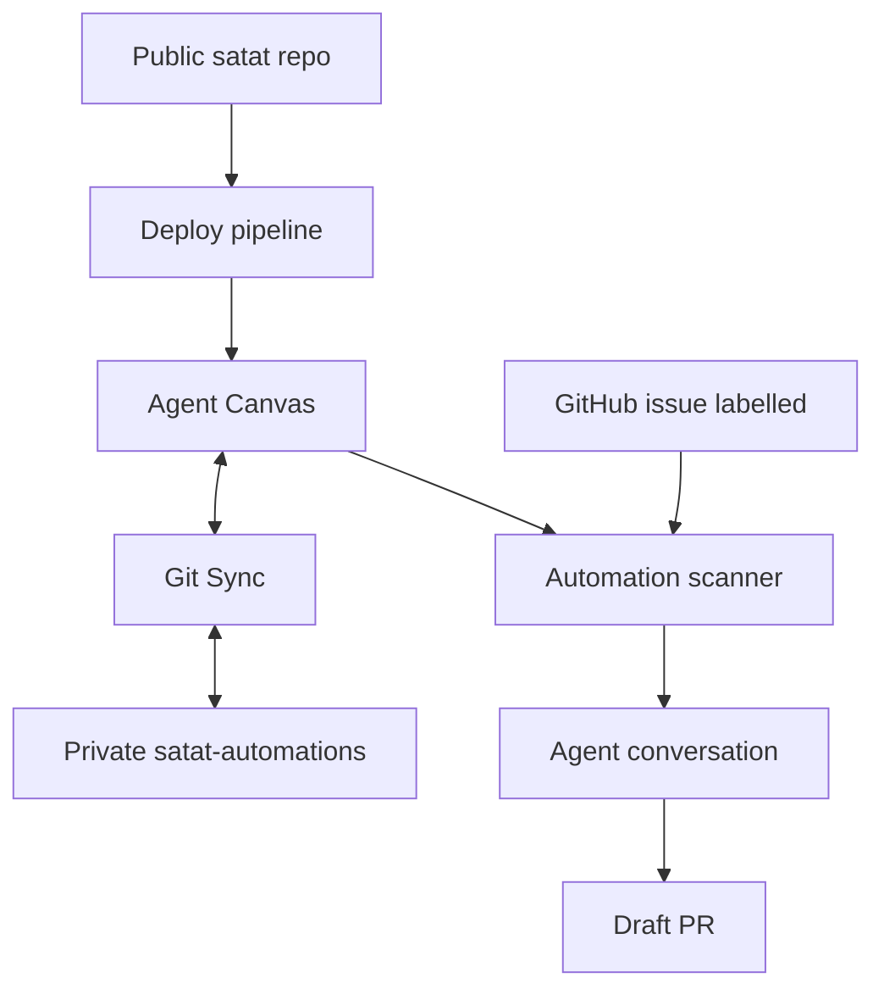
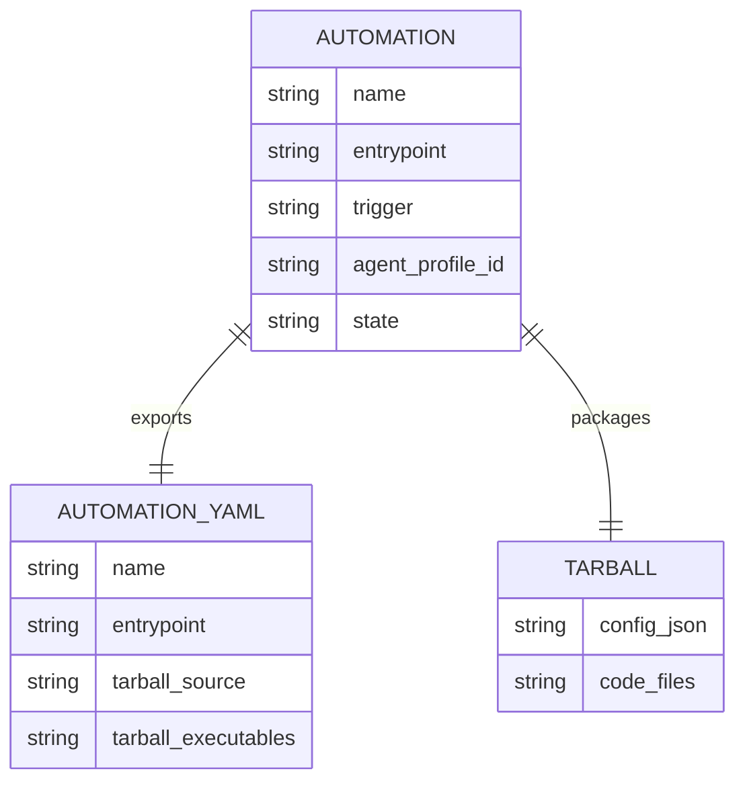
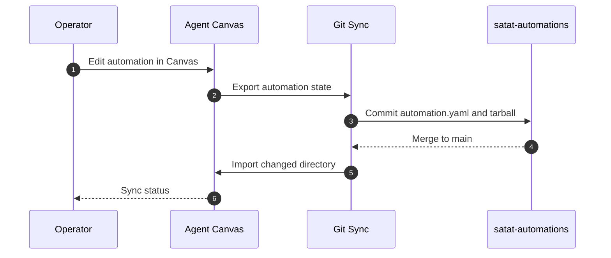
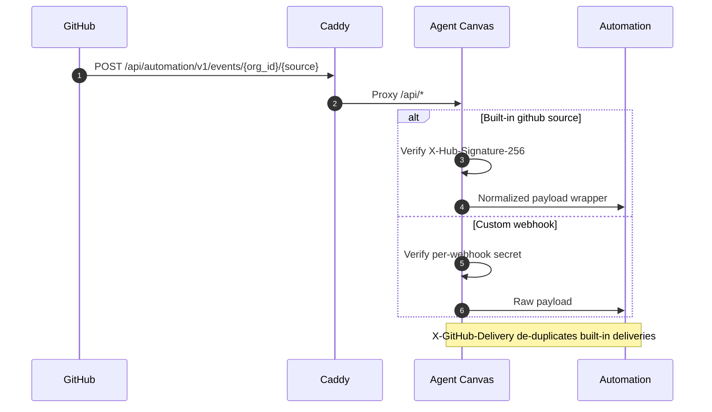
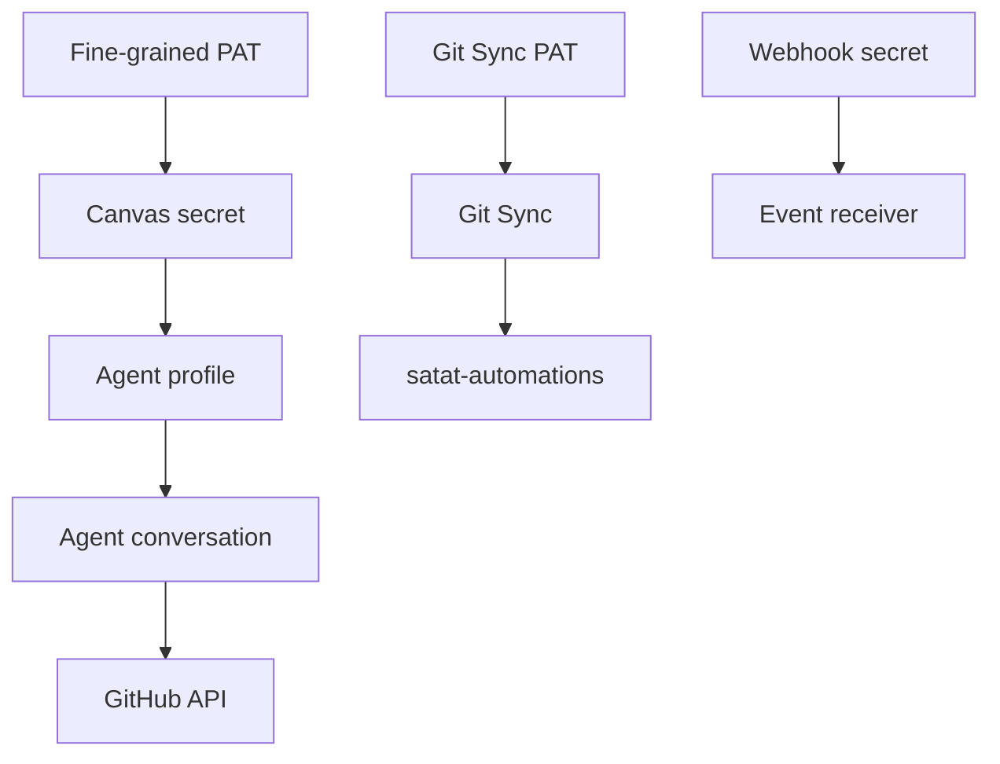
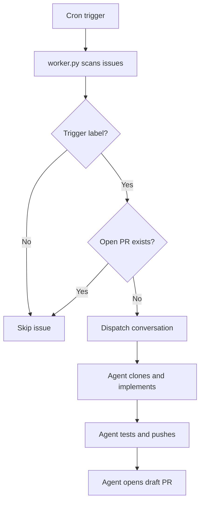
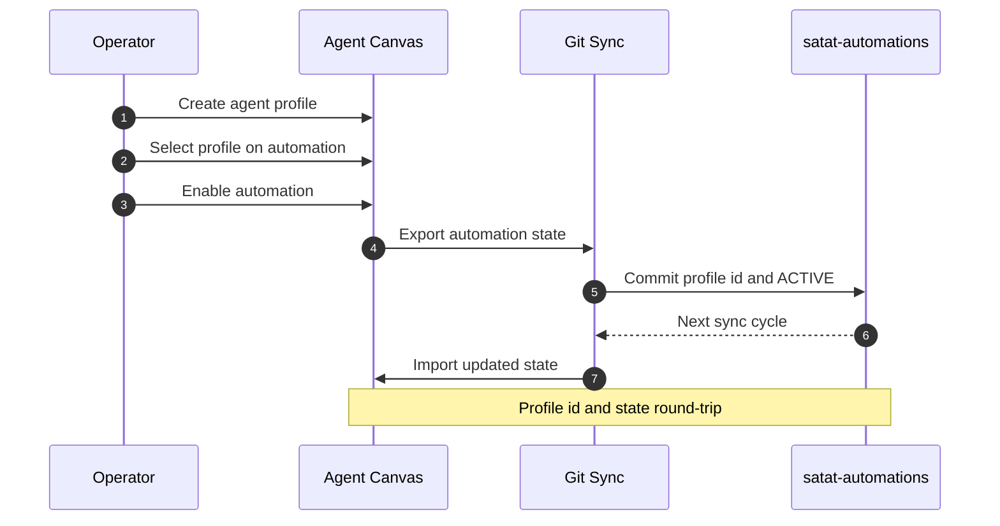

<!-- Generated by DeepWiki-Open d92819a with deepseek-v4.1-flash-1017 on 2026-10-19. Do not edit by hand; regenerate with `just wiki`. -->

[← Wiki index](index.md)

# Extensibility and Automation Configuration

<details>
<summary>Relevant source files</summary>

The following files were used as context for generating this wiki page:

- [docs/adr/0020-automation-definition-auth-trigger.md](docs/adr/0020-automation-definition-auth-trigger.md)
- [CONTEXT.md](CONTEXT.md)
- [docs/adr/0007-two-repo-split.md](docs/adr/0007-two-repo-split.md)
</details>

# Extensibility and Automation Configuration

Satat's automation layer is built on OpenHands Agent Canvas. An automation is not a declarative prompt document; it is a code tarball plus metadata, stored in a private Git repository and synchronized bidirectionally with Canvas through Git Sync. The shipped automation watches `javatarz/satat` for issues labelled `ready-for-agent`, implements each in a Docker sandbox, and opens a draft PR on a `satat/issue-N` branch. Extensibility therefore comes from three places: the automation bundle itself, the trigger and webhook surface, and the Git Sync configuration that makes automation definitions reviewable as code. Sources: [docs/research/agent-automation.md:1-18](), [docs/adr/0020-automation-definition-auth-trigger.md:1-18]()

## Two-Repo Split

Satat separates the public infrastructure recipe from private automation configuration. The public `satat` repository contains Terraform, cloud-init, service configs, CI, and documentation. The private `satat-automations` repository contains the Git-Sync'd automation YAML and tarball files that define which repositories Satat watches, under which labels, with which prompts. This keeps repository-specific configuration out of the public showcase while still allowing the infrastructure setup to be reproduced. Sources: [docs/adr/0007-two-repo-split.md:1-4]()

| Repository | Visibility | Contents | Role |
|---|---|---|---|
| `satat` | Public | Terraform, cloud-init, service configs, CI, documentation | Infrastructure recipe |
| `satat-automations` | Private | `satat-issue-to-pr/automation.yaml`, `satat-issue-to-pr/tarball/`, `config.json` | Automation definitions and deployment settings |

The automation definition lives in `satat-automations` as `satat-issue-to-pr/automation.yaml` plus `satat-issue-to-pr/tarball/`. Editing the automation is a reviewed PR in that repository; Canvas imports it on the next sync cycle. Sources: [docs/adr/0020-automation-definition-auth-trigger.md:28-44]()



The public repository deploys Canvas; Canvas synchronizes automation definitions with the private repository; the automation scanner then consumes GitHub issues and dispatches agent conversations that produce draft PRs. Sources: [docs/adr/0007-two-repo-split.md:1-4](), [docs/adr/0020-automation-definition-auth-trigger.md:28-44](), [docs/research/agent-automation.md:96-135]()

## Automation Data Model

The automation database model in the OpenHands automation service contains `name`, `trigger`, `tarball_path`, `entrypoint`, `setup_script_path`, `timeout`, `keep_alive`, `model`, `agent_profile_id`, `prompt`, `preset_metadata`, `state`, and `observability_associations`. The Git-synced `automation.yaml` exposes a related but distinct set of fields, including `enabled`, `tarball_source`, and `tarball_executables`. Sources: [docs/research/agent-automation.md:13-27]()



### `automation.yaml` Fields

| Field | Required | Purpose |
|---|---|---|
| `name` | Yes | Automation identity; import fails without it |
| `entrypoint` | Yes | Command executed by the automation runtime |
| `trigger` | No | Cron or event trigger definition |
| `model` | No | Model selection metadata |
| `agent_profile_id` | No | Agent Server profile UUID; required for dispatcher-based bundles to run |
| `observability_associations` | No | Observability linkage |
| `setup_script_path` | No | Optional setup script |
| `timeout` | No | Execution timeout |
| `keep_alive` | No | Runtime keep-alive setting |
| `enabled` | No | Enabled flag |
| `state` | No | Lifecycle state, for example `INACTIVE` or `ACTIVE` |
| `prompt` | No | Prompt metadata |
| `preset_metadata` | No | Preset metadata |
| `tarball_source` | No | External tarball source, used only when `tarball/` is absent |
| `tarball_executables` | No | Executable file list, emitted only when something is executable |

Sources: [docs/research/agent-automation.md:20-30]()

### Import Rules

- `name` and `entrypoint` are required; every other field is optional.
- An internal tarball is rebuilt from `tarball/**` and stored as a fresh upload. `tarball_source` matters only when `tarball/` is absent.
- Importing a new directory needs an owner. In local mode that is the deterministic local identity, but only once the organization's Git Sync config has been saved; otherwise the directory is skipped with a warning.
- `agent_profile_id` is validated only when set. With it `null`, the API layer accepts the record, but a dispatcher-based bundle cannot run because the entrypoint reads `AUTOMATION_AGENT_PROFILE_ID`, and the dispatcher injects that environment variable only when `automation.agent_profile_id` is truthy.
- A malformed `automation.yaml` skips only that directory; the sync cycle continues.

Sources: [docs/research/agent-automation.md:32-41]()

## Git Sync Configuration

On a self-hosted Agent Canvas, the Automation Server runs in local mode because `agent_server_url` is set to `http://127.0.0.1:18000` in the all-in-one container. Git Sync is therefore configured by environment variables rather than a committed configuration file. Sources: [docs/adr/0012-git-sync-automations.md:9-14]()

| Environment Variable | Purpose | Example or Default |
|---|---|---|
| `AUTOMATION_GIT_SYNC_REPO_URL` | Repository URL | `https://github.com/javatarz/satat-automations.git` |
| `AUTOMATION_GIT_SYNC_BRANCH` | Branch to sync | `main` |
| `AUTOMATION_GIT_SYNC_PATH` | Path inside repository | `automations` |
| `AUTOMATION_GIT_SYNC_TOKEN` | HTTPS PAT with read and write contents | No SSH or GitHub App field |
| `AUTOMATION_GIT_SYNC_AUTHOR_NAME` | Commit author name | `Satat` |
| `AUTOMATION_GIT_SYNC_AUTHOR_EMAIL` | Commit author email | `satat@karun.me` |
| `AUTOMATION_GIT_SYNC_LOCAL_WORKDIR` | Checkout working directory | Empty default |
| `AUTOMATION_GIT_SYNC_GIT_TIMEOUT_SECONDS` | Per-git-command timeout | `60` |
| `AUTOMATION_GIT_SYNC_SECRET` | Wraps per-organization token or encryption key at rest | Empty default |

Sources: [docs/adr/0012-git-sync-automations.md:14-24](), [docs/research/agent-canvas-git-sync.md:70-79]()

The sync interval has no environment variable. `git_sync_interval_seconds` is runtime-only, defaults to `0` meaning manual or "Sync now", and is set through the API or Canvas UI. This is why the earlier `gateway/canvas-config.yaml.tmpl` approach was dropped: there is no config file, only environment variables plus a runtime API call. Sources: [docs/adr/0012-git-sync-automations.md:22-27](), [docs/research/agent-canvas-git-sync.md:80-82]()

### Git Sync API

All Automation Server routes mount under `/api/automation`, so externally the Git Sync endpoints are:

| Method | Endpoint | Purpose |
|---|---|---|
| `GET` | `/api/automation/v1/git-sync/status` | Read sync status |
| `PUT` | `/api/automation/v1/git-sync/config` | Configure `enabled`, `interval_seconds`, `repo_url`, `branch`, `path`, `token`, `author_name`, `author_email`, `encryption_key` |
| `POST` | `/api/automation/v1/git-sync/check` | Trigger a sync check |
| `POST` | `/api/automation/v1/events/{org_id}/{source}` | Receive inbound events |
| `POST` | `/api/automation/v1/webhooks` | Register a custom webhook |

Sources: [docs/research/agent-canvas-git-sync.md:82-99](), [docs/research/agent-automation.md:60-80]()

The `PUT` endpoint requires an authenticated user with manage-automations permission. The `interval_seconds` field uses `0` for manual synchronization. Sources: [docs/research/agent-canvas-git-sync.md:86-93]()

### Repository Layout

Git Sync stores each automation as a directory under the configured sync path:

```text
automations/
└── <slug>/
    ├── automation.yaml
    └── tarball/**
```

The tarball is expanded under `tarball/` so Git shows meaningful diffs rather than an opaque archive. Import validation skips invalid directories and logs the error instead of applying a partial configuration. Sources: [docs/research/agent-automation.md:20-27](), [docs/research/agent-canvas-git-sync.md:101-113]()



Canvas exports edits to the private repository; merged changes are imported back into Canvas on the next cycle. Sources: [docs/adr/0012-git-sync-automations.md:1-7](), [docs/research/agent-canvas-git-sync.md:101-113]()

## Triggers

Triggers are a discriminated union with two shapes: cron and event. Event keys use the form `{event_type}.{action}`, such as `issues.labeled`, `pull_request.opened`, or `push`, and wildcards such as `pull_request.*` are allowed. The event `filter` is a JMESPath expression over the raw webhook payload with custom functions `contains`, `glob`, `icontains`, `regex`, `starts_with`, `ends_with`, `lower`, and `upper`. Sources: [docs/research/agent-automation.md:60-75]()

| Trigger Type | Schema | Example |
|---|---|---|
| Cron | `{"type": "cron", "schedule": "*/15 * * * *", "timezone": "UTC"}` | Every 15 minutes |
| Event | `{"type": "event", "source": "github", "on": "issues.labeled", "filter": "<JMESPath>"}` | Issue labelled event with a JMESPath filter |

Sources: [docs/research/agent-automation.md:60-69]()

The shipped `satat-issue-to-pr` automation is cron-polled every 15 minutes, which is the catalog default. The webhook endpoint and `AUTOMATION_WEBHOOK_SECRET` are still wired so that a later event-driven automation can use them without further infrastructure. Sources: [docs/adr/0020-automation-definition-auth-trigger.md:58-70]()

## Inbound GitHub Events

The receiver is `POST /api/automation/v1/events/{org_id}/{source}`. Two paths reach it: the built-in `github` source and a custom webhook. Sources: [docs/research/agent-automation.md:60-80]()

The built-in `github` source expects the body that the OpenHands server forwards, a normalized `{"payload": <github payload>}` wrapper, not a raw GitHub delivery. Its signature is HMAC-SHA256 in `X-Hub-Signature-256`, verified against the shared `AUTOMATION_WEBHOOK_SECRET`, and `X-GitHub-Delivery` de-duplicates deliveries. On self-hosted Canvas nothing forwards that wrapper, so this path is intended for OpenHands Cloud or enterprise. Sources: [docs/research/agent-automation.md:70-80]()

A custom webhook registered via `POST /api/automation/v1/webhooks` accepts the raw payload with a per-webhook `webhook_secret` and a configurable `signature_header`, for GitHub `X-Hub-Signature-256`. This is the viable self-hosted path for raw GitHub webhooks. Sources: [docs/research/agent-automation.md:78-85]()



Both paths sit under `/api/*`, which Caddy proxies to `canvas:8000` without oauth2-proxy. The `{org_id}` segment means an automation server's organization UUID must be in the URL. A separate `/webhook` route is unnecessary and would 404 because the Canvas ingress only routes `/api/automation/*`, and GitHub does not follow redirects. Sources: [docs/research/agent-automation.md:80-85](), [docs/adr/0020-automation-definition-auth-trigger.md:62-70]()

## GitHub Identity and Secrets

Agent Canvas has no self-hosted GitHub App support. `GITHUB_APP_ID` and `GITHUB_APP_PRIVATE_KEY` appear only in OpenHands Cloud and enterprise charts. The open-source automation service and its bundles authenticate with a saved Agent Server secret, by convention `GITHUB_PERSONAL_ACCESS_TOKEN`, read via `GET /api/settings/secrets/<name>`. This is the same reversal recorded for `AUTOMATION_GIT_SYNC_TOKEN`. Sources: [docs/research/agent-automation.md:86-95]()

| Secret or Setting | Stored In | Consumer | Notes |
|---|---|---|---|
| `GITHUB_PERSONAL_ACCESS_TOKEN` | Canvas Settings → Secrets, attached to agent profile | Agent conversation | Fine-grained PAT scoped to the target repository |
| `AUTOMATION_GIT_SYNC_TOKEN` | Environment variable | Git Sync | HTTPS PAT with read and write contents |
| `AUTOMATION_WEBHOOK_SECRET` | Environment variable from `WEBHOOK_SECRET` GitHub secret | Inbound event receiver | Wired but currently inert |
| `OH_SECRET_KEY` | Environment variable from a GitHub secret | Settings and secrets encryption | Required by Canvas |
| `LOCAL_BACKEND_API_KEY` | Environment variable | Canvas backend | Mapped from the `CANVAS_API_KEY` GitHub secret in compose |

Sources: [docs/adr/0020-automation-definition-auth-trigger.md:41-46](), [docs/adr/0012-git-sync-automations.md:14-20](), [docs/research/agent-canvas-git-sync.md:115-127]()

The PAT is scoped to the target repository with Contents read-write, Pull Requests read-write, Issues read-write, and Metadata read-only. It is never a value in the public repository or in `satat-automations`. Sources: [docs/adr/0020-automation-definition-auth-trigger.md:41-46]()



The agent profile supplies the model, tools, and secrets that each conversation receives. `agent_conversation.py` calls `workspace.get_secrets(agent_profile_id=...)`, so `GITHUB_PERSONAL_ACCESS_TOKEN` must be attached to that profile. The bundle's own `AGENT_SECRET_NAMES` allow-list belongs to the older `main.py` flow and is not what the shipped entrypoint uses. Sources: [docs/research/agent-automation.md:105-118]()

## The Pre-Built Issue-to-PR Bundle

The OpenHands extensions catalog declares `github-issue-to-pr` as a bundle automation, version `1.2.2`. The bundle contains `worker.py`, `main.py`, `github_client.py`, and `agent_conversation.py`; its entrypoint is `python3 worker.py` and its timeout is `300`. There is no setup script because the tarball runs in an environment that already has the OpenHands SDK. Sources: [docs/research/agent-automation.md:96-105]()

| Manifest Property | Value |
|---|---|
| Bundle files | `worker.py`, `main.py`, `github_client.py`, `agent_conversation.py` |
| Entrypoint | `python3 worker.py` |
| Timeout | `300` |
| Setup script | None |
| Catalog trigger | Cron, default `*/15 * * * *` |
| Version | `1.2.2` |

Sources: [docs/research/agent-automation.md:96-108]()

`worker.py` is an idempotent scanner. It lists open issues carrying the trigger label, skips any with an open `satat/issue-N` PR, and delegates each ready issue to an agent conversation via `AgentConversationDispatcher`. The agent clones, branches, implements, tests, pushes, and opens the draft PR itself. The scanner does not poll for completion, so it works under either trigger. Sources: [docs/research/agent-automation.md:104-112]()



### `config.json` Keys

The host packs the bundle files plus a rendered `config.json` and uploads the tarball. The bundle reads the following keys:

| Key | Purpose |
|---|---|
| `repos` | List of `owner/repo` targets |
| `trigger_label` | Label that marks an issue as ready |
| `branch_prefix` | Branch naming prefix, for example `satat/issue` |
| `pull_request_mode` | `draft` or `ready` |
| `max_new_per_run` | Maximum new issues processed per run |
| `agent_secret_names` | Secret allow-list for the older `main.py` flow |
| `openhands_url` | OpenHands endpoint |
| `github_token_secret` | Secret name for the GitHub token |
| `repository` | Optional single repository override |
| `base_branch` | Optional base branch |
| `review_label` | Optional review label |

Sources: [docs/research/agent-automation.md:119-128]()

The deployment settings in `satat-automations` include `repos: [javatarz/satat]`, `trigger_label: ready-for-agent`, `branch_prefix: satat/issue`, and `pull_request_mode: draft`. Sources: [docs/adr/0020-automation-definition-auth-trigger.md:33-38]()

## Staged Activation

The bundle's dispatcher requires an agent profile id because it reads `AUTOMATION_AGENT_PROFILE_ID`, and the service injects that variable only when `automation.agent_profile_id` is set. That id belongs to the Agent Server and cannot be authored in Git. The committed automation is therefore `state: INACTIVE` with `agent_profile_id: null`. Sources: [docs/adr/0020-automation-definition-auth-trigger.md:47-56]()

Activation is a manual Canvas step:

1. Create the agent profile in Canvas.
2. Select the profile on the automation.
3. Enable the automation.
4. Let Git Sync export `agent_profile_id` and `state: ACTIVE` back to `satat-automations`.

Sources: [docs/adr/0020-automation-definition-auth-trigger.md:47-56](), [docs/research/agent-automation.md:149-153]()



The committed automation remains disabled until this operator step is complete. Sources: [docs/adr/0020-automation-definition-auth-trigger.md:47-56]()

## Extensibility Paths and Constraints

Satat's platform requirements define the broader extensibility target: workflows as declarative files, repositories opting in to shared workflows with per-repo settings, cron and event and manual triggers, and every infrastructure dependency behind a plugin interface with a local implementation and a cloud or Kubernetes implementation. Sources: [docs/research/v2/platform-requirements.md:50-76]()

| Requirement | Satat Expectation | OpenHands Assessment |
|---|---|---|
| Workflows as code | Declarative, versioned, reviewable workflow graphs | Fail: single-step automations |
| Repos opt in to shared workflows | Shared workflow definition plus per-repo config | Fail |
| Triggers | Cron, events, manual dispatch | Pass |
| Every infrastructure dependency a plugin | Runtime, queue, state store, secret store, ingress, notifications, observability, model router, issue tracker | Partial: runtime and state have options; no tracker, notification, or secret-store plugin points |
| Security posture | Least privilege, no host access, no container socket, restricted egress | Partial: Docker mode drops capabilities and avoids socket exposure, but has no egress restriction |
| Self-hosted license | Public recipe allowed | Pass: MIT throughout the OSS stack |

Sources: [docs/research/v2/platform-requirements.md:50-76](), [docs/research/v2/notes/platforms-full.md:190-223]()

This assessment positions OpenHands as the harness adapter and workload runtime layer rather than the whole platform. Satat would build intake, scheduling, workflows-as-code, and the backlog control plane around it, calling agent-server or sandbox-server through their APIs. Sources: [docs/research/v2/notes/platforms-full.md:215-223]()

### Future Event Intake Options

If Satat later needs richer webhook intake than the built-in Canvas receiver, the research notes evaluate several self-hosted options:

| Option | Fit | Constraint |
|---|---|---|
| Convoy | Pass with Docker, Postgres, Redis | Adds services; removes buffering, dedupe, and replay code |
| n8n | Pass with caveat | Adds a full automation platform to run and upgrade |
| Activepieces | Pass | Adds a platform; per-piece polling versus webhook behavior is UNVERIFIED |
| Windmill | Pass | Heavy: a second workflow engine |
| Kestra | Pass | Heavy JVM service; weak webhook authentication with no HMAC |
| Trigger.dev | Best feature fit | Private beta; self-hosted webhooks gated by the vendor |
| Argo Events | Fail | Kubernetes CRDs only |
| Knative Eventing | Fail | Kubernetes only |

Sources: [docs/research/v2/notes/intake-platforms.md:48-64](), [docs/research/v2/notes/intake-platforms.md:240-271]()

## Decisions and Deferred Work

| Decision | Effect |
|---|---|
| Old `automations/satat-automation.yaml.tmpl` shape dropped | It was never a real schema; the automation lives in `satat-automations` |
| Fine-grained PAT instead of GitHub App | Supersedes ADR 0006 for this automation |
| Cron-polled instead of webhook-triggered | Supersedes ADR 0010 for this automation; webhook endpoint remains wired |
| Model, sandbox, and profile are Agent Server settings | Configured in Canvas, not in this repository or `automation.yaml` |
| `WEBHOOK_SECRET` passed as `AUTOMATION_WEBHOOK_SECRET` | Inert until an event-triggered automation exists |
| `GITHUB_APP_ID`, `GITHUB_APP_PRIVATE_KEY`, `TARGET_REPOSITORY`, `TARGET_USER` retired | Nothing consumes them; equivalent values live in `config.json` and Canvas secrets |

Sources: [docs/research/agent-automation.md:130-150](), [docs/adr/0020-automation-definition-auth-trigger.md:78-98]()

Two issue #27 acceptance bullets are deliberately deferred rather than silently dropped: the init-message additions for story-refinement and oracle questions plus the CI-round cap of 3 belong with story-refinement and hooks work, and ntfy notifications on agent start, finish, PR, and stuck are a follow-up because the bundle emits none. Sources: [docs/research/agent-automation.md:145-150](), [docs/adr/0020-automation-definition-auth-trigger.md:88-94]()

Open items remain around whether a future story-refinement or review automation uses an event trigger, in which case the webhook secret becomes load-bearing, or a custom webhook source. Selecting the agent profile also remains a mandatory manual Canvas step whose result Git Sync exports back to `satat-automations`. Sources: [docs/research/agent-automation.md:149-163]()

## Summary

Extensibility in Satat is configuration-driven: automation definitions are code bundles with metadata, synchronized through Git Sync from a private repository, authenticated with scoped PATs, and triggered by cron today with a wired webhook path for future event-driven automations. The two-repo split keeps the public infrastructure recipe reproducible while private repository names, labels, and prompts stay out of the public repository. The main constraints are that OpenHands automations are single-step, that the agent profile must be selected manually in Canvas, and that workflow-as-code and plugin-based infrastructure remain platform-level gaps to build around the harness and runtime. Sources: [docs/adr/0007-two-repo-split.md:1-4](), [docs/adr/0012-git-sync-automations.md:1-7](), [docs/adr/0020-automation-definition-auth-trigger.md:1-18](), [docs/research/v2/notes/platforms-full.md:190-223]()

## Related pages

- [Repository Layout, Docs, and Two-Repo Split](page-2.md)
- [Issue-to-PR Automation Pipeline](page-7.md)
- [Intake and Triggering](page-8.md)
