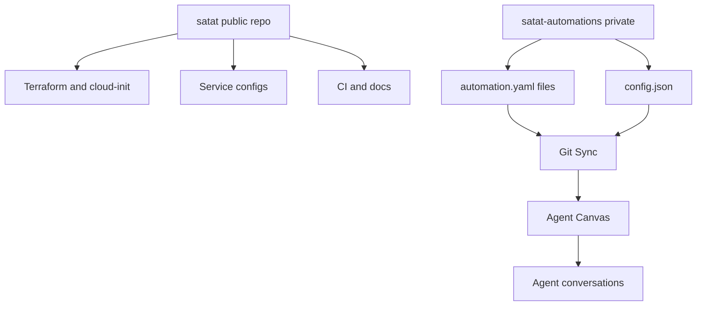
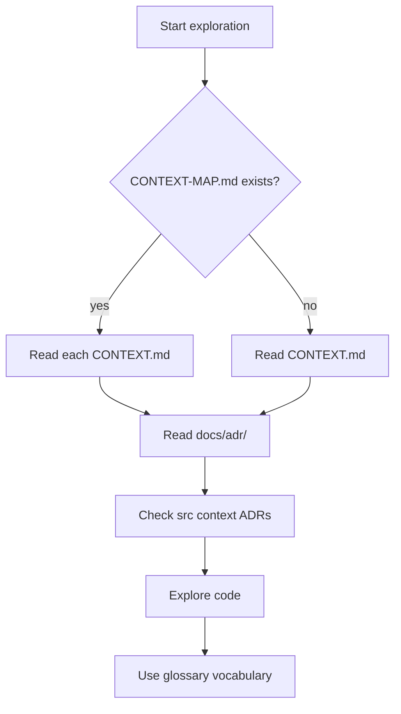
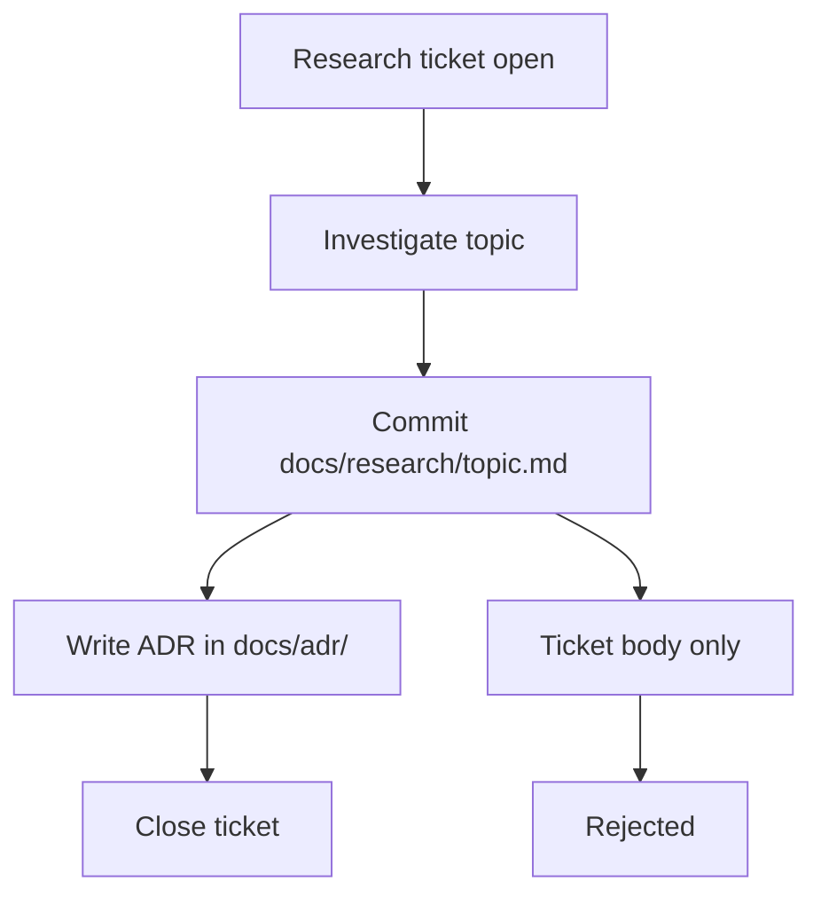
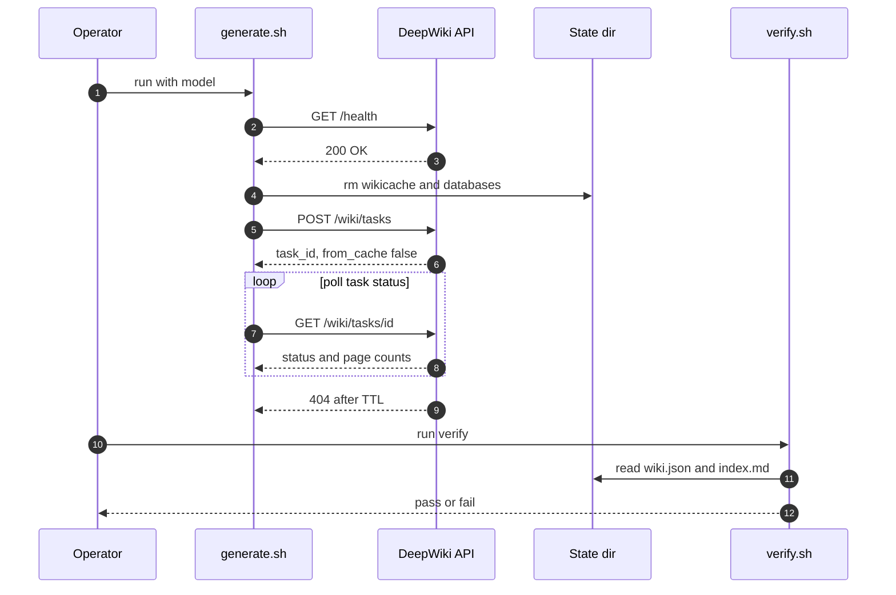

<!-- Generated by DeepWiki-Open d92819a with deepseek-v4.1-flash-1017 on 2026-10-19. Do not edit by hand; regenerate with `just wiki`. -->

[← Wiki index](index.md)

# Repository Layout, Docs, and Two-Repo Split

<details>
<summary>Relevant source files</summary>

The following files were used as context for generating this wiki page:

- [AGENTS.md](AGENTS.md)
- [docs/adr/0007-two-repo-split.md](docs/adr/0007-two-repo-split.md)
- [docs/agents/domain.md](docs/agents/domain.md)
- [docs/research/v2/README.md](docs/research/v2/README.md)
- [scripts/deepwiki/generate.sh](scripts/deepwiki/generate.sh)
- [scripts/deepwiki/export.py](scripts/deepwiki/export.py)
- [scripts/deepwiki/verify.sh](scripts/deepwiki/verify.sh)
</details>

# Repository Layout, Docs, and Two-Repo Split

Satat is organised around a deliberate separation between a **public infrastructure recipe** and a **private automation configuration set**, backed by a documentation system built from a root glossary (`CONTEXT.md`), numbered architecture decision records (`docs/adr/`), agent-facing conventions (`AGENTS.md` + `docs/agents/`), and research notes (`docs/research/`). The repository itself is described as the "infra repo" — the recipe anyone can use to deploy their own Satat — while the watched-repo configuration lives elsewhere. Sources: [CONTEXT.md:44-47](), [README.md:1-8](), [AGENTS.md:1-3]()

This page covers: the top-level directory layout, the two-repo split and its rationale, the documentation layers and how agents are instructed to consume them, the research-to-ADR flow, and the DeepWiki script pipeline that generates and verifies a wiki from this repository.

## Repository Layout

The repo root is intentionally small. The public recipe contains a gateway config, an ntfy config, observability assets, a legacy deploy reference, scripts, and docs. Sources: [README.md:26-37]()

```text
satat/
├── gateway/        # LiteLLM config template (reused from v0.1), Alloy config (reference)
├── ntfy/           # ntfy server config (reused)
├── observability/  # Grafana dashboard (VM panels are v0.1-only)
├── deploy/         # budget-relay.py: v0.1 reference, to be rewritten
├── scripts/
└── docs/
```

| Directory | Contents | Notes |
|---|---|---|
| `gateway/` | LiteLLM config template, Alloy config | Reused from v0.1; Alloy config is reference-only |
| `ntfy/` | ntfy server config | Reused from v0.1 |
| `observability/` | Grafana dashboard | VM panels are v0.1-only |
| `deploy/` | `budget-relay.py` | v0.1 reference, to be rewritten |
| `scripts/` | Operational tooling | Includes `deepwiki/` and `image-digest.sh` |
| `docs/` | ADRs, agent guides, research | See documentation sections below |

Sources: [README.md:26-37](), [AGENTS.md:23-25]()

The repository is explicitly **not deployable from `main`**: v0.2 is a Kubernetes platform (Hatchet queue, agent-sandbox runtime, LiteLLM gateway) that assumes a conformant cluster is available, while the earlier EC2 + Docker Compose stack lives on the `v0.1` branch tagged `v0.1.0-final`. Sources: [README.md:6-14](), [CONTEXT.md:9-20]()

## The Two-Repo Split

### Rationale

ADR 0007 records the decision: `satat` (public) contains the infrastructure recipe — Terraform, cloud-init, service configs, CI, and documentation — while `satat-automations` (private) contains the Git-Sync'd automation YAML files that define which repos Satat watches, under which labels, with which prompts. The stated goal is to keep repo-specific configuration (owner names, label choices, prompt templates) out of the public showcase repo while still letting anyone see and reproduce the infrastructure setup. Both single-repo alternatives were rejected: a single private repo hides the recipe from the community, and a single public repo would expose automation details. Sources: [docs/adr/0007-two-repo-split.md:1-4]()

### Repository roles

`AGENTS.md` restates the split as the canonical "External repos" list, and `CONTEXT.md` defines both roles in the glossary. Sources: [AGENTS.md:42-46](), [CONTEXT.md:42-47]()

| Repository | Visibility | Role | Key contents |
|---|---|---|---|
| `javatarz/satat` | Public | Infra repo / deployment recipe | Terraform, cloud-init, service configs, CI, docs |
| `javatarz/satat-automations` | Private | Automations repo / Git Sync target | `automations/*/automation.yaml`, `tarball/config.json` |

Sources: [AGENTS.md:44-45](), [CONTEXT.md:42-47](), [docs/adr/0020-automation-definition-auth-trigger.md:93-98]()

### Runtime relationship

The private repo is synchronised into Agent Canvas by **Git Sync**, OpenHands' native bidirectional synchronisation between Canvas automations and a Git repo, where changes in either direction are merged automatically. Sources: [CONTEXT.md:60-63]()



Sources: [docs/adr/0007-two-repo-split.md:1-4](), [AGENTS.md:44-45](), [CONTEXT.md:60-63](), [docs/adr/0020-automation-definition-auth-trigger.md:93-98]()

### Consequences of the split

ADR 0020 documents the operational consequences that flow from this arrangement: automation edits are Git-reviewable in `satat-automations`, but their runtime behaviour (model, secrets, profile) is Canvas state and is not reviewable; re-pointing at another repository is a `config.json` edit in `satat-automations` rather than a GitHub variable change; and the `GITHUB_APP_ID`, `GITHUB_APP_PRIVATE_KEY`, `TARGET_REPOSITORY`, and `TARGET_USER` variables are retired because the equivalent values now live in `satat-automations/tarball/config.json` and in Canvas secrets. Sources: [docs/adr/0020-automation-definition-auth-trigger.md:88-98]()

## Documentation System

### Layers

Satat is a **single-context repo**: the domain documentation is `CONTEXT.md` at the root plus `docs/adr/`. A `CONTEXT-MAP.md` at the root would instead indicate a multi-context repo with one `CONTEXT.md` per context under `src/<context>/`. Sources: [docs/agents/domain.md:9-38](), [AGENTS.md:13-15]()

| Layer | Path | Purpose |
|---|---|---|
| Glossary | `CONTEXT.md` | Domain vocabulary and version definitions |
| Decisions | `docs/adr/` | Numbered architecture decision records |
| Agent skills | `docs/agents/` | Issue tracker, triage labels, domain doc rules |
| Research | `docs/research/` | Topic research, plus `docs/research/v2/` for v0.2 |
| Scratch | `docs/scratch/` | Temporary working files, gitignored |

Sources: [AGENTS.md:5-21](), [docs/agents/domain.md:9-38](), [docs/research/v2/README.md:1-19]()

### Reading order for agents

`docs/agents/domain.md` prescribes exactly what to read before exploring the codebase: `CONTEXT.md` (or `CONTEXT-MAP.md` if present, reading each relevant context), then the ADRs that touch the area about to be worked in, including `src/<context>/docs/adr/` in multi-context repos. If these files do not exist, the instruction is to **proceed silently** — do not flag their absence and do not suggest creating them upfront, because the `/domain-modeling` skill creates them lazily when terms or decisions actually get resolved. Sources: [docs/agents/domain.md:5-15]()



Sources: [docs/agents/domain.md:5-42]()

### Vocabulary discipline

When output names a domain concept — in an issue title, a refactor proposal, a hypothesis, or a test name — the term must be the one defined in `CONTEXT.md`, not a synonym the glossary explicitly avoids. If the concept is missing from the glossary, that is treated as a signal: either the language is being invented (reconsider) or there is a real gap (note it for `/domain-modeling`). Sources: [docs/agents/domain.md:40-47]()

The glossary itself encodes this with `_Avoid_:` entries. For example, "Satat" avoids "the agent", "the bot", "openhands"; "Agent" avoids "bot", "worker"; "Canvas" avoids "dashboard", "control panel"; "Git Sync" avoids "automation backup". Sources: [CONTEXT.md:22-65]()

### ADR conflict flagging

If output contradicts an existing ADR, the rule is to surface it explicitly rather than silently overriding it, using the form: *Contradicts ADR-0007 (event-sourced orders), but worth reopening because…*. Sources: [docs/agents/domain.md:49-52]()

### Version naming

`CONTEXT.md` resolves a naming ambiguity that appears across docs and issue numbers: **v0.2** is the Kubernetes platform on `main`, but older docs, paths, and issues call it "v2" (for example `docs/research/v2/`, #99) — the terms mean the same thing. **v0.1** is the Canvas/OpenHands stack on an EC2 VM with Docker Compose, kept on the `v0.1` branch. Sources: [CONTEXT.md:9-20]()

## Agent Conventions (AGENTS.md)

`AGENTS.md` is the entry point for agents and contributors, and points at three skill documents. Sources: [AGENTS.md:5-15]()

| Convention | Rule | Reference |
|---|---|---|
| Issue tracker | GitHub Issues on `javatarz/satat` | `docs/agents/issue-tracker.md` |
| Triage labels | Five-label vocabulary: `needs-triage`, `needs-info`, `ready-for-agent`, `ready-for-human`, `wontfix` | `docs/agents/triage-labels.md` |
| Domain docs | Single-context: `CONTEXT.md` + `docs/adr/` | `docs/agents/domain.md` |
| Scratch directory | Use `docs/scratch/`, not `/tmp`; gitignored | — |
| Container image digests | `scripts/image-digest.sh tags\|digest <ghcr.io/owner/name> [tag]` via registry API | — |
| Secrets | Never in git-tracked files, Terraform state, or cloud-init | — |

Sources: [AGENTS.md:5-40]()

The container-digest rule carries a performance note: `docker manifest inspect` can block for minutes on a cold or rate-limited registry, so the registry API (auth-free for GHCR) is preferred. Sources: [AGENTS.md:23-25]()

### Provision-deploy split

A structural convention closely related to the two-repo split: Satat v0.2 assumes a conformant Kubernetes cluster is available. **Provisioning** a cluster will be Terraform recipes per cloud provider; **deploying** Satat onto it is a separate step (Helm chart). Neither exists yet, and the EC2 + Docker Compose pipeline lives on the `v0.1` branch. Sources: [AGENTS.md:31-35]()

### Secrets policy

Secrets are never in git-tracked files, Terraform state, or cloud-init. Where secrets live on Kubernetes is undecided (a planned ADR); until then, the policy is GitHub repository secrets and cloud OIDC with no long-lived keys. Sources: [AGENTS.md:37-40]()

ADR 0025 extends this for the token broker: the App private key lives only in the broker, and where it is stored depends on the pending platform-secrets decision. Sources: [docs/adr/0025-github-token-broker.md:64-68]()

## Research Flow

When a wayfinder research ticket is open, the flow is fixed: commit findings to `docs/research/<topic>.md`, capture the settled outcome as an ADR in `docs/adr/`, then close the ticket. Research must never be left in ticket bodies only. Sources: [AGENTS.md:27-29]()



Sources: [AGENTS.md:27-29]()

### v0.2 research index

`docs/research/v2/README.md` indexes the v0.2 research corpus and states that decisions coming out of it are recorded as ADRs in `docs/adr`, starting with ADR 0021. Sources: [docs/research/v2/README.md:1-5]()

| File | What it holds |
|---|---|
| `platform-requirements.md` | Non-negotiables, layer model, scoring rubric, open questions |
| `agent-platform-options.md` | Candidate comparison by layer, three stacks, recommendation (Stack A predates ADR 0021) |
| `why-hatchet.md` | Case for Hatchet as queue/workflow engine, costs, alternatives |
| `platform-ram-spike.md` | Measured RAM/CPU of k3s, Hatchet, Postgres, LiteLLM across three VM sizes |
| `intake-triggers.md` | Intake for webhooks, cron and alerts |
| `octo-sts-fit.md` | Whether octo-sts can mint per-step GitHub tokens on k3s |
| `notes/` | Raw per-topic research with citations; may describe rejected options |

Sources: [docs/research/v2/README.md:7-17]()

The research files also carry forward-looking constraints that shape the repo layout. `platform-requirements.md` requires that every infrastructure dependency be a plugin with at least a local implementation and one cloud or Kubernetes implementation, and that a local single-node install must work with Docker plus the k3d CLI (reworded by ADR 0022). Sources: [docs/research/v2/platform-requirements.md:63-66]()

## DeepWiki Script Pipeline

The `scripts/deepwiki/` directory holds a three-stage pipeline: serve the API, generate the wiki, export it, and verify it before anyone reads or commits it. Sources: [scripts/deepwiki/generate.sh:1-9](), [scripts/deepwiki/verify.sh:1-6]()

### Generation

`generate.sh` takes an optional model argument (defaulting to `$WIKI_MODEL`, a gateway model ID such as `deepseek-v4.1-flash`). Each run starts from scratch: it deletes the API's wiki cache and RAG index first, because otherwise DeepWiki would return the cached wiki — even one from a different model — or reuse an index of an older working tree. A stale index also breaks retrieval outright after an embedder change, since its vectors no longer match the size of the query vectors. Sources: [scripts/deepwiki/generate.sh:11-26]()

The task body is built with `jq`, passing `repo_url` as a local path, `type: "local"`, owner, repo, `provider: "litellm"`, model, language, `comprehensive`, and `excluded_dirs` of `./scratch/` and `./wiki/`. Sources: [scripts/deepwiki/generate.sh:28-35]()

```bash
body=$(jq -n \
  --arg path "$REPO_ROOT" --arg owner "$WIKI_OWNER" --arg repo "$WIKI_REPO" \
  --arg model "$model" --arg lang "$WIKI_LANGUAGE" --argjson comprehensive "$WIKI_COMPREHENSIVE" \
  '{repo_url: $path, type: "local", owner: $owner, repo: $repo,
    provider: "litellm", model: $model, language: $lang, comprehensive: $comprehensive,
    excluded_dirs: ["./scratch/", "./wiki/"]}')
```

Sources: [scripts/deepwiki/generate.sh:28-33]()

A sanity check follows: if the API answers `from_cache: true`, the script aborts because the cache wipe did not take effect. Sources: [scripts/deepwiki/generate.sh:37-40]()

Polling then loops on `GET /wiki/tasks/$task_id`, handling three cases: `404` means the task finished and was dropped after its TTL (the cache holds the result) and the loop breaks; a non-`200` status is fatal; `200` yields status, `pages_done`/`pages_total`, and current page IDs, printed only when the progress line changes. A `failed` status aborts. Sources: [scripts/deepwiki/generate.sh:42-56]()



Sources: [scripts/deepwiki/generate.sh:17-56](), [scripts/deepwiki/verify.sh:13-49]()

### Verification

`verify.sh` fails when the wiki has no pages, when a page is DeepWiki's placeholder for a failed generation (`Error generating content: ...`), when a page cites a source file (`filePaths`) that does not exist in the repo, or when an exported page links to a wiki page that was not written. It also prints a summary: model, page count, size, Mermaid diagram count. Sources: [scripts/deepwiki/verify.sh:1-6]()

| Check | Mechanism | Failure output |
|---|---|---|
| Non-empty wiki | `jq '.generated_pages \| length'` must exceed 0 | `FAIL: wiki has no pages` |
| Failed generations | Regex match on `^\s*Error generating content:` | `FAIL: pages whose generation failed` |
| Dangling source citations | Normalise `filePaths` to repo-relative, test `-e` | `FAIL: cited source files that do not exist` |
| Broken internal links | `grep` for `](*.md)` targets, test existence in `$WIKI_OUT` | `FAIL: links to missing wiki pages` |
| Summary | Model, pages, words, Mermaid count, cited-file count | `==> verify ok` or `==> verify FAILED` |

Sources: [scripts/deepwiki/verify.sh:15-49]()

The script requires both `$DEEPWIKI_DATA_DIR/wiki.json` (produced by generation) and `$WIKI_OUT/index.md` (produced by the export step), and dies with an explicit message pointing at the missing step if either is absent. Sources: [scripts/deepwiki/verify.sh:13-14]()

```bash
missing=$(jq -r '.generated_pages[] | .id as $id | .filePaths[]? | "\($id)\t\(.)"' "$wiki_json" |
  while IFS=$'\t' read -r id path; do
    rel="${path#./}"; rel="${rel#"$REPO_ROOT"/}"
    [ -e "$REPO_ROOT/$rel" ] || printf '%s\t%s\n' "$id" "$path"
  done)
```

Sources: [scripts/deepwiki/verify.sh:28-34]()

## Summary

The Satat repository is a thin public recipe: `gateway/`, `ntfy/`, `observability/`, `deploy/`, `scripts/`, and `docs/`, with no deployable v0.2 artefacts on `main`. Its structure is governed by three interlocking decisions — the public/private two-repo split (ADR 0007) that keeps automation details out of the showcase, the provision-versus-deploy separation that keeps cluster creation distinct from Helm installation, and a documentation discipline in which `CONTEXT.md` fixes vocabulary, `docs/adr/` records settled decisions, `docs/agents/domain.md` tells agents what to read first and how to flag ADR conflicts, and `docs/research/` holds findings that must graduate into ADRs rather than living in ticket bodies. Sources: [README.md:26-37](), [docs/adr/0007-two-repo-split.md:1-4](), [AGENTS.md:27-40](), [docs/agents/domain.md:5-52](), [CONTEXT.md:42-47]()

## Related pages

- [Project Overview and Versions](page-1.md)
- [Domain Glossary and Vocabulary](page-3.md)
- [Extensibility and Automation Configuration](page-12.md)
