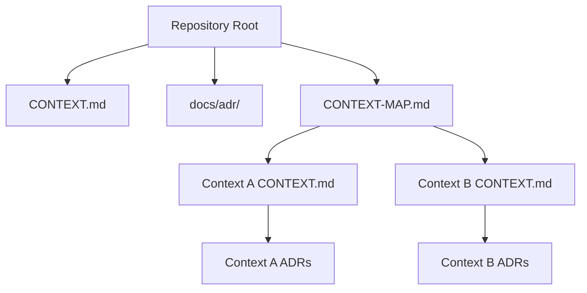
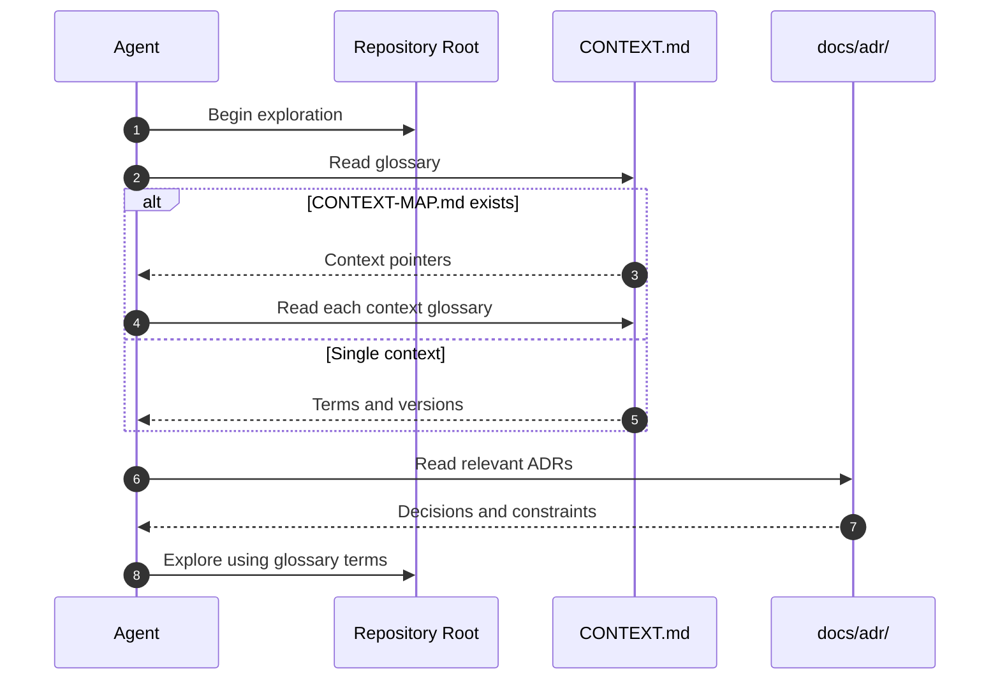
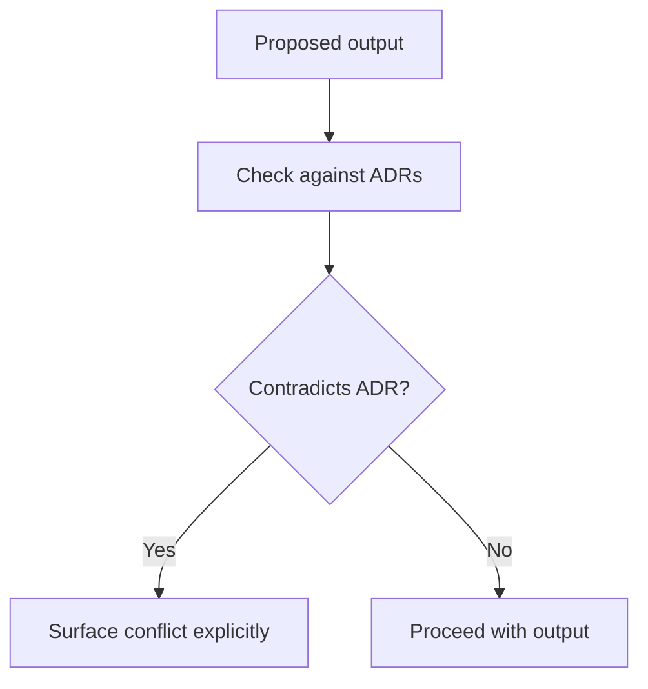
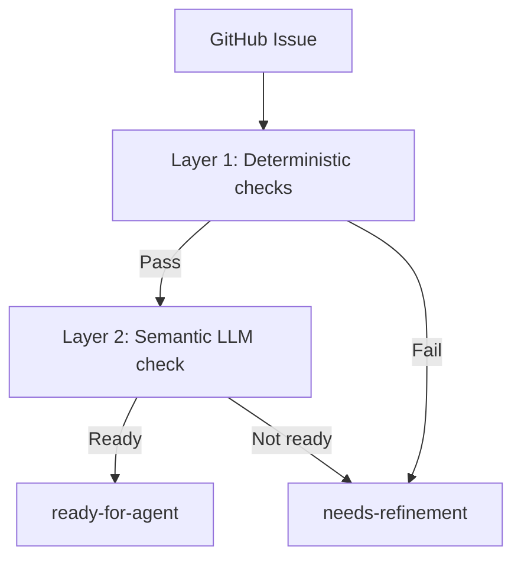
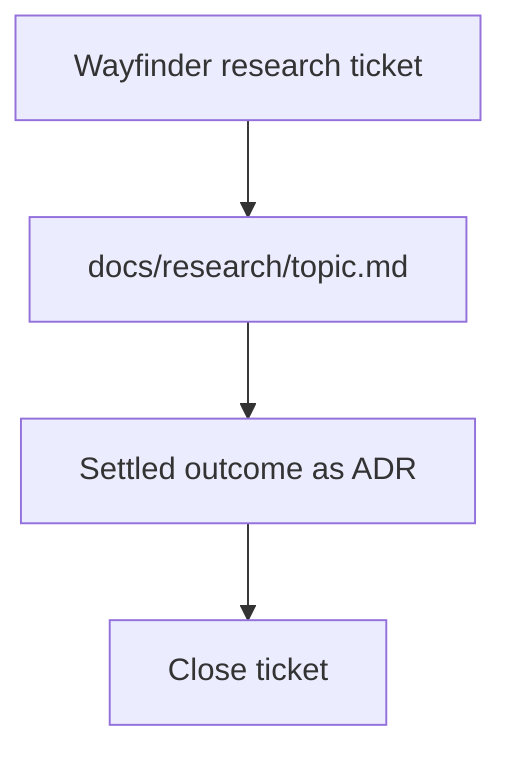

<!-- Generated by DeepWiki-Open d92819a with deepseek-v4.1-flash-1017 on 2026-10-19. Do not edit by hand; regenerate with `just wiki`. -->

[← Wiki index](index.md)

# Domain Glossary and Vocabulary

Relevant source files

The following files were used as context for generating this wiki page:

- [CONTEXT.md](CONTEXT.md)
- [docs/agents/domain.md](docs/agents/domain.md)

# Domain Glossary and Vocabulary

Satat's domain documentation provides a shared language for agents and contributors. The canonical glossary is `CONTEXT.md` at the repository root, optionally split per context by `CONTEXT-MAP.md`; architecture decisions live in `docs/adr/` and context-scoped `src/<context>/docs/adr/`. The glossary is not passive reference: agents must use its terms when naming concepts in issue titles, refactor proposals, hypotheses, and tests, and must flag outputs that contradict an ADR. Sources: [docs/agents/domain.md:3-10](), [README.md:18-24]().

## Documentation Topology

Single-context repositories place `CONTEXT.md` and `docs/adr/` at the root. Multi-context repositories add `CONTEXT-MAP.md`, which points to one `CONTEXT.md` per context and optional context-specific ADR directories. Sources: [docs/agents/domain.md:16-36]().

Sources: [docs/agents/domain.md:16-36]().

| File | Role | Location |
|---|---|---|
| `CONTEXT.md` | Canonical glossary and versions | Root, or per context |
| `CONTEXT-MAP.md` | Points to per-context `CONTEXT.md` files | Root, multi-context only |
| `docs/adr/` | System-wide architecture decisions | Root |
| `src/<context>/docs/adr/` | Context-specific decisions | Per context |

Sources: [docs/agents/domain.md:16-36](), [README.md:18-24]().

## Consuming Domain Docs Before Exploration

Before exploring the codebase, agents must read `CONTEXT.md` or `CONTEXT-MAP.md` and the ADRs that touch the area they are about to work in. If those files do not exist, the agent proceeds silently and does not suggest creating them upfront; the `/domain-modeling` skill creates them lazily when terms or decisions are actually resolved. Sources: [docs/agents/domain.md:7-14]().

Sources: [docs/agents/domain.md:7-14]().

## Glossary Vocabulary Rules

When output names a domain concept, it must use the term as defined in `CONTEXT.md`; synonyms that the glossary explicitly avoids must not be used. If the needed concept is absent from the glossary, that is a signal either that the agent is inventing language the project does not use, or that there is a real gap to note for `/domain-modeling`. Sources: [docs/agents/domain.md:38-44]().

The repository itself defines several terms that anchor the vocabulary:

| Term | Definition | Source |
|---|---|---|
| Satat | सतत, "continuous / constant"; a self-hosted, always-on AI coding agent that watches the GitHub backlog, picks up labeled issues, writes code, runs tests, and opens draft PRs without merging | [README.md:1-5]() |
| v0.1 | EC2 + Docker Compose stack (OpenHands Agent Canvas, Caddy, Terraform), kept on the `v0.1` branch, tag `v0.1.0-final` | [README.md:14-16]() |
| v0.2 | Kubernetes platform: Hatchet queue, agent-sandbox runtime, LiteLLM gateway | [README.md:9-12]() |
| ADR | Architecture decision record; `docs/adr/` contains decisions, with 0024 covering the runtime | [README.md:21](), [docs/agents/domain.md:7-10]() |
| Triage labels | `needs-triage`, `needs-info`, `ready-for-agent`, `ready-for-human`, `wontfix` | [AGENTS.md:11-13]() |
| Scratch directory | `docs/scratch/` for temporary working files; gitignored | [AGENTS.md:20-22]() |
| Research flow | Commit findings to `docs/research/<topic>.md`, capture the settled outcome as an ADR, then close the ticket | [AGENTS.md:28-31]() |
| Provision-deploy split | Provisioning a cluster (Terraform recipes per cloud) is separate from deploying Satat (Helm chart) | [AGENTS.md:33-37]() |
| Secrets | Never in git-tracked files, Terraform state, or cloud-init; use GitHub repository secrets and cloud OIDC | [AGENTS.md:39-41]() |
| External repos | `javatarz/satat` (public; docs, service configs, CI) and `javatarz/satat-automations` (private; Git Sync target) | [AGENTS.md:43-46]() |

Sources: as listed per row.

## ADR Conflicts

If an output contradicts an existing ADR, the conflict must be surfaced explicitly rather than silently overridden. The documented pattern is a quoted note naming the ADR and the reason for reopening it, for example: "_Contradicts ADR-0007 (event-sourced orders), but worth reopening because…_". Sources: [docs/agents/domain.md:46-52]().

Sources: [docs/agents/domain.md:46-52]().

## Issue Readiness Vocabulary

The project uses a structured vocabulary for agent-ready issues. The issue template defines sections: Scope (entry point, user role, files/components likely involved), Oracle (a command that fails now and passes when done), Acceptance criteria (behavior, regression boundary, verification), Non-goals (do not, paths not to touch), and Review notes (risk, suggested reviewer). Sources: [docs/research/agent-ready-issues.md:58-94]().

Issue readiness is checked in two layers: Layer 1 uses deterministic scripts and labels (`needs-refinement`, removal of `ready-for-agent`), and Layer 2 is a semantic check performed by the agent's first turn using `[NEEDS CLARIFICATION]` markers; if the issue is not ready, the agent calls `finish`. Sources: [docs/research/issue-readiness-checks.md:30-47]().

| Section | Purpose | Key fields |
|---|---|---|
| Scope | Bound the work | Entry point, user role, files/components |
| Oracle | Define pass/fail signal | Command that fails now, passes when done |
| Acceptance criteria | Define done | Behavior, regression boundary, verification |
| Non-goals | Prevent scope creep | Do not, paths not to touch |
| Review notes | Route review | Risk, suggested reviewer |

Sources: [docs/research/agent-ready-issues.md:58-94]().

Sources: [docs/research/issue-readiness-checks.md:30-47]().

## Vocabulary Across Subsystems

Domain terms also appear in subsystem research. The following table groups terms that are defined or used in the provided files.

| Subsystem | Terms | Meaning in context | Source |
|---|---|---|---|
| Agent platform | Engine, declarative workflow, concurrency limit, pause/cancel | Workflow engines are compared by runtime, DSL, flow control, and operational weight | [docs/research/v2/notes/platforms-engines.md:18-25](), [docs/research/v2/agent-platform-options.md:89-96]() |
| Agent platform | Intake, harness, concurrency key, workflow | Intake receives webhooks; harness runs coding agents; engines queue work | [docs/research/v2/notes/intake-platforms.md:48-54](), [docs/research/v2/notes/platforms-harness.md:18-23]() |
| Issue tracking | Triage labels, `ready-for-agent`, `needs-refinement` | Labels gate whether an agent may pick up an issue | [AGENTS.md:11-13](), [docs/research/issue-readiness-checks.md:30-47]() |
| Observability | Spend, requests, tokens, error rate, datasource | Grafana panels read `litellm_*` and `node_*` metrics | [observability/grafana/README.md:1-49]() |
| Wiki generation | Wiki, RAG index, embedder, comprehensive mode | DeepWiki generates pages from a RAG index; the embedder must match query vectors | [scripts/deepwiki/lib.sh:1-75](), [scripts/deepwiki/generate.sh:1-56]() |
| Research | Research ticket, ADR, scratch directory | Findings are committed to `docs/research/`, then settled as an ADR | [AGENTS.md:28-31]() |

Sources: as listed per row.

The research flow is itself a domain vocabulary: a wayfinder research ticket produces findings in `docs/research/<topic>.md`, the settled outcome becomes an ADR, and only then is the ticket closed. Sources: [AGENTS.md:28-31]().

Sources: [AGENTS.md:28-31]().

## Summary

The domain glossary and vocabulary are enforced through `CONTEXT.md` (or per-context equivalents), ADRs, and repository conventions. Agents read the glossary and relevant ADRs before exploration, use canonical terms in all output, surface ADR conflicts explicitly, and follow the issue-readiness and research-flow vocabularies. Subsystem research adds specialized terms for agent platforms, observability, and wiki generation, but the root glossary remains the authority for domain concepts. Sources: [docs/agents/domain.md:3-52](), [AGENTS.md:1-46](), [README.md:1-37]().

## Related pages

- [Project Overview and Versions](page-1.md)
- [Repository Layout, Docs, and Two-Repo Split](page-2.md)
- [Extensibility and Automation Configuration](page-12.md)
