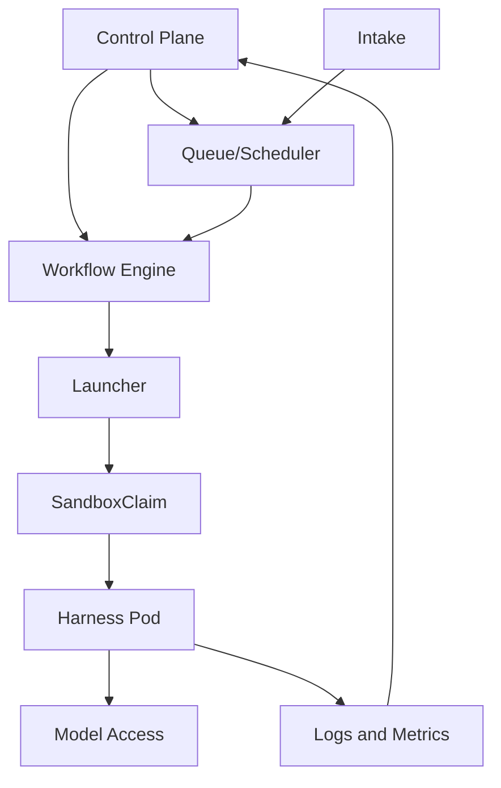
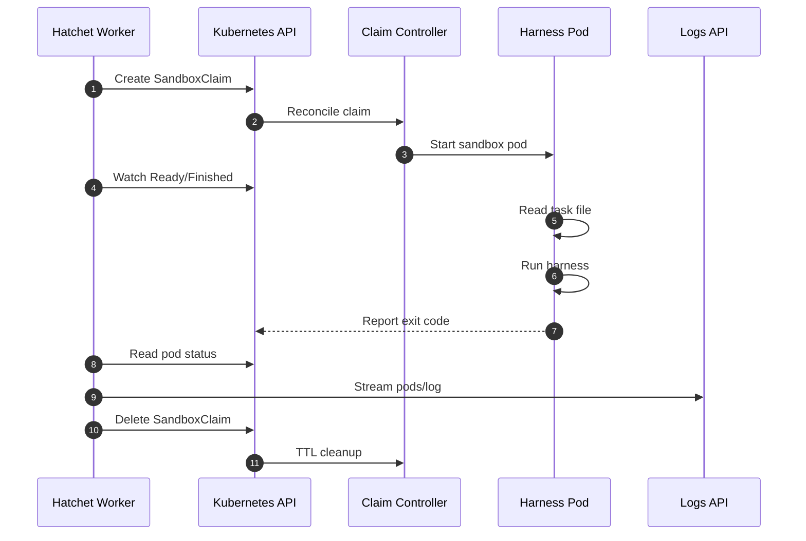
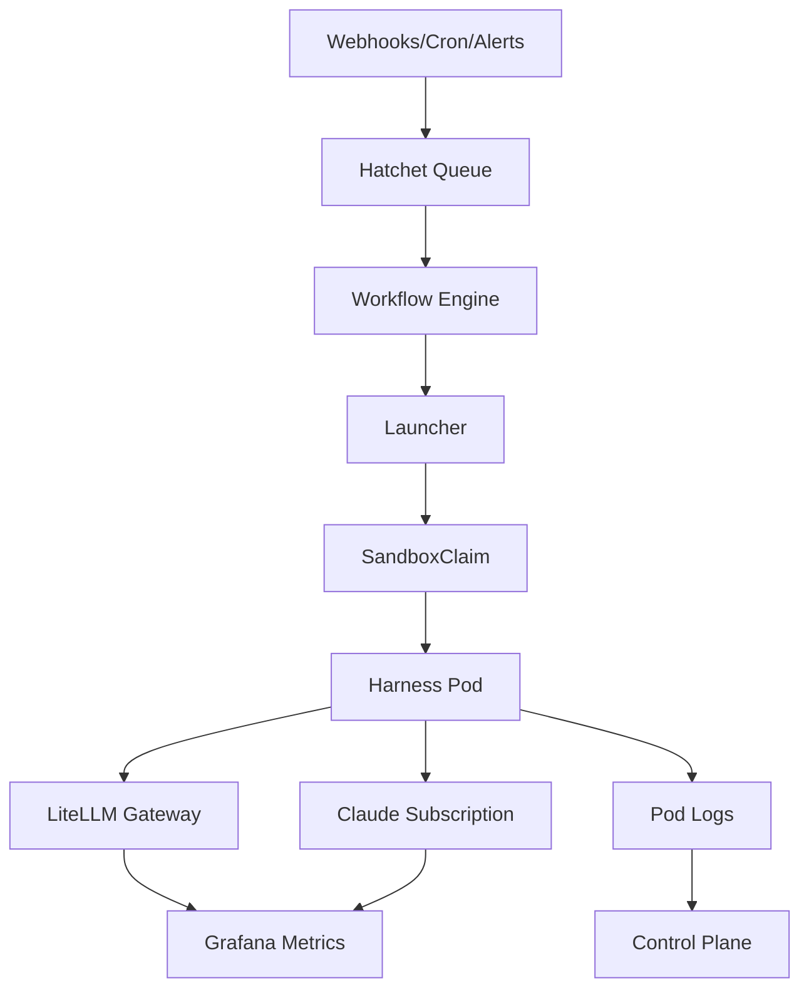

<!-- Generated by DeepWiki-Open d92819a with deepseek-v4.1-flash-1017 on 2026-10-19. Do not edit by hand; regenerate with `just wiki`. -->

[← Wiki index](index.md)

# System Architecture Overview

Relevant source files

The following files were used as context for generating this wiki page:

- [docs/research/v2/agent-platform-options.md](docs/research/v2/agent-platform-options.md)
- [docs/adr/0021-adopt-platform-plumbing.md](docs/adr/0021-adopt-platform-plumbing.md)
- [docs/adr/0024-kubernetes-agent-sandbox-runtime.md](docs/adr/0024-kubernetes-agent-sandbox-runtime.md)
- [README.md](README.md)

# System Architecture Overview

Satat v2 is a platform for running coding-agent harnesses (Claude Code, opencode, pi) as isolated, horizontally scalable task steps, with a queue, workflow engine, and a backlog control plane. The architecture is documented as a set of research notes and ADRs. The v2 design explicitly rejects adopting a single full platform because no candidate satisfies all eleven non-negotiables (NN1–NN11). Instead, Satat composes layers: it adopts platform plumbing (queue/workflow engine and runtime) and builds the pieces no project provides — workflows-as-code with repo opt-in, credential-lane wiring, and a backlog view of work items. The research scope covers several harnesses, horizontal scale, and a backlog control plane, with decisions recorded as ADRs starting with ADR 0021.

Sources: [docs/research/v2/README.md:1-19](), [docs/research/v2/agent-platform-options.md:1-43](), [docs/research/v2/notes/platforms-full.md:435-507]()

## Architectural Principles and Constraints

The architecture is filtered by 11 non-negotiables and scored by a rubric. The sources reference NN1–NN11 by number; the descriptions below are the ones directly evidenced in the research notes.

| ID | Requirement | Evidence |
|---|---|---|
| NN1 | One workload per task step; no shared process or filesystem | [docs/research/v2/notes/platforms-runtime.md:31-72]() |
| NN2 | Drives external harness CLIs (Claude Code, opencode, pi) | [docs/research/v2/platform-requirements.md:90-128]() |
| NN3 | The set of secrets a workload gets is fixed by its lane, outside the workload and prompt | [docs/research/v2/notes/platforms-runtime.md:31-72]() |
| NN4 | Backlog/control-plane view of work items | [docs/research/v2/agent-platform-options.md:1-43]() |
| NN5 | Queueing and concurrency caps exist | [docs/research/v2/notes/platforms-full.md:435-507]() |
| NN6 | Workflows as code | [docs/research/v2/agent-platform-options.md:1-43]() |
| NN7 | Repo opt-in to workflows | [docs/research/v2/agent-platform-options.md:1-43]() |
| NN8 | Maintenance and project activity | [docs/research/v2/notes/platforms-full.md:23-57]() |
| NN9 | Docker-only local implementation plus at least one k8s or cloud implementation | [docs/research/v2/notes/platforms-runtime.md:31-72]() |
| NN10 | No host access, no runtime socket, restricted egress, short-lived credentials | [docs/research/v2/notes/platforms-runtime.md:31-72]() |
| NN11 | License and self-host bar | [docs/research/v2/notes/platforms-full.md:23-57]() |

The cross-cutting conclusion is that no candidate in the full-platform group passes NN1 + NN5 + NN6 + NN7 together. Workflows-as-code with repo opt-in and lane-aware queues are absent everywhere except as single-file designs. If a control plane must be adopted, Multica is the only mature option, but its isolation model and non-OSI licence make it a poor fit.

Sources: [docs/research/v2/notes/platforms-full.md:435-507](), [docs/research/v2/platform-requirements.md:90-128]()

## Layered Architecture

Satat v2 is organized into layers. The requirements document defines the layer model, and the platform-options research evaluates candidates per layer.

| Layer | Responsibility in Satat v2 | Candidate or decision |
|---|---|---|
| Intake | Webhooks, cron, and alerts | Hatchet built-ins versus gateways and integration platforms |
| Queue/scheduler | Durable queue, concurrency caps, priority, pausing, timeouts | Hatchet |
| Workflow engine | Multi-step workflows, retries, human gates | Hatchet |
| Harness adapter | Runs Claude Code, opencode, or pi as a step | Satat-owned entrypoint in each image |
| Workload runtime | Isolated per-step execution | Kubernetes with agent-sandbox |
| Model access | Routes open harnesses to the gateway with budgets; gives Claude Code its subscription | LiteLLM + LLM Gateway; Claude subscription |
| Control plane | UI and API over the queue, workflows, and runs | Auth provider (OAuth) |
| Cross-cutting | Secrets, notifications, telemetry | Secret store, ntfy, OTLP backend |

Sources: [docs/research/v2/platform-requirements.md:90-128](), [docs/research/v2/agent-platform-options.md:47-72](), [docs/research/v2/README.md:1-19]()

The control and data flow across these layers is top-down: intake feeds the queue, the workflow engine drives the launcher, the launcher creates a sandbox claim, and the harness pod calls model access and emits logs and metrics back to the control plane.

Sources: [docs/research/v2/platform-requirements.md:90-128](), [docs/adr/0024-kubernetes-agent-sandbox-runtime.md:1-49]()

## Runtime Architecture: Kubernetes with agent-sandbox

ADR 0024 settles the runtime: Satat runs every step as a one-shot `SandboxClaim` on Kubernetes using agent-sandbox. The same API runs on k3d on a laptop, k3s on a single VM, and a managed cluster later. This decision settles the runtime proposal left open in ADR 0021 and ADR 0022 (NN1), based on the agent-sandbox spike and the platform RAM spike.

Sources: [docs/adr/0024-kubernetes-agent-sandbox-runtime.md:1-49](), [docs/research/v2/agent-platform-options.md:1-43]()

### One-Shot SandboxClaim Lifecycle

The launcher creates a claim, watches for the `Finished` condition, reads the exit code from the pod (`containerStatuses[0].state.terminated.exitCode`, not on the claim), reads `pods/log`, and deletes the claim. No router or in-pod server is used.

Sources: [docs/adr/0024-kubernetes-agent-sandbox-runtime.md:1-49](), [docs/research/v2/notes/k8s-runtime.md:193-241]()

### Lane Isolation Model

Isolation is expressed through namespaces, templates, pod security, and network policy:

- **One namespace and one `SandboxTemplate` per lane.** Pod Security `restricted` is enforced, with no service-account token.
- **Managed network policy has explicit egress:** DNS and the named backends only. `SandboxTemplate.networkPolicy` defaults to deny when the list is empty.
- **`envVarsInjectionPolicy: Disallowed`.** A claim that sets `env` is rejected.
- **Per-lane identity.** Each lane has a ServiceAccount, Secret or ExternalSecret, `SandboxTemplate`, and `SandboxWarmPool` (`replicas: 0`).
- **Isolation runtime.** gVisor (`runsc`, systrap) through a RuntimeClass on k3s. The laptop keeps plain container isolation.

Sources: [docs/adr/0024-kubernetes-agent-sandbox-runtime.md:1-49](), [docs/research/v2/notes/platforms-runtime.md:60-100](), [docs/research/v2/notes/k8s-runtime.md:193-241]()

### Inputs, Secrets, and Credential Lanes

Non-secret inputs go in a claim annotation, exposed as a file by the Downward API (`/etc/podinfo/...` or `/etc/satat/task`). The template sets `envVarsInjectionPolicy: Disallowed`, so a claim cannot inject environment variables. Secrets are not placed in claims; they are fixed by the lane through the template's ServiceAccount and Secret references. An optional token broker can mint per-task GitHub tokens, or Satat can adopt octo-sts. Credential lanes work the same way on every backend: one fixed identity per lane, and only the Claude-lane identity can read the OAuth token.

Sources: [docs/adr/0024-kubernetes-agent-sandbox-runtime.md:1-49](), [docs/research/v2/notes/k8s-runtime.md:193-241](), [docs/research/v2/agent-platform-options.md:104-126]()

### Cleanup and Failure Handling

Finished claims are removed by `ttlSecondsAfterFinished` with `shutdownPolicy: Delete`. A claim that never starts has no TTL, so the launcher deletes every claim it creates, on every exit path. The exit code is read from the pod, not the claim. Logs are streamed from `pods/log`.

Sources: [docs/adr/0024-kubernetes-agent-sandbox-runtime.md:1-49](), [docs/research/v2/notes/k8s-runtime.md:193-241]()

### Worker RBAC

The worker has least-privilege access:

| Resource | Verbs |
|---|---|
| `sandboxclaims` | create, get, watch, delete |
| `pods` | get |
| `pods/log` | get |
| Pod creation | none |
| `sandboxes`, `templates`, `secrets`, `service accounts` | none |

Templates are applied by configuration management only.

Sources: [docs/adr/0024-kubernetes-agent-sandbox-runtime.md:1-49]()

## Component Responsibilities

### Satat-Owned Components

Satat builds the parts no project provides:

| Component | Responsibility |
|---|---|
| Launcher (~150–300 LOC, Python in the Hatchet worker) | Create a `SandboxClaim`; watch `Ready`/`Finished`; read the exit code from pod status; stream `pods/log`; delete the claim on cancel |
| Harness entrypoint in each image | Read `/etc/satat/task` via the Downward API; run the harness; exit non-zero on failure |
| Manifests (no driver code) | Lane namespaces with PSS `restricted`; per-lane ServiceAccount, Secret or ExternalSecret, `SandboxTemplate`, and `SandboxWarmPool`; worker Role/RoleBinding; VAP on claims; RuntimeClass; egress proxy and per-lane allowlists; per-shape bootstrap |
| Optional token broker | Per-task GitHub tokens, or adopt octo-sts |

Sources: [docs/research/v2/notes/k8s-runtime.md:193-241](), [docs/adr/0024-kubernetes-agent-sandbox-runtime.md:1-49]()

### Adopted Components

| Component | Role | Evidence |
|---|---|---|
| Hatchet | Queue and workflow engine, including concurrency, timeouts, pausing, and priority | [docs/research/v2/README.md:1-19](), [docs/research/v2/notes/k8s-runtime.md:193-241]() |
| agent-sandbox | `Sandbox`, `SandboxTemplate`, `SandboxClaim`, `SandboxWarmPool` CRDs and controller | [docs/research/v2/notes/platforms-runtime.md:60-100](), [docs/adr/0024-kubernetes-agent-sandbox-runtime.md:1-49]() |
| Kubernetes (k3s/k3d) | Runtime substrate; same API on laptop, single VM, and managed cluster | [docs/adr/0024-kubernetes-agent-sandbox-runtime.md:1-49]() |
| gVisor | `runsc` runtime for isolation on k3s | [docs/adr/0024-kubernetes-agent-sandbox-runtime.md:1-49]() |
| LiteLLM / LLM Gateway | Model access and budgets for open harnesses | [docs/research/v2/platform-requirements.md:90-128]() |
| Grafana Cloud / Alloy | Metrics dashboards and scraping | [observability/grafana/README.md:1-49]() |
| External Secrets Operator, Secrets Store CSI Driver, Cilium, octo-sts | Candidate supporting components for secrets, egress, and GitHub tokens | [docs/research/v2/notes/k8s-runtime.md:219-281]() |

## Data and Control Flow

The end-to-end flow is: intake events enter the Hatchet queue, the workflow engine advances steps, the launcher creates a `SandboxClaim`, the harness pod runs and calls either LiteLLM or the Claude subscription, and logs and metrics flow back to the control plane and Grafana.

Sources: [docs/research/v2/platform-requirements.md:90-128](), [docs/adr/0024-kubernetes-agent-sandbox-runtime.md:1-49](), [observability/grafana/README.md:1-49]()

## Harness Layer

Satat drives three harnesses: Claude Code, opencode, and pi. The harness adapter is a Satat-owned entrypoint that reads the task file, runs the harness, and exits non-zero on failure. Claude Code is proprietary and must stay unmodified; it authenticates with `CLAUDE_CODE_OAUTH_TOKEN` from `claude setup-token`. Open harnesses route through the LiteLLM gateway with budgets. OpenHands OSS demonstrates ACP adapters for all three harnesses and is the best execution substrate, but Satat does not adopt its scheduler, lane caps, workflows-as-code, or backlog control plane.

| Harness | Credential path | Adapter role |
|---|---|---|
| Claude Code CLI | `CLAUDE_CODE_OAUTH_TOKEN` from `claude setup-token`; proprietary, unmodified | Satat entrypoint invokes `claude -p` with headless flags |
| opencode | Routed through LiteLLM / LLM Gateway | Satat entrypoint invokes the opencode CLI |
| pi | Routed through LiteLLM / LLM Gateway | Satat entrypoint invokes the pi CLI |

Sources: [docs/research/v2/agent-platform-options.md:104-126](), [docs/research/v2/notes/k8s-runtime.md:193-241](), [docs/research/v2/notes/platforms-full.md:435-507]()

## Model Access and Observability

Model access is split: open harnesses go through the gateway with budgets, while Claude Code uses its subscription. Observability is provided by Grafana dashboards tracked as code. `satat-overview.json` is imported manually into Grafana Cloud and uses the `grafanacloud-prom` datasource. The dashboard covers spend, requests, tokens, error rate, VM CPU, VM memory, spend rate by model, top models by spend, p95 latency, tokens and failures by model group, and disk-used percentage per mount.

| Panel group | Metrics | Origin |
|---|---|---|
| Spend, requests, tokens, latency, failures | `litellm_*` | LiteLLM `/metrics`, scraped by Alloy |
| CPU, memory, disk | `node_*` | `prometheus.exporter.unix`, scraped by Alloy |

No extra agent is needed; everything comes from the Grafana Alloy container already running on the VM (`gateway/alloy-config.alloy`). The known gap is issue/PR-level attribution: activity panels reflect LLM traffic, and T8 will tag requests with issue metadata via LiteLLM `custom_prometheus_metadata_labels`.

Sources: [observability/grafana/README.md:1-49](), [docs/research/v2/platform-requirements.md:90-128]()

## Deployment Topology

Satat v0.2 assumes a conformant Kubernetes cluster is available. Provisioning a cluster will be Terraform recipes per cloud provider; deploying Satat onto it is a separate Helm chart. Neither exists yet. The EC2 + Docker Compose pipeline lives on the `v0.1` branch. The runtime decision explicitly supports the same API on k3d on a laptop, k3s on a single VM, and a managed cluster later. The RAM spike measured k3s, Hatchet, Postgres, and LiteLLM across three VM sizes; the cheapest deployment stays cheap, with roughly 2–4 GB RAM platform overhead on the same t4g.xlarge.

| Environment | Runtime | Notes |
|---|---|---|
| Laptop | k3d | Plain container isolation |
| Single VM | k3s | gVisor `runsc` systrap via RuntimeClass |
| Managed cluster | Kubernetes | Later |
| v0.1 legacy | EC2 + Docker Compose | On the `v0.1` branch |
| v0.2 provisioning | Terraform per cloud | Not yet implemented |
| v0.2 deployment | Helm chart | Not yet implemented |

Sources: [AGENTS.md:1-46](), [docs/adr/0024-kubernetes-agent-sandbox-runtime.md:1-49](), [docs/research/v2/notes/k8s-runtime.md:193-241]()

## Security Architecture

Security is enforced at several layers:

- **Pod Security:** `restricted` in every lane namespace, with no service-account token.
- **Runtime isolation:** gVisor (`runsc`, systrap) on k3s; plain containers on the laptop.
- **Network policy:** default deny; explicit egress to DNS and named backends only.
- **Claim hardening:** `envVarsInjectionPolicy: Disallowed`; non-secret inputs via Downward API annotations; secrets fixed by lane.
- **RBAC:** worker can create/get/watch/delete claims and get pods and `pods/log`; it cannot create pods or read secrets, templates, or service accounts.
- **Secrets handling:** never in git-tracked files, Terraform state, or cloud-init. Where secrets live on Kubernetes is undecided (planned ADR); until then, GitHub repository secrets and cloud OIDC (no long-lived keys).
- **Credential lanes:** one fixed identity per lane; only the Claude-lane identity can read the OAuth token. On Azure Container Apps, anyone who can start a job can override its env and reference any secret on that job, so the Claude token must live on a job that open-harness steps never start.
- **Token broker:** optional per-task GitHub tokens, or adopt octo-sts.

Sources: [docs/adr/0024-kubernetes-agent-sandbox-runtime.md:1-49](), [docs/research/v2/notes/platforms-runtime.md:31-72](), [docs/research/v2/agent-platform-options.md:104-126](), [AGENTS.md:1-46]()

## Research and Decision Process

Research is tracked as wayfinder tickets. When a research ticket is open, findings are committed to `docs/research/<topic>.md`, the settled outcome is captured as an ADR in `docs/adr/`, and the ticket is closed. Research is never left in ticket bodies only. The issue tracker is GitHub Issues on `javatarz/satat`, with a default five-label triage vocabulary: `needs-triage`, `needs-info`, `ready-for-agent`, `ready-for-human`, `wontfix`. Domain documentation is single-context: `CONTEXT.md` at root plus `docs/adr/`. The repo `javatarz/satat` is public and contains docs, service configs, and CI; `javatarz/satat-automations` is private and is the Git Sync target for automation YAML files.

Sources: [AGENTS.md:1-46](), [docs/research/v2/README.md:1-19]()

## Key Decisions Summary

| Decision | ADR | Status | Impact |
|---|---|---|---|
| Adopt platform plumbing instead of building every driver | ADR 0021 | Accepted | Satat adopts its workload runtime and queue/workflow plumbing; Stack A's Satat-built drivers and intake service are superseded |
| Settle v2 platform requirements and open questions | ADR 0022 | Accepted | Answers the seven open questions, including build-vs-adopt, tracker scope, license bar, live steering, and tenancy |
| Use Kubernetes with agent-sandbox as the workload runtime | ADR 0024 | Accepted (2026-10-16) | Every step is a one-shot `SandboxClaim`; same API on k3d, k3s, and managed clusters |
| Choose the overall stack | Not decided | Open | `agent-platform-options.md` states there is no decision on the stack itself; it is input for the owner |

Sources: [docs/research/v2/README.md:1-19](), [docs/research/v2/agent-platform-options.md:1-43](), [docs/adr/0024-kubernetes-agent-sandbox-runtime.md:1-49]()

## Summary

Satat v2 is a layered platform that composes adopted plumbing with Satat-built glue. The settled runtime is Kubernetes with agent-sandbox, where each step runs as a one-shot `SandboxClaim` in a lane-specific namespace and template, with restricted pod security, explicit egress, gVisor isolation, and least-privilege worker RBAC. The launcher, harness entrypoint, and manifests are Satat-owned; Hatchet provides the queue and workflow engine; LiteLLM and the Claude subscription provide model access; Grafana Cloud and Alloy provide observability. Workflows-as-code with repo opt-in, credential-lane wiring, and the backlog control plane remain the parts Satat must build because no evaluated project satisfies all eleven non-negotiables together.

Sources: [docs/adr/0024-kubernetes-agent-sandbox-runtime.md:1-49](), [docs/research/v2/notes/k8s-runtime.md:193-241](), [docs/research/v2/notes/platforms-full.md:435-507](), [observability/grafana/README.md:1-49]()

## Related pages

- [Project Overview and Versions](page-1.md)
- [Agent Execution and Sandbox Runtime](page-5.md)
- [Workflow Orchestration, Queueing, and State](page-6.md)
- [LLM Gateway and Model Routing](page-9.md)
- [Deployment and Infrastructure](page-10.md)
