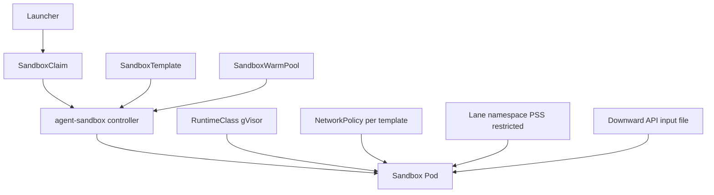
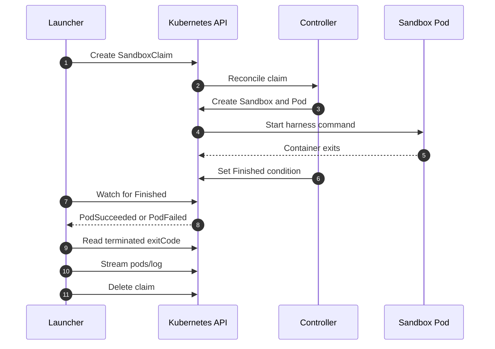
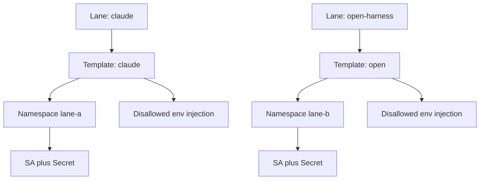
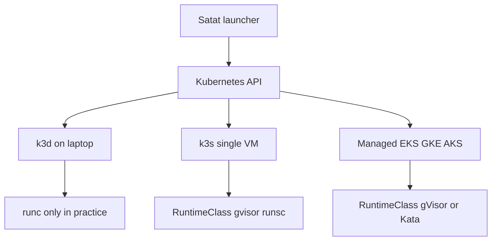

<!-- Generated by DeepWiki-Open d92819a with deepseek-v4.1-flash-1017 on 2026-10-19. Do not edit by hand; regenerate with `just wiki`. -->

[← Wiki index](index.md)

# Agent Execution and Sandbox Runtime

Relevant source files

The following files were used as context for generating this wiki page:

- [docs/adr/0024-kubernetes-agent-sandbox-runtime.md](docs/adr/0024-kubernetes-agent-sandbox-runtime.md)
- [docs/research/v2/platform-ram-spike.md](docs/research/v2/platform-ram-spike.md)
- [docs/research/v2/agent-platform-options.md](docs/research/v2/agent-platform-options.md)

# Agent Execution and Sandbox Runtime

Satat executes every workflow step as its own isolated workload, started, watched, cancelled and cleaned up by a launcher. This layer is the "workload runtime driver" from `docs/research/v2/platform-requirements.md`: it must start, watch and tear down an isolated workload per task step across Docker, Kubernetes, ECS/Fargate, Cloud Run jobs and Azure Container Apps jobs, while satisfying the non-negotiables NN1 (pluggable runtime), NN3 (credential lanes by infrastructure), NN9 (every dependency a plugin, Docker-only local install), NN10 (security posture) and NN11 (self-hosted, permissive license). Sources: [docs/research/v2/notes/platforms-runtime.md:1-21]()

ADR 0024 settles the runtime question left open by ADR 0021 and ADR 0022: Satat runs every step as a one-shot `SandboxClaim` on Kubernetes using `kubernetes-sigs/agent-sandbox`, with the same API on k3d on a laptop, k3s on a single VM, and a managed cluster later. Where the cluster runs is a separate decision. Sources: [docs/adr/0024-kubernetes-agent-sandbox-runtime.md:1-49]()

## Decision and Scope

The runtime layer's derived requirements, taken from the research pass:

- One workload per task step; no shared process or filesystem (NN1).
- The set of secrets a workload receives is fixed by its lane, decided outside the workload and outside the prompt (NN3). The Claude OAuth token reaches only Claude Code workloads; the gateway/LiteLLM key reaches only open-harness workloads.
- Docker-only local implementation plus at least one Kubernetes or cloud implementation (NN9).
- No host access, no container-runtime socket in the workload, restricted egress, short-lived per-task credentials where possible (NN10).
- 30–120 minute runs; startup latency matters little at that run length (a 30 s cold start is under 2% of a 30-minute task).
- Logs streamed to the control plane; cancel; optionally live steering.

Sources: [docs/research/v2/notes/platforms-runtime.md:31-72]()

The candidate comparison in the research pass recommended a thin Satat-owned driver spanning all five backends. ADR 0024 instead narrowed to Kubernetes as the only runtime API, with agent-sandbox supplying the per-step sandbox. The platform-options research records that no single project spans Docker, Kubernetes and all three cloud job services, so every viable answer combines layers and Satat builds the parts no project provides. Sources: [docs/research/v2/agent-platform-options.md:1-43](), [docs/research/v2/notes/platforms-runtime.md:1-21]()

## Execution Model: One-Shot SandboxClaim per Step

Satat runs each step as a one-shot `SandboxClaim`. The launcher creates a claim, watches for the `Finished` condition, reads the exit code from the pod, reads `pods/log`, and deletes the claim. There is no router and no in-pod server. Sources: [docs/adr/0024-kubernetes-agent-sandbox-runtime.md:1-49]()

### Launcher Responsibilities

The launcher is roughly 150–300 LOC of Python in the Hatchet worker and uses the plain Kubernetes client. Its responsibilities:

- Create a `SandboxClaim` (lane → warm pool, annotations for inputs, `lifecycle.shutdownTime` as a hard timeout, `shutdownPolicy: Delete`).
- Watch `Ready`/`Finished`, read the exit code from pod status, stream `pods/log` to the control plane, delete the claim on cancel.
- Delete every claim it creates on every exit path, because a claim that never starts has no TTL.

Sources: [docs/research/v2/notes/k8s-runtime.md:193-241](), [docs/adr/0024-kubernetes-agent-sandbox-runtime.md:1-49]()

### Inputs

Non-secret inputs go in a claim annotation and are exposed as a file by the Downward API (`/etc/podinfo/...`). The template sets `envVarsInjectionPolicy: Disallowed`, so a claim that sets `env` is rejected. The spike confirmed that `additionalPodMetadata.annotations["satat.dev/task"]` appeared as `/etc/podinfo/task`, that the controller records the key in `agents.x-k8s.io/propagated-annotations`, and that this works with `envVarsInjectionPolicy: Disallowed`. Sources: [docs/adr/0024-kubernetes-agent-sandbox-runtime.md:1-49](), [docs/research/v2/agent-sandbox-spike.md:1-25]()

### Lifecycle, Exit Codes and Cleanup

- `restartPolicy: Never` is required so TTL fires on pod exit. With the default `Always` the pod never finishes and TTL never fires.
- The claim has no exit-code field; the launcher reads `containerStatuses[].state.terminated.exitCode` from the pod. New sandboxes name their pod after the Sandbox, and the claim's `status.sandbox.name` gives that name.
- Logs come from plain `pods/log` via the Kubernetes API; the SDKs do not wrap logs.
- Cancel is a claim delete (`DeleteForeground` lets the caller watch teardown).
- Finished claims are removed by `ttlSecondsAfterFinished` with `shutdownPolicy: Delete`. A claim that never starts has no TTL, so the launcher deletes every claim on every exit path.

Sources: [docs/research/v2/notes/k8s-runtime.md:62-85](), [docs/adr/0024-kubernetes-agent-sandbox-runtime.md:1-49]()

The spike confirmed TTL cleanup: finished claims, sandboxes and pods were gone within the TTL (20–60 s), while a rejected claim never finishes and stays until deleted. It also confirmed cancel-by-delete: the pod went `Terminating` and then gone. Sources: [docs/research/v2/agent-sandbox-spike.md:1-25]()

## Architecture Components

The diagram shows the controller-mediated relationship between the launcher, the claim, the template and the resulting pod, together with the per-pod security and networking attachments described across the ADR and the runtime notes. Sources: [docs/adr/0024-kubernetes-agent-sandbox-runtime.md:1-49](), [docs/research/v2/notes/k8s-runtime.md:30-42](), [docs/research/v2/notes/platforms-runtime.md:31-72]()

### SandboxTemplate

`SandboxTemplate.spec` embeds `SandboxBlueprint.podTemplate`, a full `PodTemplateSpec`. Image, command, args, env, `envFrom`/`secretKeyRef`, volumes, `runtimeClassName`, `serviceAccountName`, securityContext and resources all come from the template. With templates, `automountServiceAccountToken` defaults to `false` unless set. The template owns the pod spec and therefore the lane identity. Sources: [docs/research/v2/notes/k8s-runtime.md:30-42]()

The template also carries the network policy. `SandboxTemplate.networkPolicy` with ingress/egress rules; "If this list is empty, all egress traffic is blocked (Default Deny)". `Managed` mode creates one shared NetworkPolicy per template; `Unmanaged` defers to Cilium and similar. Sources: [docs/research/v2/notes/platforms-runtime.md:60-100]()

### SandboxClaim

A `SandboxClaim` can set only a narrow set of fields:

| Field | Notes |
|---|---|
| `warmPoolRef` | Required; claims target a `SandboxWarmPool`, which references a template |
| `lifecycle` | `shutdownTime`, `ttlSecondsAfterFinished`, `shutdownPolicy` (`Delete`/`DeleteForeground`/`Retain`, default `Retain`) |
| `additionalPodMetadata` | Labels limited to an allowlisted domain (default `sandbox.users.io`); annotations allowed except in system domains |
| `env` | Name/value literals only, no `valueFrom` |
| `volumeClaimTemplates` | Additional volume claims |

A claim cannot change the image, command, ServiceAccount, secrets or runtimeClass, so lanes are fixed by the template. `envVarsInjectionPolicy` defaults to `Disallowed`. Sources: [docs/research/v2/notes/k8s-runtime.md:30-42]()

### SandboxWarmPool

`SandboxWarmPool` plus `SandboxClaim` provide warm pools; v1.0.1 notes describe OpenHands binding "to pre-warmed Agent Sandbox pods with sub-second startup latency". In Satat the per-lane warm pools are configured with `replicas: 0`, so the cold path creates the pod. Sources: [docs/research/v2/notes/platforms-runtime.md:60-100](), [docs/research/v2/notes/k8s-runtime.md:193-241](), [docs/research/v2/agent-sandbox-spike.md:1-25]()

### RuntimeClass

Isolation is whatever RuntimeClass the template names (gVisor, Kata). The pod spec is ordinary, so no host socket is mounted unless added. The controller only creates Pods, Services and NetworkPolicies, so no distribution-specific blocker is expected. Sources: [docs/research/v2/notes/platforms-runtime.md:60-100](), [docs/research/v2/notes/k8s-runtime.md:30-42]()

## Execution Flow

The sequence reflects the one-shot model verified in the spike: the claim drives pod creation through the controller, the harness runs as the container command, the controller sets the `Finished` condition with `PodSucceeded` or `PodFailed`, and the launcher reads the exit code and logs before deleting the claim. Sources: [docs/research/v2/agent-sandbox-spike.md:1-25](), [docs/research/v2/notes/k8s-runtime.md:62-85](), [docs/adr/0024-kubernetes-agent-sandbox-runtime.md:1-49]()

## Isolation

### gVisor and Kata by Platform

| Platform | gVisor | Kata | Notes |
|---|---|---|---|
| k3s (VM) | Yes | — | Install `runsc` + `containerd-shim-runsc-v1`, add a runsc runtime in the k3s containerd template, create a RuntimeClass `gvisor` with handler `runsc` |
| k3d (laptop) | runc only in practice | — | gVisor works on kind on a Linux host when host `runsc` is mounted into the node container; nobody documents it for k3d or macOS Docker Desktop/colima (UNVERIFIED) |
| Single t4g VM | Yes (runsc, systrap) | No | EC2 nested virtualization covers Intel families only, not Graviton |

Sources: [docs/research/v2/notes/k8s-runtime.md:1-19](), [docs/research/v2/notes/k8s-runtime.md:62-85]()

The ADR records the chosen shape: gVisor (`runsc`, systrap) through a RuntimeClass on k3s, while the laptop keeps plain container isolation. Sources: [docs/adr/0024-kubernetes-agent-sandbox-runtime.md:1-49]()

### Pod Security

Lane namespaces enforce Pod Security `restricted` with no service-account token. The spike confirmed that a non-root pod with drop ALL and seccomp `RuntimeDefault` is admitted. The template leaves `automountServiceAccountToken` false by default. Sources: [docs/adr/0024-kubernetes-agent-sandbox-runtime.md:1-49](), [docs/research/v2/agent-sandbox-spike.md:1-25](), [docs/research/v2/notes/k8s-runtime.md:30-42]()

## Egress and Network Policy

Managed network policy defaults matter for lanes:

- `networkPolicyManagement: Managed` (default) creates one shared NetworkPolicy per template.
- If `networkPolicy` is omitted, the secure default applies: ingress only from the Sandbox Router; egress to the public internet only, blocking 10/8, 172.16/12, 192.168/16 and 169.254/16.
- That also blocks cluster DNS, an in-cluster LiteLLM and node-local DNS. On k3s the pod CIDR (10.42/16) and service CIDR (10.43/16) both sit inside 10/8.
- Therefore every Satat template must give explicit egress rules: DNS, LiteLLM (open lane) or an egress proxy, and nothing else.

Sources: [docs/research/v2/notes/k8s-runtime.md:62-85]()

Standard NetworkPolicy is IP/CIDR-based; FQDN allowlists need Cilium (there is an `examples/demo-cilium-egress`). The ADR states the managed network policy has explicit egress to DNS and the named backends only, and that the instance role stays out of reach because the policy blocks 169.254.0.0/16. Sources: [docs/research/v2/notes/platforms-runtime.md:60-100](), [docs/adr/0024-kubernetes-agent-sandbox-runtime.md:1-49](), [docs/research/v2/notes/k8s-runtime.md:1-19]()

The spike tested per-lane network policy with managed explicit egress (DNS plus one backend): it passed with a start-up gap — the allowed backend was reachable, the other backend and the internet were refused. Sources: [docs/research/v2/agent-sandbox-spike.md:1-25]()

## Secrets and Credential Lanes

Lanes map naturally to one template per lane: one ServiceAccount, one set of Secret refs, with `envVarsInjectionPolicy: Disallowed` so claims cannot inject env vars. Short-lived credentials come from projected ServiceAccount tokens or workload identity, which are plain Kubernetes features rather than agent-sandbox features. Sources: [docs/research/v2/notes/platforms-runtime.md:60-100](), [docs/adr/0024-kubernetes-agent-sandbox-runtime.md:1-49]()

The ADR defines one namespace and one `SandboxTemplate` per lane, with Pod Security `restricted` enforced and no service-account token. Templates are applied by configuration management only. Worker RBAC is limited to create/get/watch/delete on `sandboxclaims` and get on `pods` and `pods/log`; the worker has nothing on pod creation, sandboxes, templates, secrets or service accounts. Sources: [docs/adr/0024-kubernetes-agent-sandbox-runtime.md:1-49]()

The broader platform research records that credential lanes work the same way on every backend: one fixed identity per lane. That is a task definition and role on ECS, a job and service account on Cloud Run, a job and managed identity on ACA, a ServiceAccount and Secret on Kubernetes, and a secret set on Docker. Only the Claude-lane identity can read the OAuth token. A notable Azure caveat: anyone allowed to start an ACA job can override its env and reference any secret on that job, so the Claude token must live on a job that open-harness steps never start. Sources: [docs/research/v2/agent-platform-options.md:104-126]()

The lane-to-template-to-namespace mapping is the mechanism that keeps the Claude OAuth token reachable only from Claude Code workloads. Sources: [docs/adr/0024-kubernetes-agent-sandbox-runtime.md:1-49](), [docs/research/v2/notes/platforms-runtime.md:60-100](), [docs/research/v2/agent-platform-options.md:104-126]()

## Platform Shapes

| Shape | Isolation runtime available | Egress enforcement | Lane identity | Control-plane cost |
|---|---|---|---|---|
| Laptop: k3d | runc only in practice; gVisor on kind/ Linux host (UNVERIFIED for k3d/macOS) | k3s embedded kube-router netpol on by default; IP/CIDR only, no FQDN; in-cluster egress proxy for allowlists | Namespace + ServiceAccount + Secret per lane; no cloud identity | $0; needs Docker plus the `k3d` binary |
| Single VM: k3s | gVisor (runsc, systrap) via RuntimeClass; arm64 supported; no Kata on t4g | kube-router netpol default on; FQDN via egress proxy or Cilium | SA + Secret per lane namespace; no EKS Pod Identity | $0 extra |
| Managed clusters | gVisor / Kata RuntimeClass | Depends on the cluster CNI | Cloud workload identity | EKS ~$73/mo; GKE zonal/Autopilot and AKS Free add $0 |

Sources: [docs/research/v2/notes/k8s-runtime.md:1-19]()

The ADR notes the same API runs on k3d on a laptop, k3s on a single VM, and a managed cluster later. The single VM has no HA (one node, SQLite/kine), and spot interruption kills running sandboxes, which Hatchet retries. Platform overhead is estimated at about 1.5 to 2.5 GB RAM before workloads. Sources: [docs/adr/0024-kubernetes-agent-sandbox-runtime.md:1-49](), [docs/research/v2/notes/k8s-runtime.md:1-19]()

## Candidate Landscape

The runtime-layer research evaluated several projects against the non-negotiables. agent-sandbox is the chosen implementation detail inside the Kubernetes driver; OpenSandbox is recorded as the strongest adoptable project and a candidate later backend.

| Candidate | Backends spanned | Isolation | License | Verdict |
|---|---|---|---|---|
| Satat thin driver | Docker, Kubernetes, ECS, Cloud Run jobs, ACA jobs | runc/gVisor/Kata; VM per task on Fargate; microVM on Cloud Run | Ours | Recommended abstraction in the original research; superseded by ADR 0024's Kubernetes-only decision |
| kubernetes-sigs/agent-sandbox | Kubernetes only | RuntimeClass (gVisor, Kata) | Apache-2.0 | Use inside the Kubernetes driver |
| OpenSandbox | Docker, Kubernetes (own controller or agent-sandbox), Firecracker on k8s | runc/gVisor/Kata; Firecracker k8s only | Apache-2.0 | Strongest adoptable project; candidate later backend; egress filtering does not work under gVisor |
| E2B runtime / Embed | Single node only | Firecracker | Apache-2.0 | Reject: needs KVM and ~12 GiB RAM; multi-node is Enterprise |
| Daytona | n/a | n/a | AGPL-3.0 (frozen) | Archived June 2026; reject |
| Modal, Cloudflare Sandbox | n/a | n/a | Managed only | Reject (NN11) |
| OpenKruise Agents, microsandbox | No / single host | RuntimeClass / libkrun microVM | Apache-2.0 | Watch |
| Nomad, Virtual Kubelet, Kestra runners | n/a | n/a | BUSL / Apache-2.0 / Enterprise-gated | Reject for this layer |

Sources: [docs/research/v2/agent-platform-options.md:104-126](), [docs/research/v2/notes/platforms-runtime.md:1-21](), [docs/research/v2/notes/platforms-runtime.md:88-127]()

agent-sandbox's non-negotiable check: NN1 partial (Kubernetes only), NN3 pass (per-template ServiceAccount/secrets), NN9 fails on its own (no Docker-only path), NN10 pass with gVisor/Kata RuntimeClass plus NetworkPolicy, NN11 pass (Apache-2.0, OSI). The verdict was to adopt it inside Satat's Kubernetes driver, not as the abstraction. Sources: [docs/research/v2/notes/platforms-runtime.md:88-127]()

OpenSandbox's strongest feature is egress: a sidecar in the sandbox network namespace with DNS filtering (default) or `dns+nft` packet-level default-deny, FQDN/wildcard/CIDR rules, operator `deny.always` floors, runtime mutation and fail-closed startup. Its caveat is that gVisor's netstack cannot support this, so Kata is the supported secure runtime. It also offers a Credential Vault that keeps real credentials in the egress sidecar and injects them into matching outbound HTTPS requests, so the sandbox only receives fake or empty credential values. Whether Claude Code's subscription login works with a placeholder token and header injection is UNVERIFIED and would need a spike. Sources: [docs/research/v2/notes/platforms-runtime.md:88-127]()

OpenHands' `sandbox-server` Kubernetes backend also uses agent-sandbox: each sandbox is a `SandboxClaim` against the project, with pod-level policy in the cluster `SandboxTemplate` (image, CPU/memory, `runtimeClassName`, NetworkPolicy). It caps at `max_num_sandboxes` (default 10) and pauses the oldest sandboxes rather than queueing. Known limitation: warm pools are never used because env injection forces cold starts. Sources: [docs/research/v2/notes/platforms-full.md:84-118]()

## SDKs and Client Options

The agent-sandbox project ships Go, Python and TypeScript clients. The Python client `k8s-agent-sandbox` exposes `SandboxClient.create_sandbox(...)` returning a handle with `commands.run()`, file read/write and `delete_sandbox`. `commands.run` assumes an in-sandbox runtime server (sandboxd or the Python runtime) reached through the Sandbox Router, a gateway or a port-forward tunnel. `kubectl port-forward` does not work under gVisor, so exec under gVisor needs the router. Sources: [docs/research/v2/notes/platforms-runtime.md:60-100](), [docs/research/v2/notes/k8s-runtime.md:62-85]()

For Satat, the one-shot model is simpler than exec: the harness runs as the container command, and a Hatchet worker can create the claim, watch `Finished`, read the exit code and stream `pods/log` with the plain Kubernetes client (`CustomObjectsApi` + `CoreV1Api`). That needs no router and no in-pod server, and the SDK's ready-wait (which expects a long-lived pod) becomes optional. Sources: [docs/research/v2/notes/k8s-runtime.md:62-85]()

A related OpenHands pattern is the remote runtime API: `POST /start`, `GET /sessions/{session_id}`, `GET /sessions/batch`, `GET /list`, `POST /pause`, `POST /resume`, `POST /stop`. A small service (~1–2k LOC) mapping these calls onto Docker, Kubernetes, ECS/Fargate, Cloud Run jobs or ACA would give OpenHands a pluggable runtime; pause/resume on Cloud Run or ACA would need emulation (stop plus volume snapshot). Sources: [docs/research/v2/notes/platforms-full.md:107-144]()

## Spike Results

The spike ran on k3d v5.9.0 on colima (aarch64 Linux VM, 4 CPU, 6 GiB), cluster `rancher/k3s:v1.34.12-k3s1` (containerd 2.2.7), agent-sandbox v1.0.7, gVisor release-20261005.0 (aarch64) installed by hand into the k3d node. Lane namespace `satat-lane-a` enforced Pod Security `restricted`, with one `SandboxTemplate` per test and a `SandboxWarmPool` at `replicas: 0`.

| # | Check | Result |
|---|---|---|
| 1 | Controller installs on k3s 1.34, arm64 | Pass; 17 MiB RAM, 4m CPU idle |
| 2 | One-shot claim (`restartPolicy: Never`, warm pool `replicas: 0`) | Pass; cold path creates the pod, pod `Completed`, claim and sandbox get `Finished` (`PodSucceeded`) |
| 3 | Failing step | Pass; `Finished` with `PodFailed`; exit code 7 only on the pod; `pods/log` still works after exit |
| 4 | Inputs via claim annotation + Downward API file | Pass; annotation appeared as `/etc/podinfo/task`; works with `envVarsInjectionPolicy: Disallowed` |
| 5 | Claim sets `env` when policy is `Disallowed` | Rejected; `Ready=False`, reason `EnvVarsInjectionRejected` |
| 6 | TTL cleanup (`ttlSecondsAfterFinished`, `shutdownPolicy: Delete`) | Pass; finished objects gone within 20–60 s; rejected claims never finish and stay until deleted |
| 7 | Cancel by deleting the claim | Pass; pod `Terminating` then gone |
| 8 | Per-lane network policy (managed, explicit egress: DNS + one backend) | Pass, with a start-up gap; allowed backend reachable, other backend and internet refused |
| 9 | Pod Security `restricted`, no SA token | Pass; non-root, drop ALL, seccomp `RuntimeDefault` admitted |

Sources: [docs/research/v2/agent-sandbox-spike.md:1-25]()

## What Satat Still Owns

Even with agent-sandbox providing the sandbox, Satat keeps a set of responsibilities:

- **Launcher (~150–300 LOC, Python in the Hatchet worker):** create the claim, watch `Ready`/`Finished`, read the exit code from pod status, stream `pods/log`, delete the claim on cancel.
- **Harness entrypoint in each image:** reads `/etc/satat/task` (Downward API), runs the harness, exits non-zero on failure. Satat already owns this; it is the harness adapter.
- **Manifests (no driver code):** lane namespaces with PSS `restricted`; per-lane ServiceAccount, Secret or ExternalSecret, `SandboxTemplate` (`restartPolicy: Never`, `runtimeClassName`, explicit egress) and `SandboxWarmPool` (`replicas: 0`); worker Role/RoleBinding (claims + pods/log only); VAP on claims; RuntimeClass; egress proxy plus per-lane allowlists; per-shape bootstrap (k3d config; k3s cloud-init/Terraform with the runsc containerd template; EKS/GKE/AKS Terraform).
- **Optional token broker** for per-task GitHub tokens (or adopt octo-sts).

Sources: [docs/research/v2/notes/k8s-runtime.md:193-241](), [docs/adr/0024-kubernetes-agent-sandbox-runtime.md:1-49]()

## Summary

Satat's agent execution and sandbox runtime is a Kubernetes-native, one-shot execution model: a launcher in the Hatchet worker creates a `SandboxClaim` against a per-lane `SandboxTemplate` and `SandboxWarmPool`, the agent-sandbox controller materializes a pod with the lane's RuntimeClass (gVisor on the single-VM k3s target) and managed NetworkPolicy, the harness runs as the container command and exits, and the launcher reads the exit code and `pods/log` before deleting the claim. Credential lanes are enforced structurally by one template, namespace, ServiceAccount and Secret set per lane with `envVarsInjectionPolicy: Disallowed`, so the Claude OAuth token never reaches open-harness workloads. The spike verified controller install, one-shot claims, exit codes, Downward API inputs, env-injection rejection, TTL cleanup, cancel, per-lane network policy and restricted Pod Security on k3s 1.34 arm64.

Sources: [docs/adr/0024-kubernetes-agent-sandbox-runtime.md:1-49](), [docs/research/v2/agent-sandbox-spike.md:1-25](), [docs/research/v2/notes/k8s-runtime.md:193-241](), [docs/research/v2/notes/platforms-runtime.md:31-72](), [docs/research/v2/agent-platform-options.md:104-126](), [docs/research/v2/notes/platforms-full.md:84-118]()

## Related pages

- [System Architecture Overview](page-4.md)
- [Workflow Orchestration, Queueing, and State](page-6.md)
- [Deployment and Infrastructure](page-10.md)
