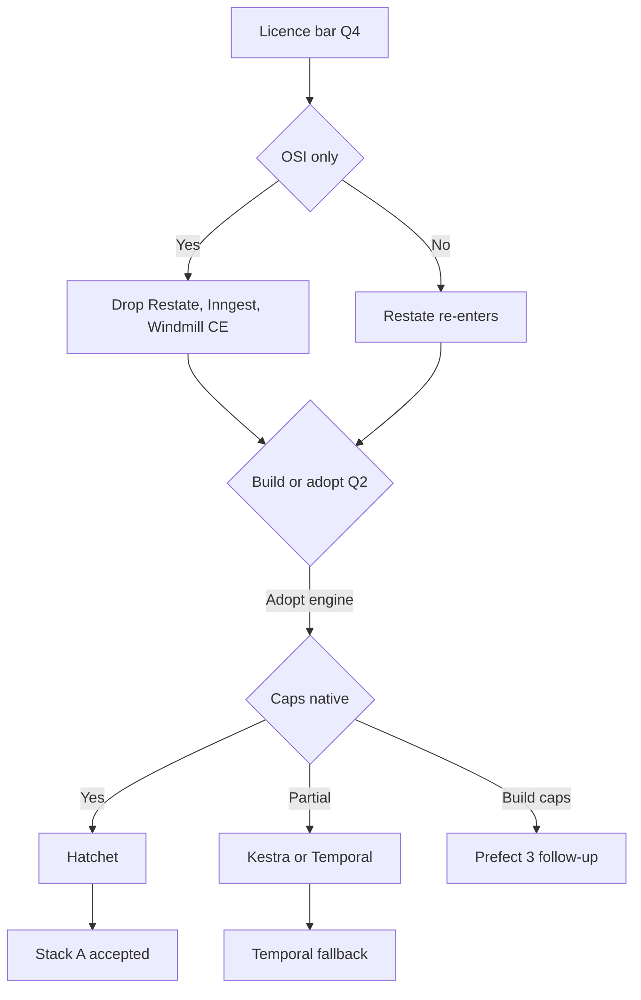
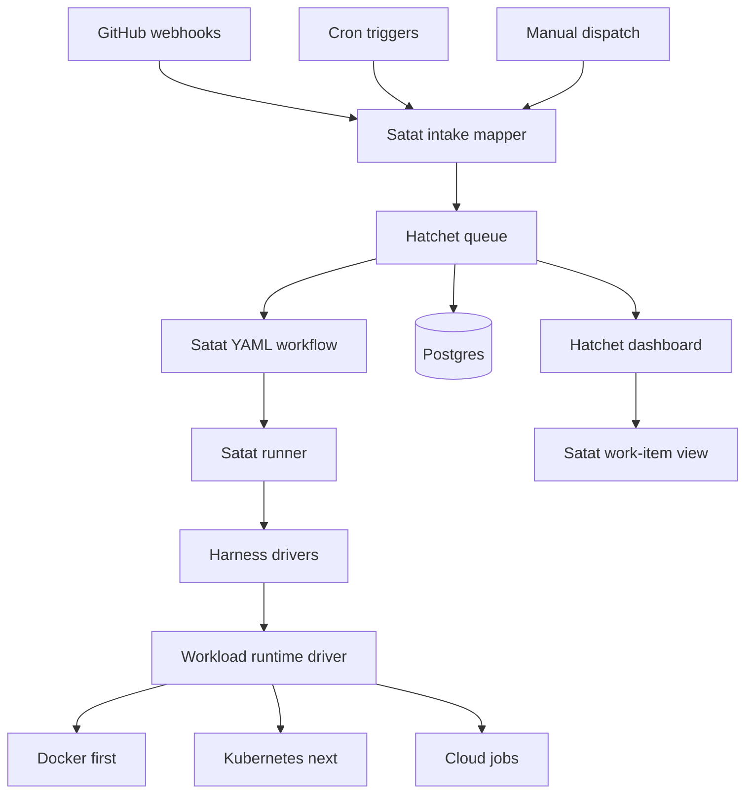
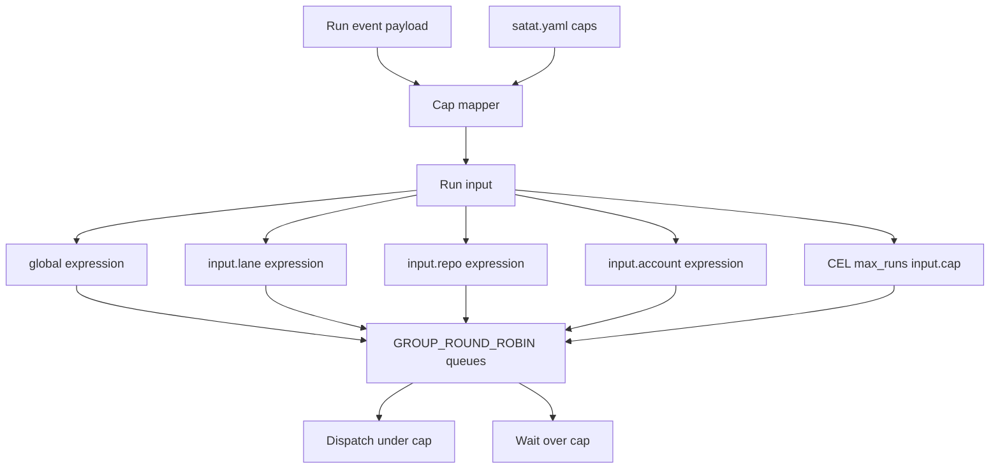
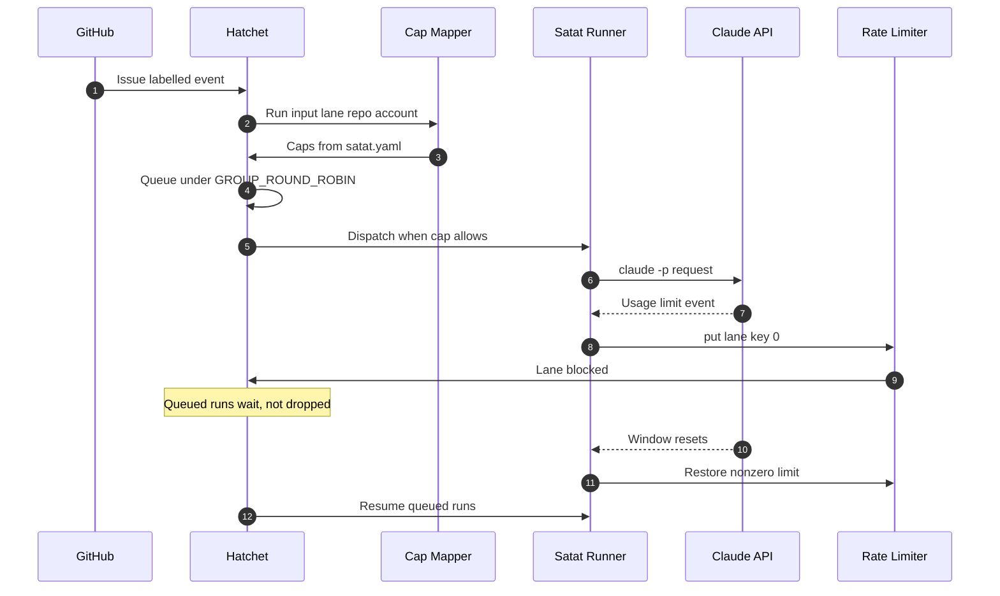
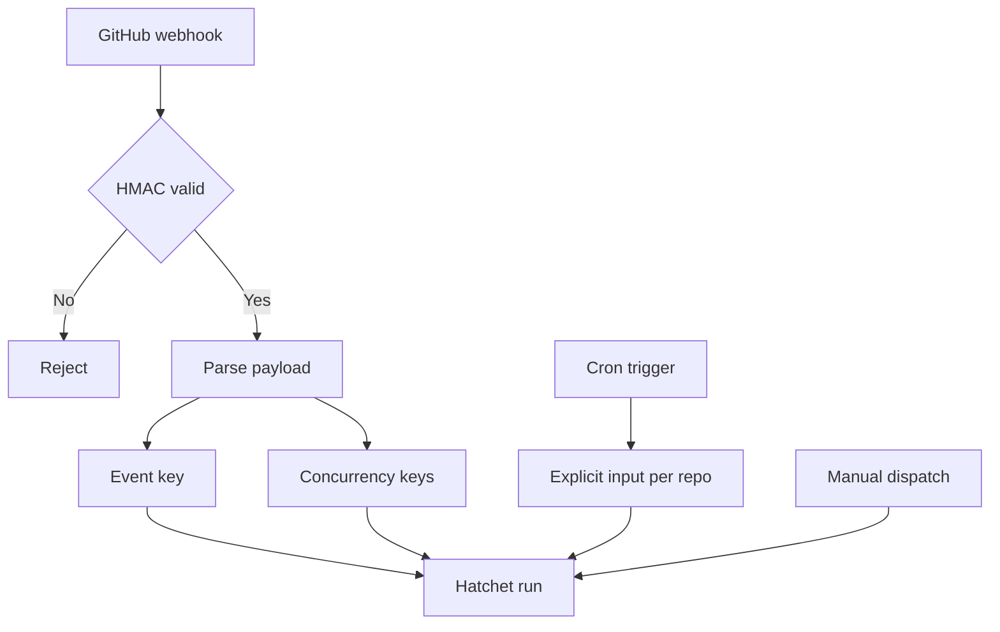

<!-- Generated by DeepWiki-Open d92819a with deepseek-v4.1-flash-1017 on 2026-10-19. Do not edit by hand; regenerate with `just wiki`. -->

[← Wiki index](index.md)

# Workflow Orchestration, Queueing, and State

Relevant source files

The following files were used as context for generating this wiki page:

- [docs/research/v2/why-hatchet.md](docs/research/v2/why-hatchet.md)
- [docs/adr/0021-adopt-platform-plumbing.md](docs/adr/0021-adopt-platform-plumbing.md)
- [docs/research/v2/platform-requirements.md](docs/research/v2/platform-requirements.md)
- [docs/research/v2/agent-platform-options.md](docs/research/v2/agent-platform-options.md)

# Workflow Orchestration, Queueing, and State

Satat's orchestration layer supplies the queue, scheduler, durable workflow engine, and part of the control plane. It does not supply the domain logic: every candidate engine is agnostic to what a "work item" or a "repo" is, so Satat still builds the harness adapters (Claude Code, opencode, pi), the workload runtime drivers, GitHub intake, and the credential-lane wiring. The work-item view is either derived from run metadata or built on top. Sources: [docs/research/v2/notes/platforms-engines.md:1-8](), [docs/research/v2/agent-platform-options.md:78-82]()

The design is constrained by the non-negotiables in the platform requirements: a control plane showing every work item's state with pause/cancel/retry/reprioritise (NN4), three-level concurrency caps where over-cap work queues and is never dropped (NN5), declarative workflows versioned in git (NN6), cron/webhook/manual triggers (NN8), per-credential-account caps and usage visibility (NN12), and an OSI-compatible licence that allows a public "deploy your own" recipe (NN11). Sources: [docs/research/v2/platform-requirements.md:29-76]()

The accepted decision is Hatchet, self-hosted under MIT, as the queue, scheduler, and workflow engine. Satat keeps its own workflow YAML; only the interpreter and the cap wiring are Hatchet-specific. Temporal is the documented fallback. Sources: [docs/adr/0023-hatchet-queue-and-workflow-engine.md:1-20](), [docs/research/v2/why-hatchet.md:52-65]()

## Requirements that drive the engine choice

| Requirement | What it forces on the engine |
|---|---|
| NN4 Control plane | Run/queue visibility with pause, cancel, retry, reprioritise; no engine models "work items", so a Satat view is built |
| NN5 Concurrency caps | Global, per-lane, per-repo caps that queue rather than drop; Claude lane backs off on usage limits and resumes at window reset |
| NN6 Workflows as code | Declarative files in git; engines that only accept code need a Satat-written interpreter |
| NN8 Triggers | Cron schedules, webhooks (issue labelled, PR review submitted), manual dispatch |
| NN12 Credential accounts | Caps, back-off, and token-expiry alerts keyed per org/account, not just per lane |
| NN11 Licence | OSI licence permitting a published "deploy your own" recipe; no managed-only control plane |
| NN9 Plugin dependencies | Local single-node install must work; Postgres must be pluggable, no mandatory Elasticsearch |

Sources: [docs/research/v2/platform-requirements.md:29-76](), [docs/research/v2/agent-platform-options.md:35-45]()

The requirements were reworded by ADR 0022: NN1 now demands a pod on Kubernetes (k3d locally, k3s on one VM, EKS/GKE/AKS), and NN9 now requires Docker plus the k3d CLI rather than "nothing but Docker". Sources: [docs/research/v2/platform-requirements.md:29-57]()

## Candidate landscape

The evaluation covered full agent platforms and durable workflow/queue engines. Full platforms were rejected for this layer because they either fail the licence bar, fail the single-VM weight test, or do not expose keyed concurrency caps. Sources: [docs/research/v2/agent-platform-options.md:78-96]()

| Engine | Licence | Caps native? | Declarative files | Single-VM weight | Verdict |
|---|---|---|---|---|---|
| **Hatchet** | MIT | Yes: multiple CEL-keyed concurrency expressions, `GROUP_ROUND_ROBIN`, dynamic `max_runs` | No (code); build YAML interpreter | `hatchet-lite` + Postgres | Best fit |
| **Temporal** | MIT | Partial: task-queue-per-lane plus worker slots; per-repo caps must be built | No (8 SDKs) | Server + UI + Postgres, ES optional | Strong alternative |
| **Kestra** | Apache-2.0 core, EE proprietary | Flow/namespace/tenant limits with QUEUE behaviour; not input-keyed | Yes, YAML flows | JVM, ≥4 GiB RAM + 2 vCPU, Postgres | Best declarative fit; cloud runners paywalled |
| **Prefect 3** | Apache-2.0 | Work-pool/queue limits plus named global limits | Partial (`prefect.yaml`) | Server + SQLite/Postgres | Viable with a security caveat |
| **Restate** | BUSL-1.1 | Yes but experimental: scope + two key levels | No | Single binary, no DB | Fails OSI bar |
| **Inngest** | SSPL-1.0 | Max two limits per function | No | Single binary (Beta self-host) | Not recommended |
| **Windmill** | AGPLv3 + proprietary CE image | Concurrency limits Enterprise-only | Yes (OpenFlow) | Rust + Postgres | Not recommended |
| **Trigger.dev** | Apache-2.0 | Queue limit + `concurrencyKey` | No (TypeScript) | ~10 services | Too heavy for one VM |
| **Conductor OSS** | Apache-2.0 | Per-task-definition limit only | Yes (JSON) | JVM + Postgres | Fallback if YAML gating is unacceptable |
| **DBOS** | MIT library | Queue + worker concurrency | No | Postgres only | UI is managed; fails NN11 |
| **Flyte 2** | Apache-2.0 | UNVERIFIED | No | Requires Kubernetes | Fails NN9 |
| **Dagger** | Apache-2.0 | None | Code modules | Engine container | Not a queue |

Sources: [docs/research/v2/agent-platform-options.md:89-96](), [docs/research/v2/notes/platforms-engines.md:18-45](), [docs/research/v2/notes/platforms-engines.md:224-254]()

The decision path under the open questions is captured below. Licence bar and build-vs-adopt answers eliminate most of the field before concurrency semantics are compared.

Sources: [docs/research/v2/notes/platforms-engines.md:261-280](), [docs/research/v2/agent-platform-options.md:35-69]()

## Stack A: Hatchet plus a Satat runner

Stack A keeps the engine thin and puts domain behaviour in Satat-owned components.

| Layer | Source |
|---|---|
| Intake | Build: GitHub webhook and label sync into Hatchet events; Hatchet has webhooks, cron, and events natively |
| Queue and scheduler | Hatchet: global, lane, and repo caps as concurrency expressions |
| Workflow engine | Hatchet durable tasks plus a Satat-built YAML interpreter (one shared workflow file plus a per-repo `satat.yaml`) |
| Harness adapter | Build: the runner plus three drivers |
| Workload runtime | Build: driver interface. Docker first (Engine API, optional gVisor, `--internal` network with per-lane egress proxy), then Kubernetes (optionally agent-sandbox), then ECS/Cloud Run/ACA |
| Model access | Existing LiteLLM + LLM Gateway; Claude subscription token |
| Control plane | Hatchet dashboard (runs, pause, cancel, replay) plus a built work-item view |
| Cross-cutting | Existing ntfy, OTLP, secrets in GitHub or the cloud secret store |

Sources: [docs/research/v2/agent-platform-options.md:169-213]()

Sources: [docs/research/v2/agent-platform-options.md:169-213]()

The build order is deliberate: runner and drivers first (Claude Code first, because the lane check matters most), then the Docker workload driver, then the YAML interpreter and repo config, then GitHub intake, then Claude-lane back-off, then the work-item view, then further runtime drivers. Sources: [docs/research/v2/agent-platform-options.md:186-200]()

## Concurrency caps and queue semantics

Hatchet is the only candidate where the caps are configuration rather than code. The ADR specifies one workflow carrying four `GROUP_ROUND_ROBIN` concurrency expressions: `'global'`, `input.lane`, `input.repo`, and `input.account`. Per-lane and per-account limits that differ use a CEL `max_runs` such as `input.cap`; the mapper looks each cap up in `satat.yaml` and passes it in the run input. Sources: [docs/adr/0023-hatchet-queue-and-workflow-engine.md:20-30]()

Sources: [docs/adr/0023-hatchet-queue-and-workflow-engine.md:20-26](), [docs/research/v2/notes/platforms-engines.md:56-76]()

Hatchet's native cap features include chained concurrency keys expressed in CEL, shared across workflows, with dynamic `max_runs` and `GROUP_ROUND_ROBIN` queues instead of dropping over-cap work. Sources: [docs/research/v2/agent-platform-options.md:84](), [docs/research/v2/notes/platforms-engines.md:56-76]()

Temporal, by contrast, provides task-queue-per-lane plus worker slots, queue RPS limits, priority 1-5, and fairness keys, but its own documentation states fairness "does not provide exact dispatch ratios, concurrency limits, or compute isolation", so per-repo caps would require a semaphore workflow Satat builds. Kestra evaluates flow, namespace, and tenant limits most-specific-first, but the limits are not keyed by input. Sources: [docs/research/v2/notes/platforms-engines.md:77-112](), [docs/research/v2/notes/platforms-engines.md:127-157]()

## Back-off, timeouts, and retention

Hatchet's defaults are unsafe for Satat's workload shape and must be overridden explicitly.

| Setting | Default | Required for Satat | Reason |
|---|---|---|---|
| `schedule_timeout` | 5 minutes | 720 h | Default cancels runs queued behind a cap or rate limit, breaking NN5 "never dropped" |
| Queue TTL on pause | 24 h (dashboard) | Long, set per pause | A paused workflow's queued runs are governed by the queue TTL, not `schedule_timeout` |
| `execution_timeout` | Not specified | Covers 30-120 minute runs | Harness runs are long |
| `SERVER_LIMITS_DEFAULT_TENANT_RETENTION_PERIOD` | 720 h | Long if history matters | Deletes runs in a final state; affects history, not queued runs |

Sources: [docs/research/v2/agent-platform-options.md:200-213](), [docs/research/v2/hatchet-caps-spike.md:30-50]()

For Claude-lane back-off the ADR selects a live rate limit on a lane key: `rate_limits.put(key, 0, ...)` while the subscription window is exhausted, restored with a nonzero limit when the token recovers. Queued work waits and resumes at the next refill window. Pausing a lane's workflow is the second option and requires each lane to be its own workflow. A `max_runs` of zero holds work but cannot change live, so it is not used for back-off. Sources: [docs/adr/0023-hatchet-queue-and-workflow-engine.md:26-32]()

Sources: [docs/adr/0023-hatchet-queue-and-workflow-engine.md:20-32](), [docs/research/v2/agent-platform-options.md:200-213]()

The alternative back-off mechanisms documented for Hatchet are: pausing a dedicated Claude-lane workflow via API until reset (subject to the queue TTL caveat), a static rate limit on the Claude-lane key adjusted via `put_rate_limit`, or the Claude-step task sleeping durably until reset. Behaviour under a zero limit was marked UNVERIFIED before the spike. Sources: [docs/research/v2/notes/platforms-engines.md:56-76]()

## Intake and triggers

Hatchet provides webhooks, cron, and events natively, including a GitHub cookbook and HMAC signature verification. The ADR confirms webhook intake with the `GITHUB` source, with the event key and the concurrency keys read from the payload, so the mapper can stay thin. Sources: [docs/research/v2/agent-platform-options.md:169-176](), [docs/adr/0023-hatchet-queue-and-workflow-engine.md:30-38]()

Cron requires care: because the concurrency keys are read from input, a cron trigger must supply explicit input per repo (`hatchet.cron.create` with input), or the workflow should avoid input-keyed expressions on cron. In the spike this failed silently. Sources: [docs/research/v2/hatchet-caps-spike.md:30-46]()

Sources: [docs/research/v2/agent-platform-options.md:169-176](), [docs/research/v2/hatchet-caps-spike.md:30-46]()

## Operational footprint and language

`hatchet-lite` bundles the engine, API, and UI in one image alongside Postgres; RabbitMQ is optional. The documentation describes Lite as being for development and low-volume use cases, which matches Satat's volume. The spike measured an idle footprint of 56 MiB for `hatchet-lite` and 393 MiB for Postgres (point-in-time `docker stats`, not a load measurement). Sources: [docs/research/v2/notes/platforms-engines.md:56-76](), [docs/research/v2/hatchet-caps-spike.md:44-50]()

The licence is MIT for the whole repository, with no `ee/` directory in the OSS tree; SSO, user groups, and tenant tags are Hatchet Cloud "Custom plan" features, while GitHub/Google OAuth is available. Hatchet tenants cover the multi-tenancy question if tenancy grows. The ADR selects the Go SDK, in line with the project's language answer. Sources: [docs/research/v2/notes/platforms-engines.md:56-76](), [docs/research/v2/agent-platform-options.md:205-213](), [docs/adr/0023-hatchet-queue-and-workflow-engine.md:38-43]()

## Spike findings

The caps spike (issue #101) established the following before the ADR was accepted.

| Finding | Detail |
|---|---|
| Caps pass | Four concurrency expressions with `GROUP_ROUND_ROBIN` behaved as configured |
| Timeouts need overrides | 720 h `schedule_timeout` accepted; 5-minute default would cancel queued runs |
| Pause has its own clock | Paused workflows use queue TTL, dashboard default 24 h |
| Retention is not a queued-work risk | Deletes only final-state runs; not tested |
| Cron needs explicit input | Input-keyed expressions fail silently on cron without input |
| Webhooks work end to end | GitHub signature checking, event key and concurrency key from payload |
| Idle footprint is small | 56 MiB `hatchet-lite`, 393 MiB Postgres |
| Not covered | Multi-hour waits (longest observed ~6 min), exact cancellation timing, arm64/k3s, tenant-scoped concurrency, load beyond 36 concurrent runs |

Sources: [docs/research/v2/hatchet-caps-spike.md:30-50]()

The spike's explicit follow-ups fed the build: prefer a live rate limit over pause or a zero cap for lane back-off, and set `schedule_timeout` and cron input explicitly in the webhook/mapper/reconciler step. Sources: [docs/research/v2/hatchet-caps-spike.md:44-50]()

## Fallbacks and alternatives

Temporal remains the drop-in alternative engine if durability track record and typed live-steering channels (Updates) outweigh the built-in cap advantage; Satat would then write the semaphore workflows for per-repo caps. Kestra is preferred only if vendor YAML in git outweighs Enterprise-gated Kubernetes and cloud task runners plus a ~4 GiB VM floor. Prefect 3 deserves a follow-up because its work pools are the only OSS native runtime plug-point across Docker, Kubernetes, ECS, Cloud Run, and ACI, but the workload needs a control-plane credential and webhooks are Cloud-only. Sources: [docs/research/v2/why-hatchet.md:52-65](), [docs/research/v2/notes/platforms-engines.md:261-280](), [docs/research/v2/agent-platform-options.md:60-69]()

Restate fails an OSI licence bar (BUSL-1.1) and Inngest fails under SSPL with a two-limit ceiling per function; Windmill requires the Enterprise edition for concurrency limits and its Community Edition image is proprietary-licensed. Sources: [docs/research/v2/notes/platforms-engines.md:18-22](), [docs/research/v2/agent-platform-options.md:89-96]()

## Summary

Orchestration in Satat is a thin adopted engine plus Satat-owned domain layers. Hatchet supplies the durable queue, scheduler, webhook/cron intake, and a run dashboard; Satat supplies the harness adapters, workload runtime drivers, the YAML workflow interpreter, the cap mapper that reads `satat.yaml`, and the work-item view. The four `GROUP_ROUND_ROBIN` concurrency expressions map one-to-one onto global, lane, repo, and credential-account caps, which is the property that made Hatchet the only candidate whose caps are configuration rather than code. The critical operational rules are non-default timeouts (720 h `schedule_timeout`, long queue TTL), explicit input on cron triggers, and live rate limits rather than zero caps for Claude-lane back-off. Sources: [docs/adr/0023-hatchet-queue-and-workflow-engine.md:1-43](), [docs/research/v2/agent-platform-options.md:169-213](), [docs/research/v2/hatchet-caps-spike.md:30-50]()

## Related pages

- [System Architecture Overview](page-4.md)
- [Agent Execution and Sandbox Runtime](page-5.md)
- [Issue-to-PR Automation Pipeline](page-7.md)
- [Intake and Triggering](page-8.md)
