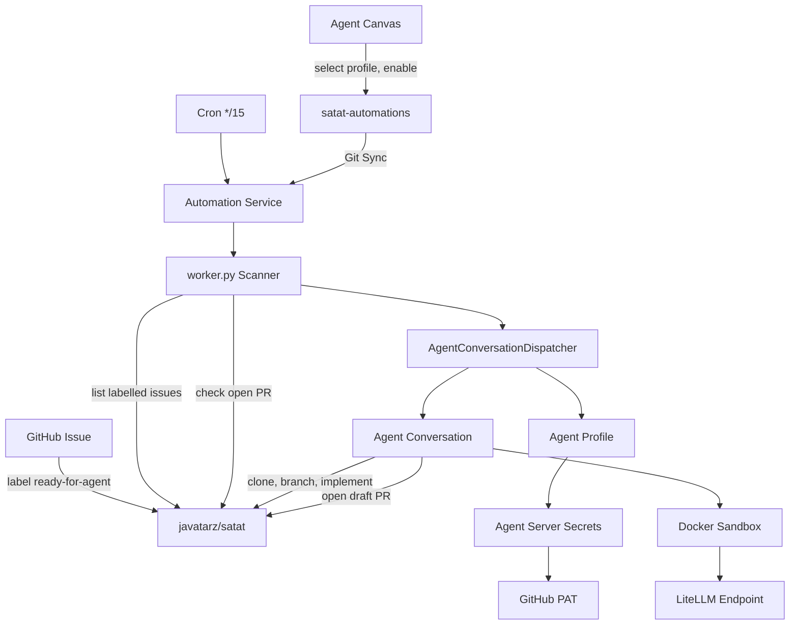
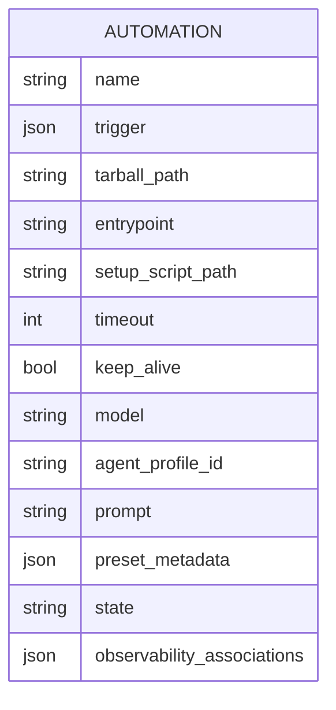
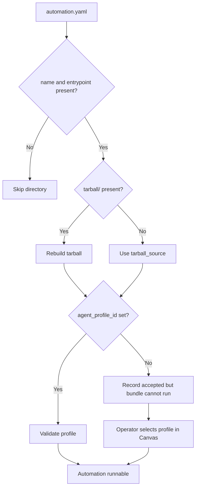
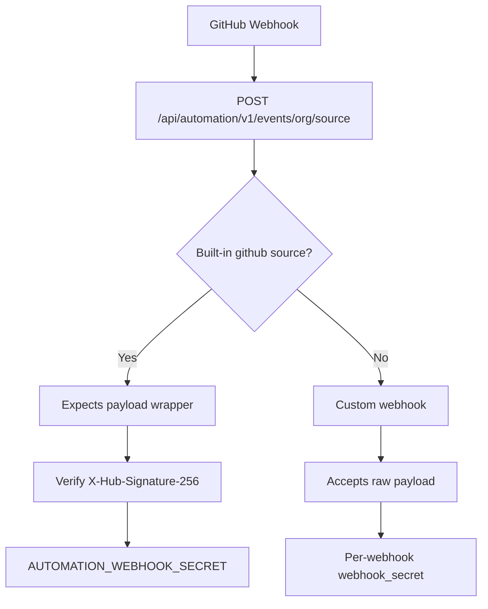
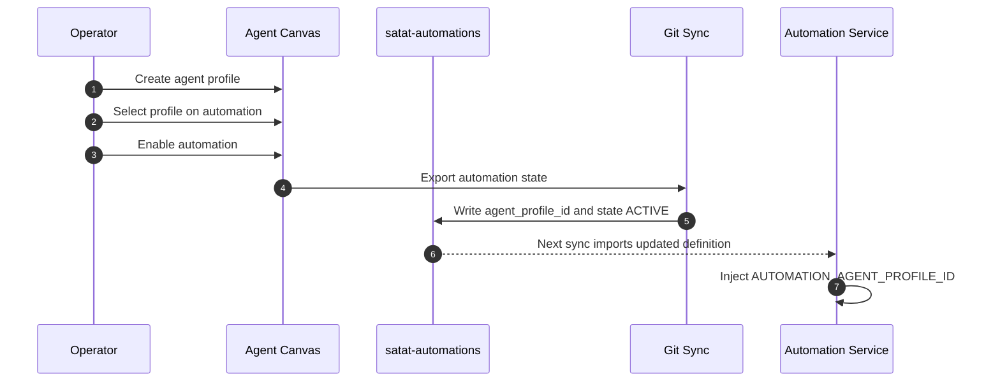
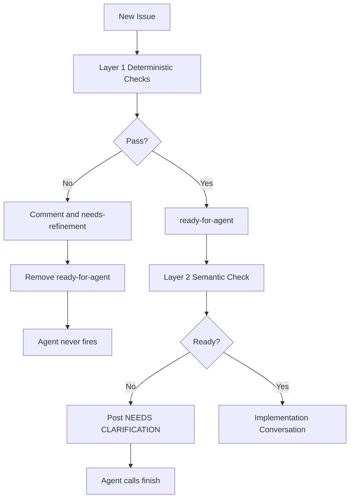

<!-- Generated by DeepWiki-Open d92819a with deepseek-v4.1-flash-1017 on 2026-10-19. Do not edit by hand; regenerate with `just wiki`. -->

[← Wiki index](index.md)

# Issue-to-PR Automation Pipeline

<details>
<summary>Relevant source files</summary>

The following files were used as context for generating this wiki page:

- [docs/research/agent-ready-issues.md](docs/research/agent-ready-issues.md)
- [docs/adr/0020-automation-definition-auth-trigger.md](docs/adr/0020-automation-definition-auth-trigger.md)
- [CONTEXT.md](CONTEXT.md)
</details>

# Issue-to-PR Automation Pipeline

Satat's issue-to-PR automation is its first shipped automation (T8, issue #27). It watches `javatarz/satat` for issues labelled `ready-for-agent`, implements each issue inside a Docker sandbox, and opens a draft pull request on a `satat/issue-N` branch. The automation is a vendored copy of the OpenHands catalog bundle `github-issue-to-pr` (pinned `1.2.2`), stored in the private `javatarz/satat-automations` repository and imported into Agent Canvas through Git Sync. Sources: [docs/adr/0020-automation-definition-auth-trigger.md:1-54](), [docs/research/agent-automation.md:82-136]()

The pipeline deliberately replaces two earlier decisions for this automation: GitHub App identity (ADR 0006) and webhook-only triggering (ADR 0010). The shipped automation authenticates with a fine-grained personal access token and is cron-polled every 15 minutes. The webhook endpoint and shared secret remain wired for future event-driven automations but are currently unused. Sources: [docs/adr/0020-automation-definition-auth-trigger.md:1-54](), [docs/adr/0010-webhook-trigger.md:1-8]()

## Pipeline Architecture

The pipeline spans GitHub, a Git Sync repository, Agent Canvas, the automation service, an Agent Server profile, a Docker sandbox, and LiteLLM. The automation definition is code plus metadata, not a declarative workflow document.



### Core Components

| Component | Role | Evidence |
|---|---|---|
| `javatarz/satat` | Target repository: source issues and destination pull requests | [docs/adr/0020-automation-definition-auth-trigger.md:1-54]() |
| `javatarz/satat-automations` | Private Git Sync repository holding `satat-issue-to-pr/automation.yaml` and `satat-issue-to-pr/tarball/` | [docs/adr/0020-automation-definition-auth-trigger.md:40-85]() |
| Agent Canvas / Git Sync | Imports automation definitions and exports runtime state such as `agent_profile_id` and `state` | [docs/research/agent-automation.md:42-101]() |
| Automation service | Runs the tarball entrypoint on a cron trigger | [docs/research/agent-automation.md:1-59]() |
| `worker.py` | Idempotent scanner that lists ready issues and dispatches agent conversations | [docs/research/agent-automation.md:82-136]() |
| `AgentConversationDispatcher` | Starts each conversation from the automation's agent profile | [docs/research/agent-automation.md:82-136]() |
| Agent profile | Supplies model, tools, and secrets to the conversation | [docs/research/agent-automation.md:82-136]() |
| Docker sandbox | Execution environment for cloning, implementing, and testing | [docs/adr/0020-automation-definition-auth-trigger.md:71-98]() |
| LiteLLM | Model endpoint at `http://litellm:4000`, using `deepseek-v4.1-flash` | [docs/adr/0020-automation-definition-auth-trigger.md:71-98]() |

### Git Sync Repository Layout

Git Sync stores each automation as a directory containing metadata and an expanded tarball:

```text
automations/
└── <slug>/
    ├── automation.yaml     # metadata; generated on export, hand-editable
    └── tarball/**          # the code bundle, expanded for reviewable diffs
```

Sources: [docs/research/agent-automation.md:1-59]()

## Automation Definition and Git Sync

### Automation as a Bundle

An automation is a code tarball plus metadata, not a declarative YAML document. The automation database model contains `name`, `trigger`, `tarball_path`, `entrypoint`, `setup_script_path`, `timeout`, `keep_alive`, `model`, `agent_profile_id`, `prompt`, `preset_metadata`, `state`, and `observability_associations`. Sources: [docs/research/agent-automation.md:1-59]()



### `automation.yaml` Fields

The Git Sync serializer exports the following fields: `name`, `model`, `agent_profile_id`, `trigger`, `observability_associations`, `setup_script_path`, `entrypoint`, `timeout`, `keep_alive`, `enabled`, `state`, `prompt`, `preset_metadata`, `tarball_source`, and `tarball_executables` when any file is executable. Sources: [docs/research/agent-automation.md:1-59]()

| Field | Purpose |
|---|---|
| `name` | Required automation name |
| `entrypoint` | Required command that runs the bundle |
| `trigger` | Cron or event trigger definition |
| `agent_profile_id` | Agent Server profile used by the dispatcher; may be `null` but then a dispatcher-based bundle cannot run |
| `state` / `enabled` | Activation state |
| `tarball_source` | Used only when `tarball/` is absent |
| `tarball_executables` | Exported only when executable files exist |
| `model`, `prompt`, `preset_metadata` | Runtime metadata |
| `timeout`, `keep_alive` | Execution limits |
| `setup_script_path` | Optional setup script |
| `observability_associations` | Observability wiring |

Sources: [docs/research/agent-automation.md:1-59]()

### Import Rules

Git Sync import applies these rules:

- `name` and `entrypoint` are required; every other field is optional.
- An internal tarball is rebuilt from `tarball/**` and stored as a fresh upload.
- Importing a new directory needs an owner. In local mode this is the deterministic local identity, but only after the org's Git Sync configuration is saved.
- `agent_profile_id` is validated only when set. With `null`, the API accepts the record, but a dispatcher-based bundle cannot run.
- A malformed `automation.yaml` skips only that directory; the sync cycle continues.

Sources: [docs/research/agent-automation.md:42-101]()



Sources: [docs/research/agent-automation.md:42-101]()

## Trigger Model

### Cron Polling

The shipped `satat-issue-to-pr` automation triggers every 15 minutes using the catalog default `*/15 * * * *` with timezone `UTC`. The trigger is represented as a discriminated union:

```json
{"type": "cron", "schedule": "*/15 * * * *", "timezone": "UTC"}
```

Sources: [docs/research/agent-automation.md:42-101](), [docs/adr/0020-automation-definition-auth-trigger.md:67-85]()

Cron polling was chosen because the vendored `github-issue-to-pr` bundle is a scanner: it dispatches an agent conversation per ready issue, but the same scan also sweeps for revisions. An event-only trigger would drop that revision work. Sources: [docs/adr/0020-automation-definition-auth-trigger.md:1-54]()

### Event Trigger Shape

The event variant is:

```json
{"type": "event", "source": "github", "on": "issues.labeled", "filter": "<JMESPath>"}
```

Event keys use `"{event_type}.{action}"`, such as `issues.labeled`, `pull_request.opened`, or `push`, and wildcards such as `pull_request.*` are allowed. `filter` is a JMESPath expression over the raw webhook payload with custom functions including `contains`, `glob`, `icontains`, `regex`, `starts_with`, `ends_with`, `lower`, and `upper`. Sources: [docs/research/agent-automation.md:42-101]()

### Webhook Endpoint Status

The webhook endpoint and `AUTOMATION_WEBHOOK_SECRET` are still wired, so a later event-driven automation can use them without further infrastructure. The receiver is:

```text
POST /api/automation/v1/events/{org_id}/{source}
```

The built-in `github` source expects the OpenHands-normalized `{"payload": …}` wrapper, so a raw self-hosted GitHub webhook must register a custom webhook through `POST /api/automation/v1/webhooks`. No `/webhook` alias is added because the Canvas ingress only routes `/api/automation/*` and GitHub does not follow redirects. Sources: [docs/adr/0020-automation-definition-auth-trigger.md:67-85](), [docs/research/agent-automation.md:82-136]()

### Inbound Event Paths



The built-in source verifies an HMAC-SHA256 signature in `X-Hub-Signature-256` against `AUTOMATION_WEBHOOK_SECRET` and uses `X-GitHub-Delivery` for de-duplication. A custom webhook accepts the raw payload with a per-webhook `webhook_secret` and configurable `signature_header` such as `X-Hub-Signature-256`. Sources: [docs/research/agent-automation.md:42-101]()

## GitHub Identity and Secrets

Agent Canvas has no self-hosted GitHub App support. `GITHUB_APP_ID` and `GITHUB_APP_PRIVATE_KEY` exist only in OpenHands Cloud and enterprise charts. The open-source automation service and its bundles authenticate with a saved Agent Server secret named `GITHUB_PERSONAL_ACCESS_TOKEN`, read via `GET /api/settings/secrets/<name>`. Sources: [docs/research/agent-automation.md:82-136]()

The agent uses a fine-grained personal access token scoped to the target repository:

| Scope | Permission |
|---|---|
| Contents | Read and write |
| Pull Requests | Read and write |
| Issues | Read and write |
| Metadata | Read-only |

Sources: [docs/adr/0020-automation-definition-auth-trigger.md:40-85]()

The token is saved in Agent Canvas as the `GITHUB_PERSONAL_ACCESS_TOKEN` secret and attached to the automation's agent profile. The dispatcher starts each conversation from that profile and resolves its secrets. The token is never a value in `javatarz/satat` or in `javatarz/satat-automations`. Sources: [docs/adr/0020-automation-definition-auth-trigger.md:40-85]()

Because the identity is a PAT rather than a GitHub App, the automation loses the App's audit attribution and the credential is scoped per repository. Sources: [docs/adr/0020-automation-definition-auth-trigger.md:71-98]()

The following variables are retired because nothing consumes them: `GITHUB_APP_ID`, `GITHUB_APP_PRIVATE_KEY`, `TARGET_REPOSITORY`, and `TARGET_USER`. Equivalent values now live in `satat-automations/tarball/config.json` and in Canvas secrets. Sources: [docs/adr/0020-automation-definition-auth-trigger.md:71-98]()

Secrets are never placed in git-tracked files, Terraform state, or cloud-init. Until a Kubernetes secrets ADR exists, secrets live in GitHub repository secrets and cloud OIDC. Sources: [AGENTS.md:1-46]()

## Agent Profile and Activation

The bundle's dispatcher requires the automation to carry an `agent_profile_id`. It reads `AUTOMATION_AGENT_PROFILE_ID`, and the service injects that environment variable only when `automation.agent_profile_id` is truthy. A profile id belongs to the Agent Server, not the automation database, so it cannot be reliably hand-authored in git. Sources: [docs/research/agent-automation.md:42-101]()

The committed automation is therefore `state: INACTIVE` with `agent_profile_id: null`. The operator creates the profile in Canvas, selects it on the automation, and enables the automation. Git Sync then exports the profile id and `state: ACTIVE` back to `satat-automations`. Sources: [docs/adr/0020-automation-definition-auth-trigger.md:40-85](), [docs/research/agent-automation.md:119-161]()



The profile supplies the model, tools, and secrets the conversation receives. `agent_conversation.py` calls `workspace.get_secrets(agent_profile_id=…)`. The bundle's own `AGENT_SECRET_NAMES` allow-list belongs to the older `main.py` flow and is not what the shipped entrypoint uses. Sources: [docs/research/agent-automation.md:82-136]()

## The `github-issue-to-pr` Bundle

The catalog manifest declares a `bundle` automation, version `1.2.2`, with these properties:

| Property | Value |
|---|---|
| Bundle files | `worker.py`, `main.py`, `github_client.py`, `agent_conversation.py` |
| Entrypoint | `python3 worker.py` |
| Timeout | `300` |
| Setup script | None; the runtime already has the OpenHands SDK |

Sources: [docs/research/agent-automation.md:82-136]()

### Scanner Behavior

`worker.py` is an idempotent scanner. It lists open issues carrying the trigger label, skips any issue that already has an open `satat/issue-N` pull request, and delegates each ready issue to an agent conversation through `AgentConversationDispatcher`. The agent clones the repository, creates a branch, implements the issue, runs tests, pushes the branch, and opens the draft pull request itself. The scanner does not poll for completion, so it works under either trigger type. Sources: [docs/research/agent-automation.md:82-136]()

### `config.json` Keys

The bundle reads the following configuration keys:

| Key | Meaning |
|---|---|
| `repos` | List of `owner/repo` strings |
| `trigger_label` | Label that marks an issue as ready |
| `branch_prefix` | Prefix for generated branches |
| `pull_request_mode` | `draft` or `ready` |
| `max_new_per_run` | Maximum new issues dispatched per scan |
| `agent_secret_names` | Secret allow-list for the older `main.py` flow |
| `openhands_url` | OpenHands service URL |
| `github_token_secret` | Name of the GitHub token secret |
| `repository` | Optional repository override |
| `base_branch` | Optional base branch |
| `review_label` | Optional review label |

Sources: [docs/research/agent-automation.md:119-161]()

The vendored deployment settings are `repos: [javatarz/satat]`, `trigger_label: ready-for-agent`, `branch_prefix: satat/issue`, and `pull_request_mode: draft`. Editing the automation is a reviewed pull request in `satat-automations`; Canvas imports it on the next sync cycle. Sources: [docs/adr/0020-automation-definition-auth-trigger.md:40-85]()

## Runtime Flow

At runtime, the cron trigger invokes the automation service, which runs the bundle entrypoint. The scanner queries GitHub for labelled issues, checks for an existing open PR per issue, and dispatches a conversation for each unclaimed issue. The conversation runs in a Docker sandbox, uses the agent profile's model and secrets, and opens the draft PR directly on GitHub.

```mermaid
sequenceDiagram
  autonumber
  participant Cron as Cron Trigger
  participant Svc as Automation Service
  participant Worker as worker.py
  participant GH as GitHub
  participant Dispatch as Dispatcher
  participant Agent as Agent Conversation
  participant Box as Docker Sandbox
  Cron->>Svc: Fire every 15 minutes
  Svc->>Worker: Run python3 worker.py
  Worker->>GH: List open issues with trigger label
  GH-->>Worker: Ready issues
  Worker->>GH: Check for open satat/issue-N PR
  alt Open PR exists
    Worker->>Worker: Skip issue
  else No open PR
    Worker->>Dispatch: Dispatch issue conversation
    Dispatch->>Agent: Start from agent profile
    Agent->>Box: Clone, branch, implement, test
    Agent->>GH: Push branch
    Agent->>GH: Open draft PR
  end
```

Sources: [docs/research/agent-automation.md:82-136](), [docs/adr/0020-automation-definition-auth-trigger.md:1-54]()

## Input Quality: Issue Readiness

Because the agent fills gaps in under-specified issues rather than asking a human, issue readiness is part of the pipeline's effective input contract. The research notes that a vague ticket is worse for an agent than for a junior human: a human asks before coding, while an agent produces a confident branch before anyone notices the missing decision. Sources: [docs/research/agent-ready-issues.md:1-34]()

### Two-Layer Readiness Design

Satat's readiness design separates deterministic structural checks from semantic judgments:

| Layer | Mechanism | Checks |
|---|---|---|
| Layer 1 | GitHub Actions, zero tokens | Body length, required sections, file paths, vague verbs, tribal-knowledge phrases |
| Layer 2 | Agent's first turn, one LLM call | Testability of acceptance criteria, oracle existence, scope feasibility |

If Layer 1 fails, the issue receives a comment plus `needs-refinement`, the `ready-for-agent` label is removed, and the agent never fires. Layer 2 posts clarifying questions using `[NEEDS CLARIFICATION]` markers and calls `finish` if the issue is not ready. It uses the same model as implementation, DeepSeek V4.1 Flash. Sources: [docs/research/issue-readiness-checks.md:1-45](), [docs/research/issue-readiness-checks.md:30-47]()



Sources: [docs/research/issue-readiness-checks.md:1-45]()

### Issue Tracker Conventions

Issues and specs live as GitHub issues, and the `gh` CLI is used for all operations. The default triage vocabulary is `needs-triage`, `needs-info`, `ready-for-agent`, `ready-for-human`, and `wontfix`. Pull requests are not treated as a request surface for this repository. Sources: [docs/agents/issue-tracker.md:1-41](), [AGENTS.md:1-46]()

## Security and Operational Constraints

The webhook route sits under `/api/*`, which the existing Caddy configuration proxies to `canvas:8000` without oauth2-proxy. The `{org_id}` path segment means an automation server's org UUID must appear in the URL. A separate `/webhook` route would return 404 because the Canvas ingress only routes `/api/automation/*`. Sources: [docs/research/agent-automation.md:82-136]()

`WEBHOOK_SECRET` is passed from GitHub secrets to Canvas as `AUTOMATION_WEBHOOK_SECRET`. It is the shared secret for the built-in `github` source. A self-hosted raw GitHub webhook needs a custom webhook registered at `https://<SATAT_DOMAIN>/api/automation/v1/events/{org_id}/{source}`. No event automation exists yet, so the secret is currently inert. Sources: [docs/research/agent-automation.md:119-161]()

## Limitations and Deferred Work

- **Cron latency:** polling every 15 minutes adds up to 15 minutes of pickup latency compared with a webhook. Sources: [docs/adr/0020-automation-definition-auth-trigger.md:71-98]()
- **Reduced audit attribution:** the PAT is per-repository and loses the GitHub App's audit attribution. Sources: [docs/adr/0020-automation-definition-auth-trigger.md:71-98]()
- **Runtime configuration is not Git-reviewable:** automation edits are reviewable in `satat-automations`, but runtime behaviour such as model, secrets, and profile is Canvas state. Sources: [docs/adr/0020-automation-definition-auth-trigger.md:71-98]()
- **Repository re-pointing:** changing the target repository is a `config.json` edit in `satat-automations`, not a GitHub variable change. Sources: [docs/adr/0020-automation-definition-auth-trigger.md:71-98]()
- **Deferred acceptance bullets:** the init-message additions (story-refinement/oracle question, CI-round cap 3) and ntfy notifications on agent start/finish/PR/stuck are not met by the vendored bundle. The former belongs with story-refinement and hooks work; the latter is a follow-up. Sources: [docs/adr/0020-automation-definition-auth-trigger.md:71-98](), [docs/research/agent-automation.md:119-161]()
- **No `/webhook` alias:** GitHub does not follow redirects, and the Canvas ingress only routes `/api/automation/*`. Sources: [docs/adr/0020-automation-definition-auth-trigger.md:67-85]()
- **Future event-driven reviewer:** a second event-based automation could trigger on `pull_request.opened` with a JMESPath filter on `pull_request.user.login`, restricted to Satat's identity. That would make the webhook secret load-bearing. Sources: [docs/research/critic-extensibility.md:233-274]()

## Summary

The issue-to-PR pipeline is a Git-synced, cron-polled automation bundle. Its definition lives in `javatarz/satat-automations`, its runtime identity is a fine-grained PAT stored as an Agent Server secret, and its execution path is `worker.py` → dispatcher → agent profile → Docker sandbox → draft PR. The design trades webhook immediacy and GitHub App auditability for compatibility with self-hosted Agent Canvas, reviewable automation definitions, and a staged activation flow that keeps Agent Server profile IDs out of hand-authored git files. Sources: [docs/adr/0020-automation-definition-auth-trigger.md:1-98](), [docs/research/agent-automation.md:1-161]()

## Related pages

- [Workflow Orchestration, Queueing, and State](page-6.md)
- [Intake and Triggering](page-8.md)
- [LLM Gateway and Model Routing](page-9.md)
- [Extensibility and Automation Configuration](page-12.md)
