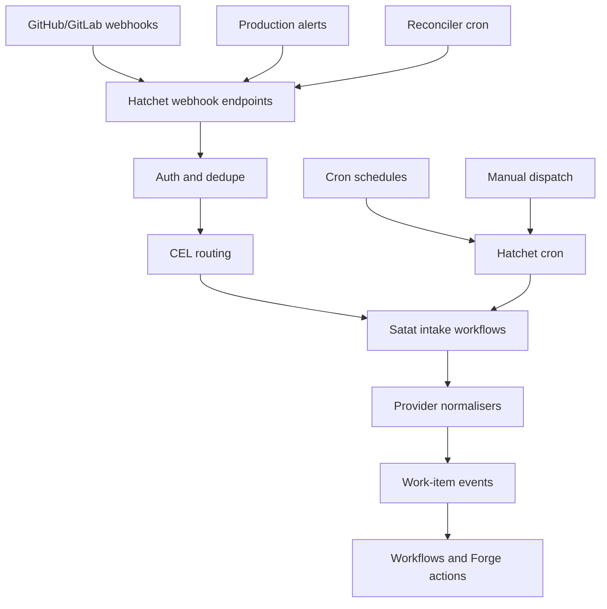
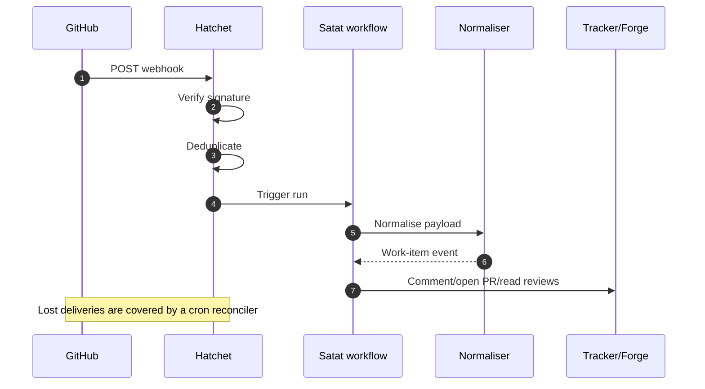

<!-- Generated by DeepWiki-Open d92819a with deepseek-v4.1-flash-1017 on 2026-10-19. Do not edit by hand; regenerate with `just wiki`. -->

[← Wiki index](index.md)

# Intake and Triggering

Relevant source files

The following files were used as context for generating this wiki page:

- [docs/research/v2/intake-triggers.md](docs/research/v2/intake-triggers.md)
- [docs/research/v2/notes/intake-abstractions.md](docs/research/v2/notes/intake-abstractions.md)
- [docs/research/v2/notes/intake-platforms.md](docs/research/v2/notes/intake-platforms.md)
- [docs/adr/0020-automation-definition-auth-trigger.md](docs/adr/0020-automation-definition-auth-trigger.md)

# Intake and Triggering

## Purpose and Scope

Intake and triggering covers how Satat starts work from GitHub and GitLab webhooks, cron schedules, production alerts, and manual dispatch. The owner’s requirements are to avoid maintaining trigger endpoints, hide GitHub-versus-GitLab differences, and write only integration code plus workflows such as issue-to-PR or alert-to-issue/PR. This is research status as of 2026-10-15, with no final decision recorded. Sources: [docs/research/v2/intake-triggers.md:1-16]().

Satat’s platform requirements define triggers as cron schedules, events such as issue-labelled or PR-review-submitted webhooks, and manual dispatch from the control plane. They also require workflows as code, repo-level opt-in to shared workflows, plugin-based infrastructure dependencies, self-hosting with a public recipe, and least-privilege credentials. Sources: [docs/research/v2/platform-requirements.md:50-76]().

## Architecture Overview

The recommended baseline is Hatchet’s built-in intake rather than a separate intake service. Hatchet is already in Stack A, and its native webhooks, cron, schedules, manual runs, CEL routing, and run idempotency cover most intake needs. Satat still owns provider normalisers, a reconciler for missed GitHub deliveries, and idempotency expressions. Sources: [docs/research/v2/intake-triggers.md:18-32](), [docs/research/v2/notes/intake-platforms.md:1-36]().

The diagram reflects Hatchet as the intake boundary, with Satat-owned normalisation and reconciliation after Hatchet triggers a workflow. Sources: [docs/research/v2/intake-triggers.md:18-32](), [docs/research/v2/notes/intake-platforms.md:115-154]().

A GitHub webhook flow through Hatchet and Satat looks like this:

Hatchet verifies and routes the webhook, then invokes a Satat workflow. Satat normalises provider payloads into its own work-item events and uses a `Forge` interface for actions such as commenting, opening PRs, and reading reviews. Sources: [docs/research/v2/intake-triggers.md:34-44](), [docs/research/v2/intake-triggers.md:125-154]().

## Hatchet Baseline Capabilities

Hatchet provides one webhook endpoint per source, provider presets, signature checks, CEL-based routing and filtering, deduplication through run idempotency, cron and scheduled runs, manual runs, and an event log. Sources: [docs/research/v2/intake-triggers.md:34-44]().

| Need | Hatchet built-in |
|---|---|
| Webhook endpoint per source | Yes. Source presets `GITHUB`, `STRIPE`, `SLACK`, `LINEAR`, `SVIX`, plus `GENERIC` |
| Signature checks | GitHub preset, or generic `HMAC`, `API_KEY`, or `BASIC` auth. Secrets stored encrypted |
| Routing and filtering | CEL expressions for event key and scope |
| Dedupe | Run idempotency by TTL or until run finishes. Keys on body fields; headers such as `X-GitHub-Delivery` are not visible |
| Cron, schedules, manual runs | Yes |
| Event log and replay | Events stored and validation failures logged. UI replay is UNVERIFIED |

Sources: [docs/research/v2/intake-triggers.md:34-44]().

The Hatchet webhook endpoint is `/api/v1/stable/tenants/{tenant}/webhooks/{name}`, one per webhook. Webhooks can be created in the dashboard or through SDK webhook feature clients in Python, TypeScript, Go, and Ruby, so they can be managed as code. The source enum includes `GITHUB`, `STRIPE`, `SLACK`, `SVIX`, `LINEAR`, and `GENERIC`. Sources: [docs/research/v2/notes/intake-platforms.md:62-80]().

## Source Coverage

Hatchet covers GitHub natively through its preset. GitLab uses generic auth with GitLab’s shared token header. Grafana Alerting and Alertmanager use generic HMAC or API key. Sentry, Gitea, and Bitbucket use generic HMAC, but their header formats are UNVERIFIED. PagerDuty’s `v1=` signature prefix is not stripped by generic HMAC, so it needs a custom-header API key or a small shim. Sources: [docs/research/v2/intake-triggers.md:46-55]().

| Source | Through Hatchet |
|---|---|
| GitHub | Native preset |
| GitLab | Generic auth with GitLab’s shared token header |
| Grafana Alerting, Alertmanager | Generic HMAC or API key |
| Sentry, Gitea, Bitbucket | Generic HMAC; header formats UNVERIFIED |
| PagerDuty | `v1=` prefix is not stripped; use custom-header API key or a shim |

Sources: [docs/research/v2/intake-triggers.md:46-55]().

## Gaps and Limitations

Hatchet does not provide a durable buffer. If Hatchet is down, the sender’s retry policy is the only protection. GitHub never retries automatically, and failed deliveries can only be redelivered for three days. Sources: [docs/research/v2/notes/intake-platforms.md:1-36](), [docs/research/v2/intake-triggers.md:56-60]().

Hatchet does not normalise payloads across providers. No tool found normalises GitHub, GitLab, and Bitbucket payloads into one schema. Keep does normalise alerts, but SCM payload normalisation remains Satat’s responsibility. Sources: [docs/research/v2/intake-triggers.md:18-32](), [docs/research/v2/notes/intake-platforms.md:209-255]().

Hatchet stores events and logs validation failures, but replaying an event from the UI is UNVERIFIED. Its generic HMAC also strips only `sha1=`, `sha256=`, `sha512=`, and `md5=`, so PagerDuty’s `v1=` signatures fail verification. Sources: [docs/research/v2/intake-triggers.md:34-55](), [docs/research/v2/notes/intake-platforms.md:1-36]().

## Satat-Owned Components

On Hatchet alone, Satat must write four categories of code:

1. Per-provider normalisers, starting with GitHub, inside the tracker plugin. These turn payloads into Satat work-item events and are required regardless of gateway because no evaluated tool normalises SCM payloads.
2. A cron reconciler task that lists hook deliveries and redelivers failures, or polls for labelled issues and reconciles them against work items. This is roughly 100–200 lines.
3. Idempotency expressions on intake workflows.
4. One webhook definition per provider in code via the SDK, plus repo or org webhook registration manually or through a GitHub App with one org-level webhook.

Sources: [docs/research/v2/notes/intake-platforms.md:115-154]().

The reconciler is necessary because GitHub does not retry failed deliveries and only allows redelivery for three days. It also covers label drift by periodically reconciling label state. Sources: [docs/research/v2/intake-triggers.md:125-154](), [docs/research/v2/notes/intake-platforms.md:1-36]().

Satat also needs a `Forge` interface for workflow actions: comment, open PR, and read reviews. This keeps provider-specific forge operations behind one abstraction. Sources: [docs/research/v2/intake-triggers.md:125-154]().

## Candidate Evaluation

The research evaluated multiple intake platforms. The summary below captures the candidates most relevant to Satat’s constraints.

| Candidate | Intake role | License | Main fit / issue |
|---|---|---|---|
| Hatchet built-in | Webhooks, cron, schedules, manual runs, idempotency | MIT | Lowest maintenance; already running; Satat writes reconciler and normalisers |
| Convoy | HTTP ingest, HMAC/basic/API-key auth, custom GitHub verifier, retries, replay, dedupe | ELv2 | Adds durable buffer and replay, but adds Postgres and Redis; fails OSI-only bar |
| Keep | Alert webhook and pull providers, normalised alert schema, dedupe, correlation | MIT outside `ee/` | Good for many monitoring vendors; Elastic-owned and slowing |
| Hookdeck Event Gateway | Managed source presets for GitHub, GitLab, Bitbucket, Grafana; retries, dedupe, replay | Proprietary SaaS | Removes most work but fails NN11 |
| Trigger.dev | About 30 webhook presets, dedupe, filters, replay API | Apache-2.0 | Best feature fit but private beta and would replace Hatchet |
| Argo Events / Knative | Kubernetes-native event sources | Apache-2.0 | Fails Docker-only local requirement; Kubernetes CRDs |
| Svix OSS | Outbound sender; Bridge only receives Svix-signed webhooks | MIT | Svix Ingest is managed, so not a self-hosted intake solution |
| n8n | GitHub/GitLab triggers, schedules, webhook nodes | Sustainable Use License | Full automation platform; license limits internal business use |
| Activepieces | Trigger catalogue, schedules, run log | MIT outside `packages/ee` | Adds platform; GitHub trigger behavior UNVERIFIED |
| Windmill | HTTP routes with signature presets, schedules, broker triggers | AGPL-3.0 + proprietary EE | Second workflow engine; CE image contains proprietary code |
| Kestra | Schedule, webhook, polling triggers | Apache-2.0 | Webhook trigger has no HMAC, only secret key in URL |

Sources: [docs/research/v2/notes/intake-platforms.md:28-80](), [docs/research/v2/notes/intake-platforms.md:145-185](), [docs/research/v2/notes/intake-platforms.md:175-220](), [docs/research/v2/notes/intake-platforms.md:209-255]().

Convoy is the main option if a durable buffer, deduplication on delivery id, and replay become necessary. It supports idempotency keys from `request.header.*`, `request.body.*`, and `request.query.*`, so `X-GitHub-Delivery` works. It runs with Convoy server and agent, Postgres, and Redis, but it is ELv2 and fails an OSI-only license bar. Sources: [docs/research/v2/notes/intake-platforms.md:145-185]().

Keep is relevant only if production alerts arrive in volume from many tools and need normalisation, deduplication, and correlation before becoming issues. Its core is MIT outside `ee/`, but Elastic acquired it on 2025-05-21, and activity is slowing. With one Grafana stack, Grafana’s HMAC webhook straight to Hatchet is simpler. Sources: [docs/research/v2/notes/intake-platforms.md:209-255]().

Trigger.dev is the closest to “intake done for me” because of its webhook presets, dedupe, filters, delivery inspection, and replay API. However, it is in private beta, self-hosted access is enabled by the vendor, and adopting it would mean replacing Hatchet as the engine. Sources: [docs/research/v2/notes/intake-platforms.md:175-220](), [docs/research/v2/notes/intake-platforms.md:52-64]().

## Trigger Model and Event Schema

Satat’s platform requirements call for cron schedules, event triggers from webhooks such as issue-labelled or PR-review-submitted, and manual dispatch from the control plane. Workflows must be declarative files versioned in git, with human approval gates expressible. Sources: [docs/research/v2/platform-requirements.md:50-76]().

The OpenHands automation research documents a concrete trigger shape that can inform Satat’s event model. It uses a discriminated union with cron triggers containing `schedule` and `timezone`, and event triggers containing `source`, `on`, and an optional JMESPath `filter`. Event keys are `"{event_type}.{action}"`, such as `issues.labeled`, `pull_request.opened`, or `push`, and wildcards such as `pull_request.*` are allowed. The filter supports custom functions including `contains`, `glob`, `icontains`, `regex`, `starts_with`, `ends_with`, `lower`, and `upper`. Sources: [docs/research/agent-automation.md:42-59]().

For the event envelope, CloudEvents is available as an Apache-2.0 envelope spec with adapter documentation for GitHub and GitLab, but it only wraps the raw body and does not normalise provider payloads. CDEvents defines vocabulary such as `change.created`, `change.reviewed`, `change.merged`, `ticket.created`, and `incident.detected`, but `change.reviewed` has no review state, so it is not sufficient by itself. Alertmanager webhook v4 is the de facto alert payload, and Grafana’s default webhook payload is a superset. Sources: [docs/research/v2/notes/intake-abstractions.md:20-26]().

## Decision and Revisit Criteria

The recommendation is not to adopt a separate intake framework now. Satat should use Hatchet’s native webhooks, cron, and manual triggers, and maintain only provider normalisers, a cron reconciler for missed GitHub deliveries and label drift, idempotency expressions, and webhook definitions in code. Sources: [docs/research/v2/notes/intake-platforms.md:209-255](), [docs/research/v2/intake-triggers.md:125-154]().

Revisit the decision when:

- Sources grow past about five, or lost deliveries start to hurt. Add Convoy if a source-available license is acceptable.
- Alerts come from several monitoring vendors. Add Keep in front of Hatchet.
- Trigger.dev webhooks reach general availability. Re-evaluate Trigger.dev as the engine.
- NN11 is relaxed for intake only. Hookdeck becomes the low-maintenance option.

Sources: [docs/research/v2/intake-triggers.md:125-154](), [docs/research/v2/notes/intake-platforms.md:240-271]().

The engine comparison also shows that alternative engines carry trade-offs. Kestra’s OSS Docker runner is available but Kubernetes, AWS Batch, Cloud Run, and Azure Batch runners are Enterprise features. Trigger.dev supports Docker and Kubernetes but requires many services. Prefect 3 is viable but has a security caveat. Restate fails the OSI bar with BUSL-1.1. Inngest uses SSPL-1.0 and is not recommended. Sources: [docs/research/v2/agent-platform-options.md:89-96](), [docs/research/v2/notes/platforms-engines.md:18-25]().

## Summary

Intake and triggering in Satat is currently a research-backed architecture decision: use Hatchet as the intake boundary, avoid a separate gateway, and keep Satat’s code focused on provider normalisation, reconciliation, idempotency, and forge actions. Hatchet covers webhooks, cron, schedules, manual runs, signature checks, routing, and basic deduplication, but it does not provide a durable buffer, cross-provider SCM normalisation, or verified UI replay. Convoy, Keep, Trigger.dev, Hookdeck, and Kubernetes-native options remain revisit candidates under specific conditions. Sources: [docs/research/v2/intake-triggers.md:18-55](), [docs/research/v2/notes/intake-platforms.md:1-36](), [docs/research/v2/notes/intake-platforms.md:209-255]().

## Related pages

- [Workflow Orchestration, Queueing, and State](page-6.md)
- [Issue-to-PR Automation Pipeline](page-7.md)
- [Extensibility and Automation Configuration](page-12.md)
