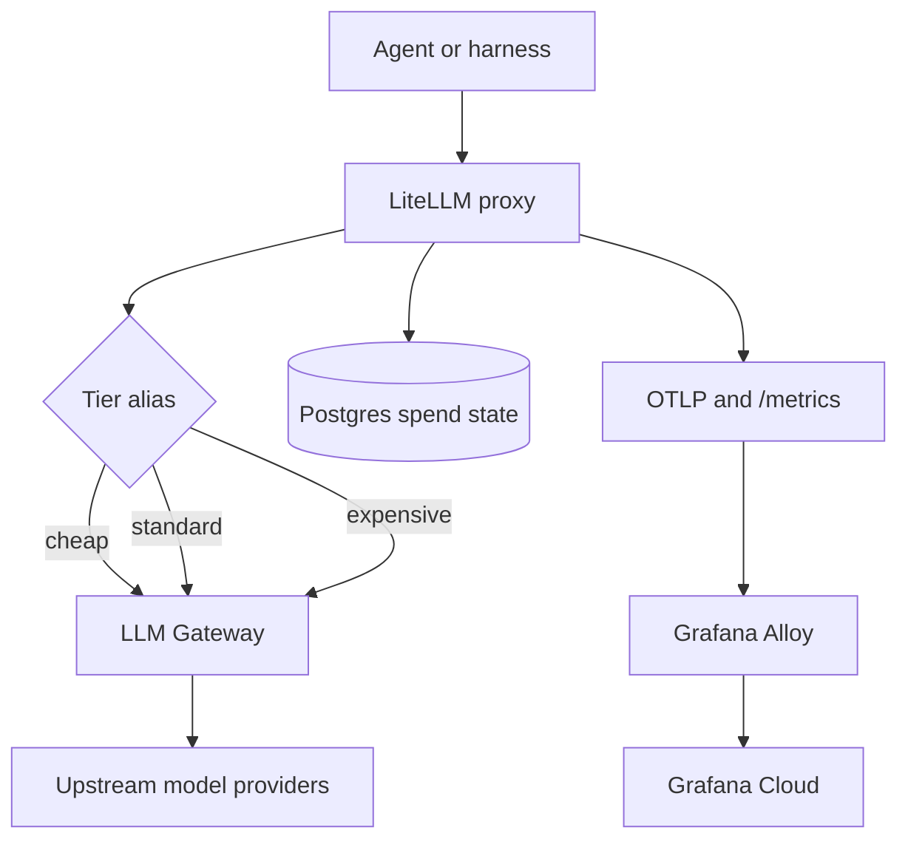
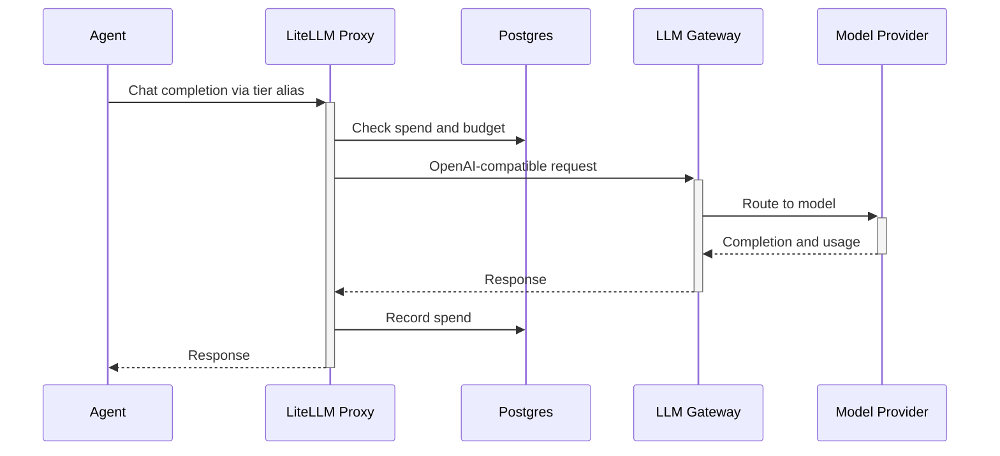
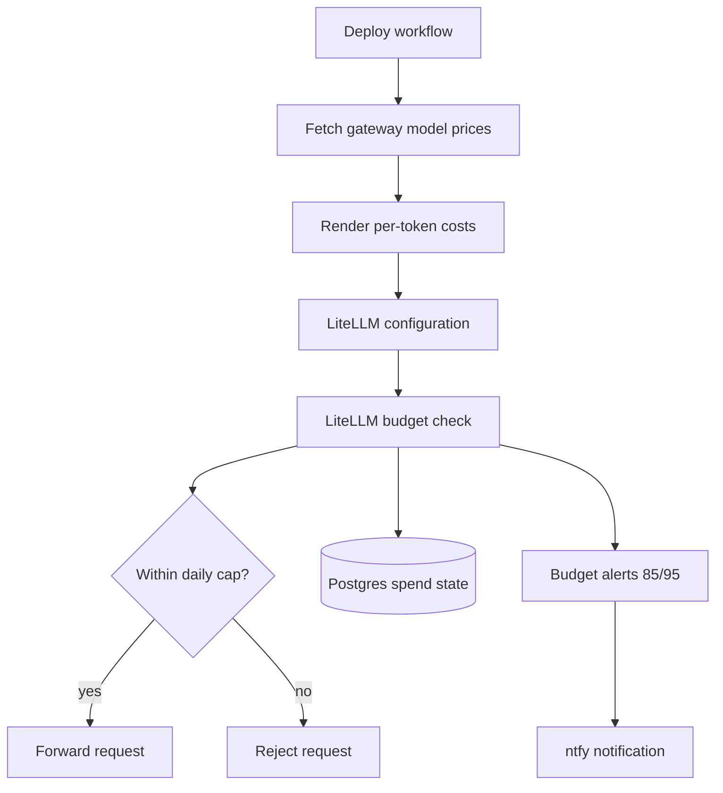
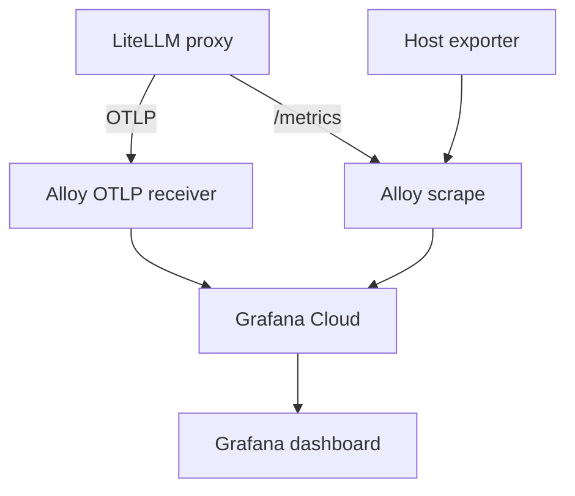

<!-- Generated by DeepWiki-Open d92819a with deepseek-v4.1-flash-1017 on 2026-10-19. Do not edit by hand; regenerate with `just wiki`. -->

[← Wiki index](index.md)

# LLM Gateway and Model Routing

<details>
<summary>Relevant source files</summary>

The following files were used as context for generating this wiki page:

- [gateway/](gateway/)
- [observability/grafana/README.md](observability/grafana/README.md)
- [CONTEXT.md](CONTEXT.md)
</details>

# LLM Gateway and Model Routing

Satat separates model access from model selection. The LLM Gateway provides a single OpenAI-compatible upstream endpoint backed by a DevPass subscription, while a self-hosted LiteLLM proxy provides tiered routing, budget enforcement, and telemetry. Production LLM traffic is expected to pass through LiteLLM rather than calling the gateway directly, with direct gateway calls reserved for validation such as smoke tests. Sources: [docs/adr/0003-llm-gateway-provider.md:1-4](), [docs/adr/0002-litellm-model-routing.md:1-28]()

## Architecture Overview

The routing layer exposes three model aliases — `cheap`, `standard`, and `expensive` — that callers select by tier. Each alias maps to a concrete upstream model ID and forwards requests to `https://api.llmgateway.io/v1` using the DevPass key. LiteLLM stores spend state in Postgres and emits both OTLP and Prometheus telemetry. Grafana Alloy receives OTLP, scrapes LiteLLM’s `/metrics`, and ships data to Grafana Cloud. Sources: [gateway/litellm-config.yaml.tmpl:1-36](), [docs/adr/0002-litellm-model-routing.md:1-28](), [gateway/alloy-config.alloy:1-77]()



Sources: [docs/adr/0003-llm-gateway-provider.md:1-4](), [docs/adr/0002-litellm-model-routing.md:1-28](), [gateway/litellm-config.yaml.tmpl:1-36](), [gateway/alloy-config.alloy:1-77]()

A representative request flow is:



Sources: [docs/adr/0002-litellm-model-routing.md:1-28](), [docs/adr/0003-llm-gateway-provider.md:1-4](), [gateway/litellm-config.yaml.tmpl:1-36]()

## LLM Gateway as Upstream Provider

The LLM Gateway is the upstream model provider. Satat uses it through an existing DevPass subscription instead of integrating directly with individual providers such as OpenAI, Anthropic, or DeepSeek. The gateway provides a single OpenAI-compatible endpoint, unified billing, and access to multiple providers through one API key. Sources: [docs/adr/0003-llm-gateway-provider.md:1-4]()

| Concern | Implementation |
|---|---|
| Upstream endpoint | `https://api.llmgateway.io/v1` |
| Access model | DevPass subscription and gateway API key |
| Protocol | OpenAI-compatible chat completions |
| Main benefits | Single endpoint, unified billing, multiple providers via one key |
| Alternatives considered | Provider-direct API keys; OpenRouter |

Provider-direct API keys can be cheaper per token for some models, but require managing multiple billing relationships and rotating credentials per provider. OpenRouter is a comparable gateway with different pricing and model selection. Sources: [docs/adr/0003-llm-gateway-provider.md:1-4]()

## LiteLLM Router and Tiered Models

LiteLLM is a self-hosted proxy on the VM. It routes all LLM traffic and provides three tiered model profiles that the agent selects by tier, a hard budget cap, and spend tracking. Without LiteLLM, budget enforcement would require manual monitoring. The proxy also avoids changing OpenHands configuration when models are added to or removed from the gateway. Sources: [docs/adr/0002-litellm-model-routing.md:1-28]()

The tier aliases are defined in `gateway/litellm-config.yaml.tmpl`. The concrete model IDs are not hardcoded in the template; they are GitHub variables such as `SATAT_MODEL_CHEAP`, `SATAT_MODEL_STANDARD`, and `SATAT_MODEL_EXPENSIVE`. Per-token cost values are also rendered from variables. Sources: [gateway/litellm-config.yaml.tmpl:1-36](), [docs/adr/0002-litellm-model-routing.md:1-28]()

| Tier alias | Upstream model | Provider | Intended role | Pricing |
|---|---|---|---|---|
| `cheap` | `glm-5.3-flash` | SCX.ai | Critic and story refinement | $0.07/M input, $0.20/M output |
| `standard` | `deepseek-v4.1-flash` | SCX.ai | Main coding agent | $0.15/M input, $0.60/M output |
| `expensive` | `kimi-k2.7-code` | SCX.ai | Reserved future upgrade | $0.76/M input listed in ADR |

Sources: [docs/adr/0016-model-selection.md:1-59](), [docs/adr/0002-litellm-model-routing.md:1-28](), [gateway/litellm-config.yaml.tmpl:1-36]()

The core configuration is:

```yaml
model_list:
  - model_name: cheap
    litellm_params:
      model: openai/${SATAT_MODEL_CHEAP}
      api_base: https://api.llmgateway.io/v1
      api_key: os.environ/LLMGATEWAY_API_KEY
      input_cost_per_token: ${SATAT_MODEL_CHEAP_IN}
      output_cost_per_token: ${SATAT_MODEL_CHEAP_OUT}
  - model_name: standard
    litellm_params:
      model: openai/${SATAT_MODEL_STANDARD}
      api_base: https://api.llmgateway.io/v1
      api_key: os.environ/LLMGATEWAY_API_KEY
      input_cost_per_token: ${SATAT_MODEL_STANDARD_IN}
      output_cost_per_token: ${SATAT_MODEL_STANDARD_OUT}
  - model_name: expensive
    litellm_params:
      model: openai/${SATAT_MODEL_EXPENSIVE}
      api_base: https://api.llmgateway.io/v1
      api_key: os.environ/LLMGATEWAY_API_KEY
      input_cost_per_token: ${SATAT_MODEL_EXPENSIVE_IN}
      output_cost_per_token: ${SATAT_MODEL_EXPENSIVE_OUT}

general_settings:
  master_key: os.environ/LITELLM_MASTER_KEY
  database_url: os.environ/DATABASE_URL
  alerting: ["webhook"]

litellm_settings:
  callbacks: ["otel", "prometheus"]
  max_budget: ${SATAT_DAILY_BUDGET}
  budget_duration: 1d
```

Sources: [gateway/litellm-config.yaml.tmpl:1-36]()

## Model Selection and Privacy Constraints

Satat needs three LLM roles: a main coding agent, a critic reviewer, and a future story-refinement validator. The selected models are open-weight and must match or exceed Anthropic’s privacy guarantees: no training on API data and no prompt logging. Sources: [docs/adr/0016-model-selection.md:1-59]()

The “No AI training” DevPass setting is enabled and rejects requests to providers that train on API data or log prompts. This eliminated DeepSeek direct, Meta Contributor, Alibaba Cloud, and Xiaomi. The selected SCX.ai models are described as privacy-safe with no training, no logging, and 0-day retention; SCX.ai holds SOC 2 Type 1 and ISO 27001 certifications. Sources: [docs/adr/0016-model-selection.md:1-59]()

| Eliminated option | Reason |
|---|---|
| DeepSeek direct | Trains on API data |
| Meta Contributor | Trains on data |
| Alibaba Cloud | Logs prompts |
| Xiaomi | Logs prompts, 30-day retention |

Sources: [docs/adr/0016-model-selection.md:1-59]()

Backup models are defined for cases where the primary Flash models underperform:

| Priority | Model | Provider | When to use | Listed price |
|---|---|---|---|---|
| 1 | `qwen3.8-flash` | NovitaAI | If DeepSeek Flash underperforms | $0.15/M input |
| 2 | `kimi-k2.7-code` | SCX.ai | If both Flash models are insufficient | $0.76/M input |

Sources: [docs/adr/0016-model-selection.md:1-59]()

Rejected alternatives include Claude Sonnet 5.5 and GPT-6.1 Sol because they are not open-weight and are substantially more expensive. Kimi K3 was rejected because its pricing would drain the $58 budget in roughly 20 issues. Muse Spark 1.3 and MiMo V2.6 Flash were rejected due to provider training or prompt-logging behavior. Sources: [docs/adr/0016-model-selection.md:1-59]()

Model IDs and providers are to be confirmed against the live LLM Gateway catalog before production deployment. Sources: [docs/adr/0016-model-selection.md:1-59]()

## Budget Enforcement and Spend Tracking

LiteLLM enforces a single global hard budget cap through `litellm_settings.max_budget`, set from `SATAT_DAILY_BUDGET` and documented as US$10. The budget duration is `1d`, resetting at midnight UTC. This replaced the original US$100/`30d` monthly cap. Sources: [docs/adr/0002-litellm-model-routing.md:1-28](), [gateway/litellm-config.yaml.tmpl:1-36]()

LiteLLM does not expose a global `soft_budget` for the whole proxy; `soft_budget` exists only on keys and teams. The daily budget is therefore a hard cap. Budget alerts fire on the way to the cap via `threshold_crossed` at 85% and 95%, and reach ntfy through the `budget-relay` sidecar. Sources: [docs/adr/0002-litellm-model-routing.md:1-28]()



Sources: [docs/adr/0002-litellm-model-routing.md:1-28](), [gateway/litellm-config.yaml.tmpl:1-36]()

| Setting / behavior | Value | Notes |
|---|---|---|
| `litellm_settings.max_budget` | `${SATAT_DAILY_BUDGET}` | Documented as US$10/day |
| `litellm_settings.budget_duration` | `1d` | Resets at midnight UTC |
| `general_settings.alerting` | `["webhook"]` | Budget events POST to the configured webhook |
| Budget alerts | 85% and 95% `threshold_crossed` | Delivered to ntfy via `budget-relay` |
| Spend storage | Postgres via `DATABASE_URL` | SQLite is not used |
| Cost source | `https://api.llmgateway.io/v1/models` | Nightly refresh renders `input_cost_per_token` and `output_cost_per_token` |

Sources: [docs/adr/0002-litellm-model-routing.md:1-28](), [gateway/litellm-config.yaml.tmpl:1-36]()

Postgres is required because LiteLLM enforces budgets from stored spend and fails open without a database. Per-token costs are fetched rather than hardcoded because LiteLLM prices unknown model IDs at $0, which would leave the cap unenforced. The deploy workflow pulls prompt and completion pricing for each configured model from the gateway’s `/v1/models` endpoint and renders those values into the LiteLLM configuration. A nightly cron re-runs the same workflow so prices stay current. Sources: [docs/adr/0002-litellm-model-routing.md:1-28]()

## Observability and Dashboards

LiteLLM is configured with `callbacks: ["otel", "prometheus"]`. The `otel` callback sends OTLP traces and GenAI metrics to Alloy, while `prometheus` exposes metrics on `/metrics` for Alloy to scrape. Sources: [gateway/litellm-config.yaml.tmpl:1-36](), [gateway/alloy-config.alloy:1-77]()



Sources: [gateway/litellm-config.yaml.tmpl:1-36](), [gateway/alloy-config.alloy:1-77](), [observability/grafana/README.md:1-49]()

Alloy receives OTLP over gRPC on `0.0.0.0:4317` and HTTP on `0.0.0.0:4318`, batches telemetry, and exports it to Grafana Cloud. It also runs `prometheus.exporter.unix` for host CPU, memory, and disk metrics, scrapes LiteLLM at `litellm:4000` using `LITELLM_MASTER_KEY` as the bearer token, and remote-writes to Grafana Cloud. Sources: [gateway/alloy-config.alloy:1-77]()

The `satat-overview` dashboard is tracked as JSON and imported manually into Grafana Cloud using the `grafanacloud-prom` datasource. There is no provisioning pipeline yet. The dashboard `uid` is `satat-overview`, so re-importing the same file updates the existing dashboard rather than creating a duplicate. Sources: [observability/grafana/README.md:1-49]()

| Dashboard section | Panels | Metrics |
|---|---|---|
| At a glance | Spend, requests, tokens, error rate, VM CPU, VM memory | `litellm_spend_metric`, `litellm_proxy_total_requests_metric`, `litellm_total_tokens_metric`, `node_*` |
| Spend | Spend rate by model ($/hour), top models by spend | `litellm_spend_metric` |
| Models & activity | Requests by model, p95 latency by model group, tokens by model, failures by model | `litellm_proxy_total_requests_metric`, `litellm_request_total_latency_metric_bucket`, `litellm_total_tokens_metric`, `litellm_proxy_failed_requests_metric` |
| Host (VM) | CPU %, memory %, disk-used % per mount | `node_cpu_seconds_total`, `node_memory_*`, node disk metrics |

Sources: [observability/grafana/satat-overview.json:30-57](), [observability/grafana/satat-overview.json:67-92](), [observability/grafana/satat-overview.json:85-107](), [observability/grafana/satat-overview.json:101-125](), [observability/grafana/satat-overview.json:120-144](), [observability/grafana/README.md:1-49]()

Issue/PR-level attribution is not available yet. The activity panels reflect LLM traffic. T8 is expected to tag requests with issue metadata via LiteLLM `custom_prometheus_metadata_labels`, after which a “current issues” panel can be added. Sources: [observability/grafana/README.md:1-49]()

## Client and Harness Integration

| Consumer | Endpoint / configuration | Notes |
|---|---|---|
| Agent Server / Agent Canvas | `http://litellm:4000`; standard-tier `deepseek-v4.1-flash` | Model and sandbox are Agent Server settings, not in this repo or `automation.yaml` |
| DeepWiki generator | `default_provider: litellm`; `LiteLLMClient`; default model `deepseek-v4.1-flash` | Supports custom model; model-specific temperatures are configured |
| Smoke test | `scripts/llm-smoke.sh` | Directly tests the DevPass LLM Gateway before a longer job spends money |
| OpenHands | LiteLLM proxy | Proxy avoids changing OpenHands configuration when gateway models change |

Sources: [docs/adr/0020-automation-definition-auth-trigger.md:71-98](), [scripts/deepwiki/config/generator.json:1-23](), [scripts/llm-smoke.sh:1-53](), [docs/adr/0002-litellm-model-routing.md:1-28]()

The DeepWiki generator configuration selects LiteLLM as the default provider and uses `LiteLLMClient`. It defines `deepseek-v4.1-flash` as the default model with `temperature: 0.7` and `top_p: 0.8`, and also lists `gemini-3.8-flash` and `claude-opus-5-5` with `temperature: 1.0`. Sources: [scripts/deepwiki/config/generator.json:1-23]()

The smoke-test script validates the DevPass LLM Gateway directly. It requires `DEVPASS_TOKEN`, defaults `LLM_GATEWAY_BASE_URL` to `https://api.llmgateway.io` without `/v1`, and appends `/v1` internally. The chat model defaults to `$WIKI_MODEL` and then `deepseek-v4.1-flash`. It sends a `/chat/completions` request with `max_tokens: 2000` and a simple prompt, then optionally checks `/embeddings`. Embeddings can target another OpenAI-compatible endpoint because DevPass blocks them. Sources: [scripts/llm-smoke.sh:1-53]()

## Credentials and Key Management

| Credential / variable | Used by | Purpose |
|---|---|---|
| `LLMGATEWAY_API_KEY` | LiteLLM model configuration | Authenticates to the LLM Gateway |
| `LITELLM_MASTER_KEY` | LiteLLM `master_key`; Alloy scrape bearer | Root LiteLLM secret and metrics authentication |
| `DATABASE_URL` | LiteLLM `database_url` | Postgres connection for spend and budget state |
| `DEVPASS_TOKEN` | `scripts/llm-smoke.sh` | Direct smoke-test access to the gateway |
| `EMBED_API_KEY` | `scripts/llm-smoke.sh` | Optional key for the embeddings endpoint |

Sources: [gateway/litellm-config.yaml.tmpl:1-36](), [gateway/alloy-config.alloy:1-77](), [scripts/llm-smoke.sh:1-53]()

The secrets research notes identify LiteLLM virtual keys as a supported credential mechanism: they can be minted with `POST /key/generate` using the master key, with controls such as `duration`, `models`, `max_budget`, `budget_duration`, `rpm`/`tpm`, per-model budgets, and `team_id`. The master key is a root secret. These notes also describe JWT-to-key mapping as an alternative to presenting a raw key. Sources: [docs/research/v2/notes/secrets-taxonomy.md:47-52](), [docs/research/v2/notes/secrets-taxonomy.md:83-91]()

## Operational Notes and Failure Modes

| Failure mode / operational concern | Impact | Mitigation / note |
|---|---|---|
| Postgres unavailable | LiteLLM fails open and budgets are not enforced | Postgres is required; SQLite is not used |
| Unknown model ID priced at $0 | Budget cap would not be enforced | Deploy workflow fetches pricing from `/v1/models` and nightly cron refreshes it |
| No global soft budget | Only a hard cap is available | Budget alerts fire at 85% and 95% via ntfy |
| LiteLLM admin UI not exposed | No `/ui` access yet | Serving it behind oauth2-proxy is an open decision |
| Dashboard import is manual | No provisioning pipeline | Import `satat-overview.json` into Grafana Cloud manually |
| Issue/PR attribution missing | Activity panels show LLM traffic only | T8 adds `custom_prometheus_metadata_labels` |
| Smoke test bypasses LiteLLM | Does not exercise routing or budget enforcement | Use it to validate token, base URL, and model reachability before spending |

Sources: [docs/adr/0002-litellm-model-routing.md:1-28](), [observability/grafana/README.md:1-49](), [scripts/llm-smoke.sh:1-53]()

## Summary

Satat’s LLM path is layered: the LLM Gateway provides a single OpenAI-compatible upstream with unified billing, while LiteLLM provides tiered aliases, hard budget enforcement, spend tracking, and telemetry. Model selection is constrained by privacy requirements, with SCX.ai-hosted open-weight models serving the main agent, critic, and story-refinement roles. Grafana Alloy and the `satat-overview` dashboard expose operational and cost visibility from LiteLLM and host metrics. Sources: [docs/adr/0003-llm-gateway-provider.md:1-4](), [docs/adr/0002-litellm-model-routing.md:1-28](), [docs/adr/0016-model-selection.md:1-59](), [gateway/alloy-config.alloy:1-77](), [observability/grafana/README.md:1-49]()

## Related pages

- [System Architecture Overview](page-4.md)
- [Issue-to-PR Automation Pipeline](page-7.md)
- [Observability and Cost Tracking](page-11.md)
